# Threadia

Threadia는 Jira, Slack, Confluence처럼 분리된 협업 도구의 흐름을 하나의 프로젝트 협업 서비스로 통합하는 것을 목표로 하는 팀 프로젝트입니다.

이슈, 채팅, 쓰레드, 문서, 그래프, 알림을 연결해서 업무 맥락이 흩어지지 않게 하는 것이 핵심 콘셉트입니다.

> **Thread**(모든 논의가 쓰레드 하나로 남는 구조) + **idea**(채팅에서 나온 생각이 이슈·문서로 이어지는 흐름) + **area**(프로젝트·채팅·문서가 분산되지 않는 통합 협업 공간)를 합친 이름입니다.

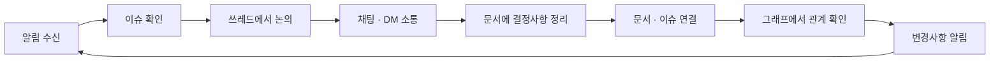

---

## 실제 실행 화면

로컬 프론트엔드·백엔드와 임시 MySQL을 연결해 캡처했습니다. 화면의 계정·프로젝트·공고는 포트폴리오 시연을 위한 합성 데이터입니다.

### 칸반 보드

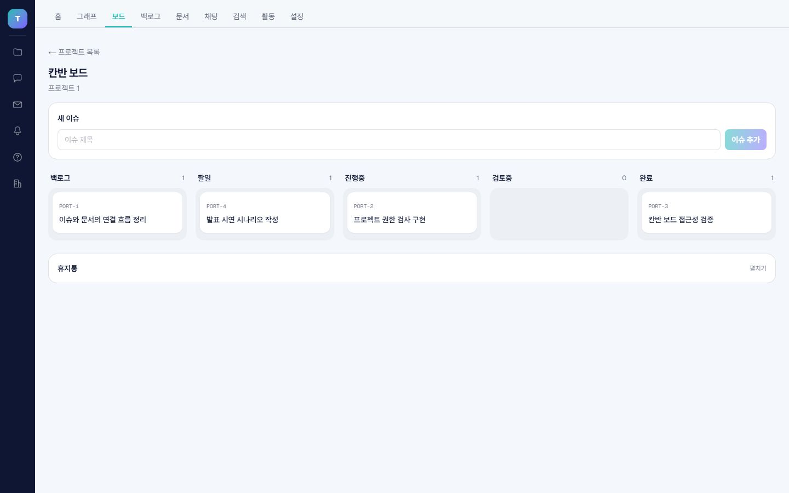

이슈 상태별 작업 흐름

### 문서 작성·미리보기

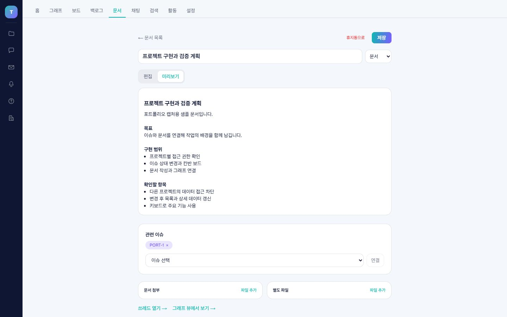

문서 작성과 관련 이슈 연결

### 문서·이슈 그래프

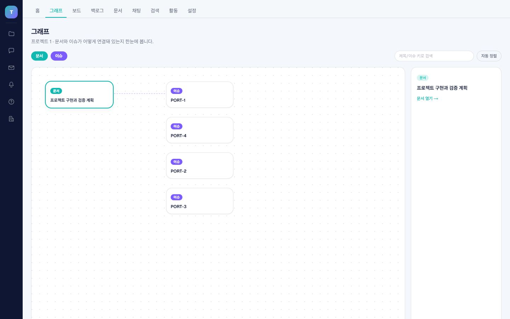

문서와 이슈 관계 확인

## 팀 구성

| 구성원 | 역할 | 담당 업무 |
|---|---|---|
| 황스일 | 팀장 | 팀 운영 총괄, WBS/일정 관리, 플랫폼 관리자(감사 로그, 회사 생명주기) 백엔드 |
| 정철진 | 부팀장 / Frontend lead | 프로젝트·문서·그래프 화면, 프론트엔드 아키텍처 |
| 김민경 | 팀원 | 이메일 Auth API 구현, 회사/부서 Backend API, 이슈·칸반 최소 API 구현 |
| 김민정 | 팀원 | DB schema 설계, Auth API 구현 지원, API 문서화, 검증 evidence 정리, Sprint QA/CI 총괄 |
| 김태준 | 팀원 | 프로젝트 백엔드(생성/조회/수정/archive), 인증 Entity 구현, API 문서화 |
| 여도현 | 팀원 | 인증 API(OAuth/JWT) 구현, 기술 검토, 회사/RBAC 리뷰 |

---

## 핵심 기능

| 영역 | 기능 |
|---|---|
| 인증 | OAuth 소셜 로그인, 이메일 회원가입/로그인 |
| 회사·조직 | 회사 관리, 부서, 구성원, RBAC |
| 프로젝트 | 생성/조회/수정/보관, 멤버 관리 |
| 이슈·칸반 | 이슈 목록/생성, 5컬럼 칸반, 스프린트/백로그 |
| 문서 | 문서 작성·편집, 문서·이슈 그래프 연결 |
| 메시지 | 프로젝트 채팅(쓰레드 연동), 1:1 DM |
| 검색 | 프로젝트/이슈 통합 검색 |
| 알림 | 실시간 알림, 안읽음 카운트 |
| 플랫폼 관리자 | 회사·관리자 생명주기, 감사 로그, 시스템 설정, 고객센터 |

---

## 트러블슈팅 하이라이트

### Frontend

**"같은 버그가 4번 재발했다" — DM 화면 동시성 버그를 라이브러리 교체로 근절**

<details>
<summary>📖 <strong>▶ 펼쳐서 보기 — 리뷰 5라운드 타임라인 · Before/After 다이어그램 · 정량 지표</strong></summary>

1:1 DM 화면(WBS 4.7.3.2, REST 폴링 기반) 코드 리뷰 5라운드 동안 "배지가 안 바뀐다", "새 대화가 옛 대화로 덮인다", "읽음 처리가 되돌아간다"처럼 겉보기엔 서로 다른 버그가 계속 재발했습니다. 원인은 하나였습니다 — 컴포넌트마다 "이 비동기 응답이 지금도 유효한가?"를 손으로 판정하는 ref를 각자 새로 발명하고 있었던 것입니다(`sequenceRef`, `readGenerationsRef` 등 한 화면에만 7개).

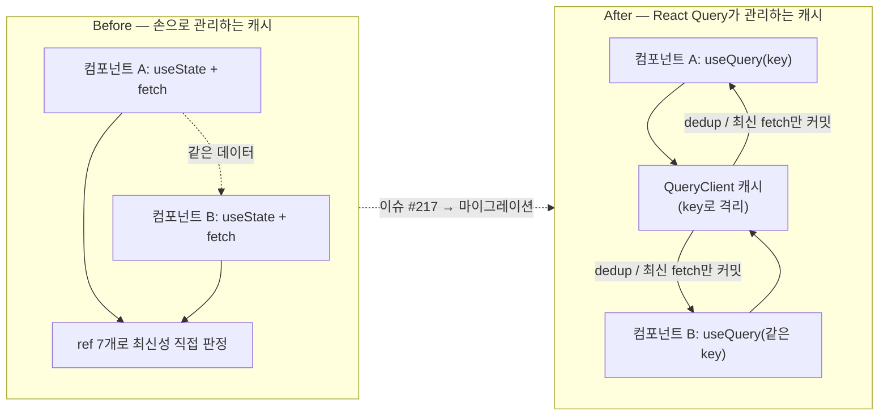

TanStack Query를 도입해 손으로 짠 방어 코드를 걷어내고 캐시 최신성 판정 자체를 라이브러리에 위임했습니다. 다만 라이브러리가 mutation/cache lifecycle은 관리해도 `router.push()` 같은 side effect는 자동으로 취소해주지 않는다는 것도 함께 드러나, 그 경계에 남은 gap(로그아웃 시 캐시 미분리, 언마운트 후 남은 라우팅)은 별도로 막았습니다. 이 원리를 검색·활동 피드 화면에도 감사해서 같은 방식으로 정리했습니다.

| 지표 | Before → After |
|---|---|
| 손으로 짠 방어 코드(DM+검색+활동 피드) | 9개 → 0개 |
| 코드 리뷰 라운드(승인까지) | 6회 |
| DM 회귀 테스트 | 0개 → 12개 |
| 적용 범위 | DM 1개 화면 → DM·검색·활동 피드 3개 화면 |

과정 전체는 [dm-react-query-마이그레이션-트러블슈팅.md](docs/08-members/member-정철진/기술-연구/dm-react-query-마이그레이션-트러블슈팅.md)에 리뷰 라운드별 타임라인, 시퀀스 다이어그램과 함께 정리해뒀습니다.

</details>

**AI는 3D 좌표와 방향 감각이 약하다 — 월드 좌표 실측 + 임시 방향지시물로 해결**

<details>
<summary>📖 <strong>▶ 펼쳐서 보기 — 방향 마커 다이어그램 · 실측 원칙 · 관련 코드</strong></summary>

3D 허브(S03 메인 허브) 작업 초반에는 문제가 없었지만, 책상·의자 같은 가구를 세부적으로 배치하면서부터 AI에게 3차원 좌표(x, y, z)와 방향(동서남북)을 그대로 맡기면 자꾸 어긋났습니다. 텍스트 기반으로 좌표를 계산해 배치를 지시하다 보니, 실제 씬에서는 물체가 반대 방향을 보거나 의도한 자리에서 벗어나는 일이 반복됐습니다.

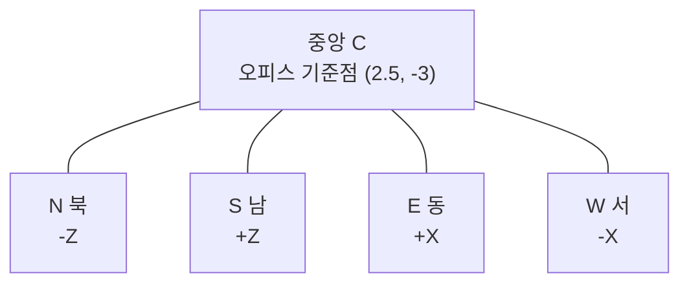

"손 계산 대신 항상 실측"으로 원칙을 바꿔서 해결했습니다.

1. 씬 중앙을 기준으로 동서남북에 색이 다른 기둥과 좌표 라벨을 세우는 `DebugDirections` 컴포넌트를 임시로 만들어, 방향과 좌표를 눈으로 직접 확인할 수 있게 했습니다.
2. 이후 가구 배치는 계산값을 그대로 믿지 않고, `getWorldPosition()`으로 실제 렌더링된 월드 좌표를 읽어와 확정하는 방식으로 바꿨습니다(예: 책상 8석 좌표를 전부 이 방식으로 재확정).

이 원칙은 이후 프로젝트의 3D 작업 컨벤션으로 굳어져, 지금도 씬에 새로 뭔가를 배치할 때는 `SHOW_DEBUG_DIRECTIONS` 플래그로 방향지시물을 잠깐 켜서 기준으로 삼습니다(`frontend/components/hub/DebugDirections.tsx`). 회전이 섞인 배치에서 위치가 어긋나거나 모델 pivot이 반대라 벽을 뚫었던 구체적인 사고 사례는 [3d-배치-ai-공간지각-한계-실측-트러블슈팅.md](docs/08-members/member-정철진/기술-연구/3d-배치-ai-공간지각-한계-실측-트러블슈팅.md)에 정리해뒀습니다.

</details>

그 밖에도 아래 버그를 직접 찾아 고쳤습니다.

- **그래프 화면 노드 겹침**: 문서 카드가 6개를 넘어 두 번째 서브열이 생기면, 이슈 열의 시작 x좌표가 고정값이라 그 서브열과 겹쳐 보이는 버그가 있었습니다. 이슈 열 시작 위치를 "문서 열이 실제로 차지하는 폭 + 여백" 기준으로 다시 계산하도록 고치고, 회귀 테스트를 추가했습니다.
- **로그인 실패가 세션 만료로 오분류되는 문제**: axios 인터셉터가 모든 401을 "세션 만료"로 보고 refresh 실패 시 무조건 `/login`으로 리다이렉트해서, 로그인 자격증명 오류 같은 화면 자체의 인라인 오류 메시지가 사용자에게 보일 새도 없이 덮여버렸습니다. "401이 곧 비즈니스 로직 실패"인 endpoint를 인터셉터 예외 목록으로 분리해 해결했습니다.

### Backend

**"404와 403의 순서가 도메인마다 달랐다" — 존재 확인·권한 확인 순서를 공통 규칙으로 통일**

<details>
<summary>📖 <strong>▶ 펼쳐서 보기 — 인증·존재·권한 검증 순서 · 도메인 공통화 · 회귀 기준</strong></summary>

Company, Department, Project, CompanyMember처럼 비슷한 API라도 리소스 존재 확인과 권한 확인 순서가 제각각이면, 같은 실패 조건이 endpoint마다 404 또는 403으로 다르게 나타납니다. 호출자는 예외 처리를 예측할 수 없고, 구현자는 새 도메인을 추가할 때마다 같은 순서 버그를 다시 만들기 쉬운 상태였습니다.

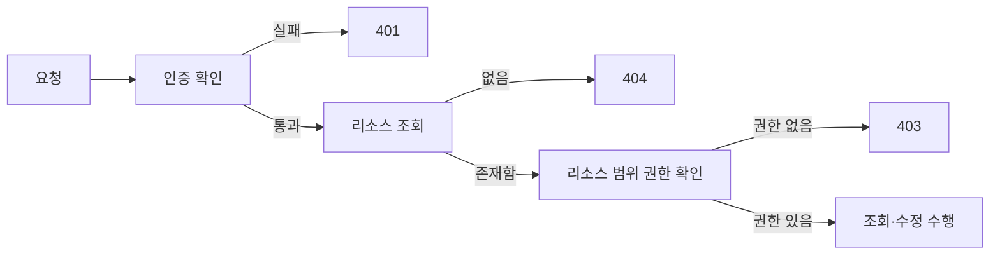

인증된 사용자인지 먼저 확인한 뒤, 요청 리소스를 조회하고, 마지막으로 해당 리소스 범위의 접근 권한을 검사하는 순서로 통일했습니다. Company·Department·Project 서비스의 조회·수정 경로를 같은 기준으로 맞추고, 존재하지 않는 리소스와 권한 없는 리소스의 응답 계약을 회귀 테스트로 고정했습니다.

이후에는 신규 endpoint를 추가할 때도 `인증 → 존재 확인 → 권한 확인`을 셀프 리뷰 체크리스트로 사용합니다. 순서 자체를 공통 규칙으로 만든 덕분에, 한 도메인에서 고친 검증 정책이 다른 도메인에서 다시 흔들리는 반복을 줄였습니다.

</details>

**"다른 프로젝트의 대상도 쓰레드가 될 수 있었다" — 요청 프로젝트와 대상의 실제 소속을 교차 검증**

<details>
<summary>📖 <strong>▶ 펼쳐서 보기 — Issue·Document·Message 소속 검증 · cross-project 차단 · 접근 경계</strong></summary>

쓰레드는 Issue, Document, Message를 대상으로 만들거나 조회합니다. 대상 ID만 검증하고 그 대상이 요청한 프로젝트에 실제로 속하는지 확인하지 않으면, 프로젝트 경계를 넘는 링크가 만들어져 다른 프로젝트의 문서·이슈·메시지 맥락이 노출될 수 있습니다.

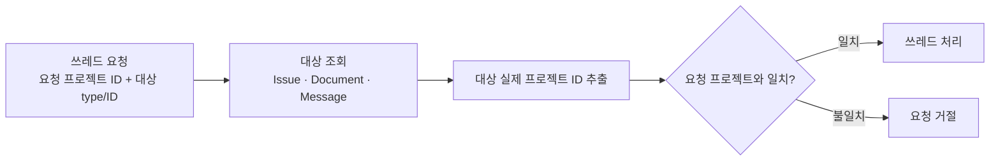

`ThreadService`에서 대상 타입별로 실제 프로젝트 ID를 조회하고, 요청 프로젝트 ID와 다르면 쓰레드 요청을 즉시 거절하도록 `validateTargetProject()`를 추가했습니다. 기존 쓰레드를 조회·수정·댓글 작성할 때도 쓰레드가 속한 프로젝트에 대한 접근 권한을 확인합니다.

이제 대상 존재 여부만이 아니라 대상의 프로젝트 소속까지 검증합니다. cross-project mismatch를 다루는 테스트를 추가해 Issue·Document·Message 어느 경로에서도 같은 경계 검사가 빠지지 않도록 했습니다.

</details>

**"404와 409가 가입 여부를 알려줬다" — 초대 후보 조회의 user enumeration을 제거**

<details>
<summary>📖 <strong>▶ 펼쳐서 보기 — 회사 경계 안 email 조회 · 오류 응답 통일 · 초대 권한 최소화</strong></summary>

프로젝트 초대 후보를 이메일로 찾을 때 전역 사용자 조회를 먼저 수행하면, 미가입 이메일과 다른 회사에 가입한 이메일이 서로 다른 오류로 응답할 수 있습니다. `PROJECT_ADMIN`이 임의의 이메일을 반복 입력하는 것만으로 서비스 가입 여부를 추측할 수 있는 user enumeration 취약점입니다.

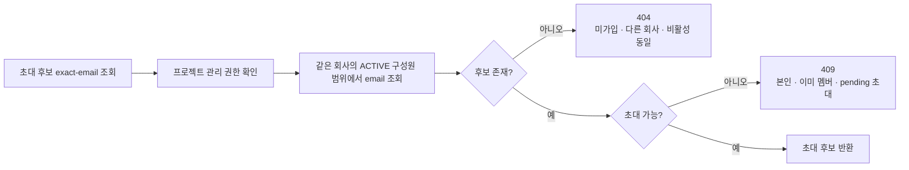

초대 후보 조회는 프로젝트 관리 권한을 먼저 확인한 뒤, 해당 프로젝트 회사의 ACTIVE 구성원 범위 안에서만 이메일을 찾도록 바꿨습니다. 미가입, 다른 회사 소속, 비활성 사용자는 모두 같은 404로 처리해 회사 경계 밖의 존재 여부를 노출하지 않습니다.

전역 이메일 조회가 필요한 경우는 COMPANY_ADMIN 전용 endpoint로 분리하고, 초대 화면의 exact-email 조회는 읽기 전용으로 유지했습니다. 오류 코드뿐 아니라 조회 범위 자체를 좁혀서 권한 모델과 데이터 노출 범위를 일치시켰습니다.

</details>

---

## 품질 관리

- **5단계 검증 체계**: Test · Build · API · DB · 화면 영역별 확인 기준을 문서화했습니다.
- **구현자 자체검증 + QA 교차검증**: 구현 담당자가 `./gradlew test` + curl로 1차 확인하고, QA 담당이 Apidog collection으로 43개 케이스를 교차 검증합니다.
- **"증거 없으면 미완료" 원칙**: 정상 케이스만 확인하거나 증빙 없는 작업은 완료로 인정하지 않습니다.
- **실제 커버리지**: 134개 테스트 · 20개 도메인 · PR마다 CI가 실 MySQL에 연결해 자동 검증합니다.

---

## 기술 스택

| 영역 | 구성 |
|---|---|
| Backend | Java 17, Spring Boot 3.5, Spring Data JPA, Spring Security(JWT + OAuth2), MySQL 8.4 |
| Frontend | Next.js 16(App Router), React 19, TypeScript, TanStack Query, Tailwind CSS 4, React Three Fiber(3D 허브) |
| 파일 저장 | AWS S3 호환 스토리지(로컬 개발은 MinIO) |
| 테스트 | JUnit 5 + Testcontainers(Backend), Playwright(Frontend smoke test) |
| 인프라 | AWS(EC2, RDS, S3, ECR, SSM 배포), Docker Compose(로컬 개발) |

---

## 아키텍처

<details>
<summary>🏗️ <strong>▶ 펼쳐서 보기 — 런타임 구성 · 배포 파이프라인 다이어그램</strong></summary>

### 런타임 구성

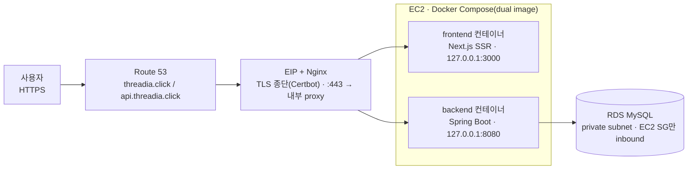

프론트엔드와 백엔드를 같은 EC2 위에서 서로 다른 ECR 이미지로 독립 실행하고, Docker Compose는 public port를 열지 않고 Nginx만 외부에 노출합니다.

### 배포 파이프라인

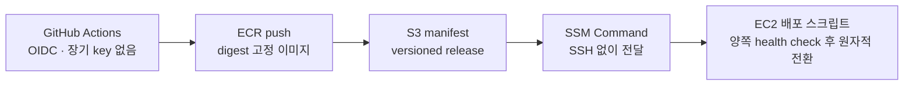

health check가 실패하면 기존 버전을 그대로 유지합니다(rollback 안전). secret은 저장소에 두지 않고 root-only runtime env로만 주입합니다.

</details>

---

## 핵심 도메인 모델

회사(workspace) 아래 프로젝트가 있고, 프로젝트 아래에서 이슈·문서·채팅·쓰레드가 서로 연결되는 구조입니다. 전체 ERD는 [docs/03-design/ERD.md](docs/03-design/ERD.md)에서 확인할 수 있습니다.

<details>
<summary>🗂️ <strong>▶ 펼쳐서 보기 — 협업 도메인 · 운영·관리자 도메인 ERD</strong></summary>

### 협업 도메인

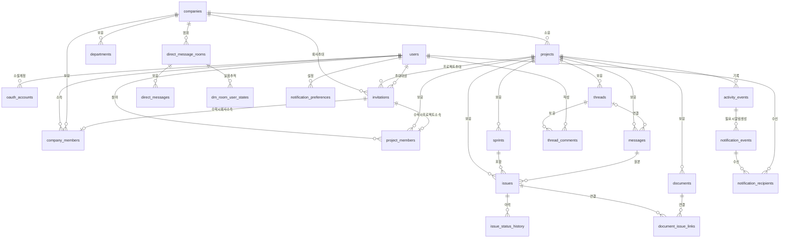

### 운영·관리자 도메인

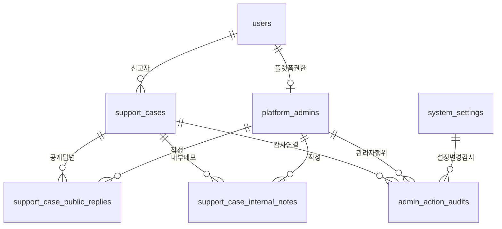

</details>

---

## 문서

기능/화면/API/DB 설계의 canonical 기준 문서는 [docs/02-requirements/요구사항-정의서.md](docs/02-requirements/요구사항-정의서.md)에서 각 영역별 문서로 안내합니다.

| 구분 | 기준 문서 |
|---|---|
| 기능 요구사항 | `docs/02-requirements/기능-분해표.md` |
| 화면 기준 | `docs/03-design/화면정의서.md` |
| API 기준 | `docs/04-api/API-명세서.md` |
| DB 기준 | `docs/03-design/ERD.md`, `db/schema.sql` |
| Architecture | `docs/05-architecture/` |

전체 문서는 [docs/](docs/) 아래에 있으며, 작성 규칙은 [docs/00-project/문서-작성-규칙.md](docs/00-project/문서-작성-규칙.md)를 따릅니다. 폴더별 용도는 [docs/README.md](docs/README.md)에 정리되어 있습니다.

---

## 기여 규칙

Git, commit message, PR 기준은 [CONTRIBUTING.md](CONTRIBUTING.md)를 따릅니다. 코드/문서/Git 작업 전 공통 작업 규칙은 [AGENTS.md](AGENTS.md)(또는 Claude Code 사용자는 [CLAUDE.md](CLAUDE.md))를 참고해 주세요.

---

## 프로젝트 구조

```text
Threadia/
├── backend/     Spring Boot API 서버
├── frontend/    Next.js 프론트엔드
├── docs/        기획/설계/API/아키텍처/회의록 등 전체 문서
├── docs-site/   docs/ 렌더링·검색용 사이트
├── db/          DB 스키마(schema.sql)
├── infra/       인프라 구성
├── scripts/     배포·운영 스크립트
└── compose.*.yml  로컬/배포용 Docker Compose 정의
```

---

## 로컬 개발 환경 실행

### 1. 환경 변수

```bash
cp .env.example .env
```

`.env`의 `REPLACE_ME_*` 값을 로컬 값으로 채워주세요. `SPRING_PROFILES_ACTIVE=local`은 로컬 개발에서 `S3StorageConfig`의 production 검증만 우회하는 선택 키입니다.

### 2. 로컬 인프라(MySQL, MinIO) 기동

```bash
docker compose -f compose.mysql.yml -f compose.minio.yml up -d
```

### 3. Backend 실행

```bash
cd backend
./gradlew bootRun
```

### 4. Frontend 실행

```bash
cd frontend
npm install
npm run dev
```

프론트엔드는 기본적으로 `http://localhost:3000`, 백엔드 API는 `http://localhost:8080`에서 실행됩니다.

---

## 테스트

### Backend

```bash
cd backend
./gradlew test
```

### Frontend

```bash
cd frontend
npx tsc --noEmit
npm run lint

npm run test:smoke
```
