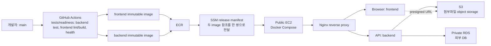

> **작성자**: Threadia 팀
> **작성일**: 2026-07-22
> **최종 수정**: 2026-07-22
> **버전**: v1.0
> **상태**: 검토 중
> **태그**: github-actions, ci, cd, aws, ec2, ecr, ssm, rds, s3, docker-compose

# GitHub Actions, EC2, S3, RDS CI/CD 참고자료

**용어 요약**: CI는 코드 통합 뒤 test와 build로 품질을 확인하는 Continuous Integration이다. CD는 검증된 결과물을 배포하는 Continuous Delivery 또는 Continuous Deployment다. GitHub Actions는 이 과정을 자동 실행하는 GitHub 도구다. ECR은 Docker image registry이며, immutable digest는 image 내용에 고정된 식별자다. SSM은 EC2에 승인된 명령을 전달하는 AWS Systems Manager다. EC2는 AWS virtual server이고, Docker Compose는 여러 container를 함께 실행하는 도구다. RDS는 관리형 관계형 DB다. S3 presigned URL은 제한된 시간과 권한으로 S3 object에 접근하게 하는 임시 URL이다. Nginx reverse proxy는 외부 요청을 내부 service로 전달한다. rollback은 문제 발생 시 이전 정상 release로 되돌리는 절차다.

## 1. 발표용 한 줄 요약

`main`의 코드를 GitHub Actions가 검사하고, 통과한 frontend와 backend를 각각 변경 불가능한 Docker image로 ECR에 저장한 뒤, SSM을 통해 public EC2의 Docker Compose를 같은 release 쌍으로 교체한다. 사용자는 Nginx reverse proxy를 거쳐 frontend와 API를 사용하며, 데이터는 private RDS에, 첨부파일은 S3에 분리해 둔다.

## 2. 현재 발표 아키텍처

* EC2는 Docker Compose로 frontend와 backend를 분리 실행한다. Docker Compose는 여러 container를 함께 정의하고 실행하는 도구다.
* Nginx reverse proxy는 사용자의 HTTPS 요청을 받아 내부 frontend 또는 backend로 전달하는 앞단 웹 서버다. container port는 인터넷에 직접 공개하지 않는다.
* RDS는 application과 분리된 private 외부 DB다. Docker Compose 안에 DB를 새로 띄우지 않는다.
* S3는 첨부파일 같은 object를 저장하는 object storage다. application DB에는 첨부파일 자체가 아니라 필요한 metadata를 관리한다.

## 3. 발표 release 흐름

1. 개발자가 `main` 기준으로 release workflow를 시작한다. GitHub Actions는 GitHub 안에서 test, build, 배포 절차를 자동 실행하는 CI/CD 도구다.
2. **CI**는 Continuous Integration의 약자로, 코드 변경을 합친 뒤 test와 build로 문제를 먼저 찾는 과정이다. 이 흐름에서는 backend test와 frontend lint, SSR build가 통과해야 다음 단계로 간다.
3. frontend와 backend를 각각 Docker image로 build한다. image는 실행에 필요한 application과 환경을 묶은 package다.
4. 두 image를 **ECR**에 저장한다. ECR은 Docker image를 보관하는 AWS registry다. 각 image는 tag 대신 immutable digest로 식별한다. immutable digest는 image 내용에서 계산된 고정 식별자이므로, 같은 참조가 다른 image를 가리키지 않는다.
5. **SSM**은 AWS Systems Manager의 약자로, EC2에 직접 SSH 접속하지 않고 승인된 명령을 전달하는 서비스다. release manifest는 같은 release에 속한 frontend와 backend의 immutable image 참조를 묶어 EC2에 전달하는 정보다.
6. **CD**는 Continuous Delivery 또는 Continuous Deployment의 약자다. 여기서는 검증된 image 쌍을 EC2의 Docker Compose에 반영하는 배포 단계다. EC2는 AWS에서 실행하는 virtual server다.
7. EC2는 frontend와 backend가 모두 health check를 통과한 뒤에만 새 release 쌍을 active state로 바꾼다. Nginx가 browser 요청을 각 service로 전달한다.

> **현재 workflow와 설계 문서의 구분**
> 현재 workflow는 SSM command에 frontend와 backend image 참조를 직접 전달한다. 별도 설계 문서에는 versioned S3 object의 release manifest를 고정 SSM document가 읽는 계약도 정의돼 있다. 발표에서는 두 방식을 하나의 실제 흐름처럼 섞지 말고, 현재 public dual-image release는 frontend와 backend의 immutable image 쌍을 SSM으로 전달해 Compose에 반영한다고 설명한다.

## 4. RDS와 S3의 역할

### RDS

RDS는 관계형 DB를 관리형 서비스로 제공한다. backend는 private RDS에 연결하며, DB migration은 image release 흐름에 포함하지 않는다. 즉, application 배포와 DB 구조 변경은 같은 작업으로 설명하지 않는다.

### S3와 presigned URL

S3 presigned URL은 backend가 짧은 유효 기간과 권한을 넣어 발급하는 임시 URL이다. browser는 이 URL로 S3에 첨부파일을 올리거나 내려받을 수 있다. 파일 전송은 browser와 S3 사이에서 일어나고, backend는 권한 확인과 URL 발급을 담당한다. S3 bucket은 private이며, artifact를 보관하는 release storage와 첨부파일 storage는 분리한다.

## 5. 안전장치와 rollback

rollback은 새 release에 문제가 있을 때 이전 정상 release로 되돌리는 절차다. 이 아키텍처의 rollback 단위는 frontend 하나 또는 backend 하나가 아니라 **frontend와 backend의 이전 image 쌍**이다.

새 candidate의 두 service가 모두 정상이어야 current release가 바뀐다. 어느 한쪽 health check라도 실패하면 이전 frontend와 backend 쌍을 함께 다시 실행하고 health check한다. 따라서 browser와 API가 서로 다른 release 조합으로 남는 위험을 줄인다.

## 6. 현재 검증 상태

2026-07-22 public dual-image in-place presentation release의 release evidence는 통과했다. frontend와 backend health, public root의 login 이동, login 응답, API health가 확인됐다.

다만 test credential이 없어 authenticated upload/presign smoke를 수행하지 못했다. 따라서 첨부파일 upload와 presigned URL 전송은 아직 검증 완료라고 말할 수 없고, attachment transfer smoke gate는 열려 있다. release가 전체 attachment rollout까지 완료됐다고 설명해서는 안 된다.

## 7. 발표에서 이렇게 설명한다

* "`main`의 변경은 GitHub Actions가 test와 build로 먼저 확인한다."
* "통과한 frontend와 backend는 각각 immutable image가 되어 ECR에 저장된다."
* "SSM이 두 image를 같은 release 쌍으로 EC2에 전달하고, Docker Compose가 함께 교체한다."
* "Nginx가 외부 요청을 받아 frontend와 API로 나누고, DB는 private RDS, 첨부파일은 S3에 분리한다."
* "문제가 생기면 frontend와 backend를 함께 이전 쌍으로 rollback한다. 다만 첨부파일 upload/presign smoke는 아직 남아 있다."

## 8. 발표에서 섞지 말아야 할 범위

legacy single-image 배포와 restricted SSM 경로는 historical 또는 별도 경로다. 이것들을 현재 public dual-image Compose presentation release 이야기와 결합하지 않는다. 현재 발표 범위에는 inactive target, canary 또는 새 edge route가 없다.

## 9. Canonical source

* [동일 EC2 dual-image Compose 배포](../05-architecture/동일-EC2-dual-image-Compose-배포.md)
* [GitHub OIDC, SSM Command, EC2 배포 설계](../05-architecture/GitHub-OIDC-SSM-EC2-배포-설계.md)
* [Route 53, EIP, Nginx, Certbot 수동 운영 가이드](../05-architecture/Route53-EIP-Nginx-Certbot-운영-가이드.md)
* [Public Compose Attachment Storage Runbook](attachment-storage-public-compose-runbook.md)
* [Public dual-image release 검증기록](public-dual-image-release-검증기록.md)
* [ECR Compose dual-image SSM deploy workflow](../../.github/workflows/ecr-compose-dual-image-ssm-deploy.yml)
