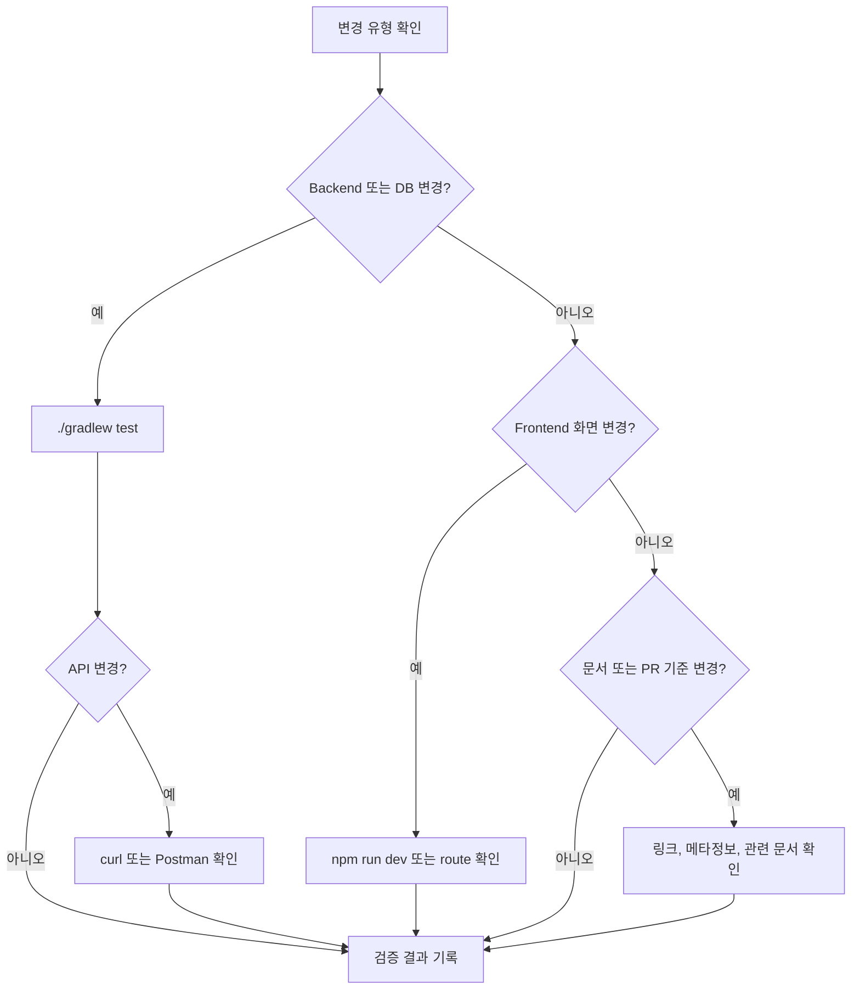

> **작성자**: Threadia 팀
> **작성일**: 2026-06-16
> **최종 수정**: 2026-07-07
> **버전**: Sprint 3 기준선 정합화 v1
> **상태**: 확정
> **태그**: test, build, api, verification
> **수정 근거**: Threadia-기획문서-검수리포트.md, DB-schema-관리-정책.md

# test/build/API/화면 확인 기준 v2

> **Phase A 정합도 메모**: 이 파일은 공식 결정 반영 조정본이다. Sprint 1 구현 기준은 Auth only, Spring Boot/MySQL/Frontend skeleton, CI/PR baseline, Auth flows다. DB schema는 `docs/03-design/ERD.md`와 `db/schema.sql`을 기준으로 관리하고, Spring Boot/JPA는 schema 생성이 아니라 mapping 검증에 사용한다. 회사, 프로젝트, 이슈, 문서, 채팅, DM, 쓰레드, 알림, 프로필 수정, invitation 구현은 Sprint 1 범위에서 제외하고, 전체 MVP API/ERD는 후속 구현 sprint의 reference contract로 유지한다.


## 1. 목적

이 문서는 Threadia Sprint 1 작업 완료 여부를 확인하기 위한 test, build, API, 화면, DB, 문서, PR 검증 방법을 정리한다.

`작업 유형별 완료 조건 v2.md`가 완료 기준을 정의한다면, 이 문서는 그 기준을 어떻게 확인하고 어떤 증빙을 남길지 정의한다.

## 2. 검증 기본 원칙

| 원칙 | 설명 |
|---|---|
| 변경 범위 기준 | 모든 명령을 무조건 실행하지 않고 변경 유형에 맞는 검증을 선택한다 |
| 자동 검증 우선 | 가능한 항목은 test, build, CI 같은 자동 검증으로 확인한다 |
| 수동 검증 기록 | API 응답, 화면 캡처, DB query 결과처럼 자동화가 어려운 항목은 재확인 가능한 기록을 남긴다 |
| 실패 케이스 포함 | 정상 케이스뿐 아니라 주요 실패 케이스를 함께 확인한다 |
| 미확인 항목 공개 | 실행하지 못한 검증은 사유, 영향, 후속 조치를 남긴다 |
| secret 비노출 | token, password, `.env`, DB 접속 정보, AWS key는 검증 기록에 남기지 않는다 |

## 3. Sprint 1 검증 흐름



## 4. Threadia 기준 명령어

| 영역 | 명령/확인 | Sprint 1 적용 기준 |
|---|---|---|
| Backend local 실행 | `./gradlew bootRun` | 서버 실행과 DB 연결 확인이 필요할 때 사용 |
| Backend 최소 test | `./gradlew test` | PR 전 기본 검증. 초기 CI 기준 |
| Backend build | `./gradlew build` | Spring Boot skeleton 안정화 후 merge 기준으로 확대 |
| Backend 확장 검증 | `./gradlew check` | lint/check 도구 도입 후 적용 |
| API 확인 | `curl` 또는 Postman | API 추가/변경, 인증/인가, validation 확인 |
| DB 확인 | MySQL client, application log, 관련 API 응답 | ERD/schema.sql/entity/table 관계, local 연결 확인 |
| Frontend 실행 | `npm run dev` | React + Next 구조 생성 후 route와 화면 확인 |
| Frontend script | `npm run lint`, `npm run typecheck`, `npm run test:e2e` | script 확정 후 적용 |
| CI | GitHub Actions 초록 체크 | workflow 생성 이후 PR 자동 검증으로 적용 |

## 5. Test 확인 기준

### 5.1 Backend test

Backend 변경이 있으면 우선 아래 명령을 실행한다.

```bash
./gradlew test
```

| 확인 항목 | 기준 |
|---|---|
| 성공 여부 | test command가 exit code 0으로 종료된다 |
| 대상 | 변경된 service, controller, repository, validation에 관련 test가 포함된다 |
| 실패 케이스 | 필수값 누락, 권한 부족, 리소스 없음 등 주요 실패 조건을 확인한다 |
| DB 연동 | DB 저장/조회/수정/삭제 변경이면 관련 repository 또는 API 흐름을 확인한다 |
| 기록 | 실행 명령과 결과 요약을 PR 또는 작업 기록에 남긴다 |

### 5.2 Frontend test

Sprint 1 초기에는 Frontend skeleton과 npm script가 확정된 뒤 자동 검증을 적용한다.

| 단계 | 적용 기준 |
|---|---|
| 초기 | `npm run dev`로 route와 주요 화면을 브라우저에서 확인 |
| script 확정 후 | `npm run lint`, `npm run typecheck`를 PR 전 검증에 추가 |
| e2e 도입 후 | 로그인, 프로젝트 홈, 이슈 흐름 같은 핵심 flow를 `npm run test:e2e`로 확인 |

## 6. Build 확인 기준

### 6.1 Backend build

Spring Boot skeleton이 안정화되면 아래 명령을 merge 기준으로 확대한다.

```bash
./gradlew build
```

| 확인 항목 | 기준 |
|---|---|
| compile | Java compile error가 없다 |
| test | build 과정에서 test가 통과한다 |
| packaging | 실행 가능한 artifact 생성이 가능하다 |
| 설정 | 환경 변수 누락이나 profile 오류로 build가 실패하지 않는다 |
| warning | warning이 있으면 Sprint 1 진행에 영향이 있는지 기록한다 |

### 6.2 Frontend build

Frontend build는 Next 구조와 package manager, script가 확정된 뒤 적용한다.

```bash
npm run build
```

| 확인 항목 | 기준 |
|---|---|
| compile | TypeScript 또는 bundling 오류가 없다 |
| route | 주요 route가 build 과정에서 실패하지 않는다 |
| resource | 이미지, font, 환경 변수 참조가 누락되지 않는다 |
| 적용 시점 | script 준비 전에는 필수 기준으로 두지 않고 후속 항목으로 남긴다 |

## 7. API 확인 기준

### 7.1 확인 대상

다음 변경이 있으면 API 확인을 수행한다.

| 변경 | 확인 이유 |
|---|---|
| 신규 API 추가 | request/response 형식이 합의와 맞는지 확인 |
| 인증/인가 변경 | token 없음, 권한 부족 요청이 차단되는지 확인 |
| validation 변경 | 필수값, 형식 오류가 일관된 응답으로 반환되는지 확인 |
| DB 저장/수정/삭제 | API 성공 후 DB 반영 여부 확인 |
| 검색/필터/정렬/페이징 | 조건에 맞는 결과가 반환되는지 확인 |

### 7.2 Threadia API 확인 예시

아래 예시는 형식 예시이며 실제 endpoint와 request body는 API 명세 초안에 맞춰 조정한다.

```bash
curl -i -X POST "http://localhost:8080/api/v1/auth/login" \
  -H "Content-Type: application/json" \
  -c cookies.txt \
  -d '{"email":"user@example.com","password":"password"}'

curl -i -X GET "http://localhost:8080/api/v1/auth/me" \
  -H "Authorization: Bearer <access-token>"

curl -i -X POST "http://localhost:8080/api/v1/auth/logout" \
  -H "Authorization: Bearer <access-token>" \
  -b cookies.txt

curl -i -X POST "http://localhost:8080/api/v1/auth/password-reset/request" \
  -H "Content-Type: application/json" \
  -d '{"email":"user@example.com"}'
```

### 7.3 API 확인 항목

| 항목 | 기준 |
|---|---|
| 정상 응답 | 기대한 status code와 response body가 반환된다 |
| validation | 필수값 누락, 잘못된 형식, 길이 초과가 적절한 오류로 반환된다 |
| 인증 | token이 없거나 만료된 요청, `SUSPENDED`/`DELETED` 사용자의 login/OAuth callback/token refresh/`/auth/me`가 차단된다 |
| 권한 | 접근 권한이 없는 project, issue 요청이 차단된다 |
| 리소스 없음 | 존재하지 않는 id 요청이 404 또는 합의된 오류로 처리된다 |
| 민감 정보 | password, raw refresh token, 내부 stack trace가 응답 body에 포함되지 않는다 |
| refresh cookie | login/refresh 성공 응답에 `Set-Cookie: refreshToken=<...>; HttpOnly; SameSite=Lax; Path=/; Max-Age=1209600`이 포함되고 response body에는 `refreshToken`이 없다 |
| logout cookie | logout 성공 응답에 `Set-Cookie: refreshToken=; HttpOnly; SameSite=Lax; Path=/; Max-Age=0`이 포함되고 후속 인증 상태가 정리된다 |
| 이메일 정규화 | signup, login, password reset, OAuth 계정 연결, invitation lookup에서 `trim + lowercase` 기준이 동일하게 적용된다 |
| token revoke | `password-reset/confirm` 성공과 사용자 상태 변경 시 기존 `refresh_tokens`가 revoke된다 |
| OAuth link | 이메일만 같은 provider 계정을 기존 계정에 blind auto-link하지 않는다 |
| DB 반영 | 생성, 수정, 삭제 API는 DB 또는 후속 조회 API로 결과를 확인한다 |

## 8. DB 확인 기준

DB 검증은 ERD와 application 동작 사이의 정합성을 확인하는 절차다.

| 확인 항목 | 방법 | 기준 |
|---|---|---|
| local 연결 | `./gradlew bootRun`, application log, health check | MySQL 8.4 local DB에 연결된다 |
| table/entity 정합성 | ERD v2.0, `db/schema.sql`, entity class 비교 | 이름, 관계, null, unique, foreign key 기준이 충돌하지 않는다 |
| 저장 결과 | 생성 API 후 조회 API 또는 query 확인 | 기대한 table에 데이터가 저장된다 |
| 수정 결과 | 수정 API 후 조회 API 또는 query 확인 | 변경된 field만 의도대로 바뀐다 |
| 삭제 결과 | 삭제 API 후 조회 API 또는 query 확인 | hard delete 또는 soft delete 기준이 문서와 일치한다 |
| schema.sql | `db/schema.sql` 실행 결과 | local 또는 test DB에서 재현 가능하다 |

DB 접속 정보, password, connection string은 검증 기록에 남기지 않는다.

## 8.1 Sprint 1.5 invitation 검증 기준

| 확인 항목 | 방법 | 기준 |
|---|---|---|
| seed 회사 | local/dev/demo seed 또는 fixture 확인 | 회사 1개와 `COMPANY_ADMIN` 1명이 준비되어 있고 운영 데이터에는 포함하지 않는다 |
| 회사 생성 API 제외 | API 목록과 구현 범위 확인 | `POST /api/v1/companies`는 Sprint 1.5 검증 범위가 아니다 |
| invitation 생성 | curl 또는 Postman | 등록 사용자 exact email lookup 후 `PENDING` company invitation을 생성한다 |
| 만료 시각 | API 응답과 DB 확인 | 기본 7일 `expiresAt`, UTC 저장, ISO-8601 UTC `Z` 응답을 사용한다 |
| accept/decline/cancel | API 정상/실패 케이스 | accept 시 company membership 생성, decline/cancel은 상태 전이만 수행한다 |
| notification optional | API/DB 또는 event 기록 확인 | `notification_events`는 필요 시 내부 event 원장으로 기록할 수 있으나 Sprint 1.5 완료 조건에는 포함하지 않는다. Push/S11 UI 필수 구현은 제외한다 |
| project invitation 제외 | API 목록과 구현 범위 확인 | project invitation과 `project_members` 생성은 현재 기준선에서 Sprint 3 `PROJECT-MEMBER-01~02` 후보로 분리한다 |

## 9. 화면 확인 기준

### 9.1 실행 전 준비

Frontend 구조가 생성된 뒤 아래 명령으로 화면을 확인한다.

```bash
npm run dev
```

확인 전에 아래 항목을 준비한다.

| 항목 | 예시 |
|---|---|
| 확인 URL | `/login`, `/signup`, `/password-reset`, OAuth callback route |
| Backend 상태 | API server 실행 여부 |
| 테스트 계정 | 권한 조건만 기록하고 password는 기록하지 않음 |
| 테스트 데이터 | project, issue, member 등 화면 확인에 필요한 데이터 |
| 화면 크기 | Desktop 우선. 필요 시 Mobile 375px 추가 |

### 9.2 화면 확인 항목

| 항목 | 기준 |
|---|---|
| 진입 | 대상 route에 정상 진입할 수 있다 |
| runtime | 흰 화면, 무한 loading, console fatal error가 없다 |
| 데이터 표시 | API 또는 mock data가 요구된 위치와 형식으로 표시된다 |
| 사용자 action | 클릭, 입력, 저장, 수정, 삭제 등 변경 범위의 action이 동작한다 |
| 오류 상태 | API 실패, validation 실패, 권한 없음 상태가 사용자에게 전달된다 |
| 화면 깨짐 | Desktop 기준으로 요소 겹침, 잘림, 불필요한 가로 scroll이 없다 |
| 증빙 | route, 브라우저, 화면 크기, 캡처 또는 확인 결과를 기록한다 |

## 10. 문서 확인 기준

| 항목 | 확인 방법 |
|---|---|
| 메타정보 | 작성자, 작성일, 최종 수정, 버전, 상태가 있는지 확인 |
| 문체 | 한국어 `~다` 체와 기술 용어 표기가 일관적인지 확인 |
| 링크 | 상대 경로와 관련 문서명이 실제 존재하는지 확인 |
| 명령어 | 문서에 적은 명령어가 현재 프로젝트 기준과 맞는지 확인 |
| 충돌 | API, ERD, 화면 정의서, Backlog 문서와 내용이 충돌하지 않는지 확인 |
| 미확정 | 미확정 항목에 owner, 결정 시점, 후속 조치가 있는지 확인 |

## 11. PR/CI 확인 기준

| 항목 | 확인 기준 |
|---|---|
| PR 설명 | 변경 목적, 주요 변경, 제외 범위가 적혀 있다 |
| 검증 결과 | 실행한 명령과 결과, API/화면 확인 결과가 적혀 있다 |
| CI | workflow 생성 이후 GitHub Actions가 초록 체크인지 확인한다 |
| AI 사용 | AI 사용 여부와 범위가 적혀 있다 |
| 승인 필요 | DB schema, 인증/인가, CI, AWS, secret 변경 여부가 표시되어 있다 |
| reviewer | owner와 reviewer가 분리되어 있다 |

## 12. 작업 유형별 필수 검증 요약

| 작업 유형 | 필수 검증 | 보조 검증 |
|---|---|---|
| Backend | `./gradlew test`, API 정상/실패 케이스 | `./gradlew build` |
| Frontend | `npm run dev`, 브라우저 route와 주요 flow 확인 | `npm run lint`, `npm run typecheck`, `npm run build` |
| DB | DB 연결, ERD/schema.sql/entity/table 정합성, 관련 API 확인 | schema.sql 재실행, 검증 query |
| Infra/AWS | 사용 범위, 비용/계정, 배포 시점, secret 관리 문서 확인 | 실제 배포는 Sprint 1 이후 |
| 문서 | 메타정보, 링크, 관련 문서 충돌 확인 | 명령어 직접 실행 |
| PR | 검증 결과, 영향 범위, 보안/승인 체크 | CI 초록 체크 |
| AI-assisted | owner 직접 검증, AI 사용 범위 기록 | reviewer 추가 검토 |

## 13. 검증 결과 작성 예시

PR 또는 작업 기록에는 아래 형식으로 검증 결과를 남긴다.

```markdown
## 검증 결과

- Backend test: `./gradlew test` 통과
- Backend build: skeleton 안정화 전이라 미실행. 후속 기준은 `./gradlew build`
- API:
  - `POST /api/v1/auth/login` 정상 응답 확인
  - 필수값 누락 시 400 계열 오류 응답 확인
  - token 없는 `GET /api/v1/auth/me` 요청 차단 확인
- DB:
  - MySQL 8.4 local 연결 확인
  - signup 또는 password reset API 후 Auth table 데이터 반영 확인
- 화면:
  - Chrome Desktop에서 `/login`, `/projects` 진입 확인
  - 화면 캡처 첨부
- 문서:
  - 관련 API/ERD 문서 링크 확인
- AI 사용:
  - Controller 초안 생성에 사용. owner가 수정 내용 확인 후 직접 test 실행
- 미확인 항목:
  - Frontend `npm run typecheck`는 script 확정 후 적용
```

## 14. 완료로 보지 않는 경우

| 경우 | 처리 |
|---|---|
| test 또는 build 결과가 없다 | 실행하거나 미실행 사유와 후속 조치를 기록한다 |
| API 변경인데 요청/응답 예시가 없다 | curl, Postman, test 중 하나로 재확인한다 |
| 화면 변경인데 화면 확인 기록이 없다 | route, 브라우저, 화면 크기, 캡처를 남긴다 |
| DB 변경인데 DB 반영 확인이 없다 | query, log, 조회 API 중 하나로 확인한다 |
| 정상 케이스만 확인했다 | 실패 케이스를 추가 확인한다 |
| secret이 검증 기록에 노출되었다 | 즉시 제거하고 노출 범위와 후속 조치를 기록한다 |
| 미확인 항목의 owner와 처리 시점이 없다 | Backlog 또는 PR TODO로 추적 가능하게 만든다 |

---

## Phase B invitation 반영 메모

> **생성일**: 2026-06-16
> **상태**: 공식 결정 반영 완료
> **기준**: `.sisyphus/evidence/task-5-invitation-impact-matrix.md`의 affected row와 2026-06-16 공식 decision set을 사용한다.

### 반영 범위

1. Phase B는 Sprint 1.5의 등록 사용자 대상 app-internal invitation 정책을 반영한다.
2. Sprint 1은 Auth-only이며 invitation을 구현하지 않는다.
3. Sprint 1.5부터 회사 멤버 추가는 즉시 membership 생성이 아니라 `invitations` 생성과 대상자 accept 후 membership 생성으로 처리한다. 프로젝트 멤버 추가와 project invitation은 당시 Sprint 2 후보로 분리한 과거 결정 기록이며, 현재 기준선에서는 Sprint 3 `PROJECT-MEMBER-01~02` 후보로 다룬다.
4. 당시 Sprint 2는 project invitation, project membership 생성, actual invitee email sending, token link acceptance, unregistered onboarding, resend, email template, delivery failure handling, batch cleanup/operations의 후보 시점이며 확정 구현 commitment는 아니었다. 현재 project invitation baseline은 Sprint 3 `PROJECT-MEMBER-01~02` 후보이고, `INVITE-01~04`는 company invitation 전용이다.

### invitation 공식 결정

1. Sprint 1.5 포함 범위는 `invitations` table, `PENDING / ACCEPTED / DECLINED / CANCELED / EXPIRED`, company invitation, exact email lookup for registered users, received invitation list, accept/decline/cancel, company membership creation on accept다.
2. Sprint 1.5 제외 범위는 project invitation, project membership creation, actual email sending to invitees, invitation token link, unregistered-user invitation, signup/onboarding auto-accept, resend다.
3. `notification_events`에는 필요 시 `INVITATION_CREATED`, `INVITATION_ACCEPTED`, `INVITATION_DECLINED`, `MEMBER_ADDED`를 내부 event 원장으로 기록할 수 있으나 Sprint 1.5 완료 조건에는 포함하지 않는다. Push 알림, 별도 Invitation notification preference, S11 사용자 알림 UI 필수 구현은 Sprint 1.5 범위가 아니다.
4. Sprint 1.5에서는 user-facing `notification_preferences`에 별도 Invitation category를 노출하지 않고 기존 global notification preference policy를 따른다.
5. `EXPIRED`와 `expires_at`을 유지하고 기본 만료 기간은 7일로 둔다. read/accept/decline/cancel 시 lazy expiration을 확인하며, 만료된 `PENDING` invitation accept는 `409 INVITATION_EXPIRED`로 거절한다.
6. Sprint 1.5에는 필수 batch scheduler를 추가하지 않는다. Batch cleanup/sweeper는 Sprint 2 이후 admin list hygiene, retention, metrics, operational cleanup 필요에 따라 검토한다.

### Phase C 추가 동기화 결정

1. Sprint 1.5 invitation 검증은 local/dev/demo seed 회사 1개와 `COMPANY_ADMIN` 1명을 사용한다. `POST /api/v1/companies`는 Sprint 1.5 구현 범위에 포함하지 않고 MVP/Sprint 2 reference로 유지하며 운영 데이터에는 seed를 포함하지 않는다.
2. `activity_events`는 활동 원장, `notification_events`는 알림 사건 원본으로 별도 운영한다. 두 저장소를 통합하지 않고, 필요 시 activity 이벤트에서 notification 이벤트를 생성하는 연계만 허용한다.
3. 서버 생성 시각과 만료 시각은 UTC 기준으로 생성, 저장, 비교한다. ERD의 `DATETIME` 타입은 유지하고 API 응답은 ISO-8601 UTC `Z` 형식으로 반환한다.
4. 로그인 이메일은 모든 진입점에서 `trim + lowercase`로 정규화한 값을 저장, 조회, 비교한다. 이 기준은 signup, login, password reset, OAuth 계정 연결, invitation lookup에 동일하게 적용한다.
5. OAuth 계정 연결은 이메일만 같다는 이유로 blind auto-link하지 않는다. 이미 로그인한 사용자이거나 provider 이메일 검증을 신뢰할 수 있는 경우에만 기존 `users` 계정과 연결한다.
6. `password-reset/confirm` 성공 시 해당 사용자의 모든 기존 `refresh_tokens`를 revoke한다. 기존 access token은 별도 blacklist 없이 짧은 만료 시간에 따라 자연 만료시킨다.
7. login, OAuth callback, token refresh, `/auth/me`는 `users.status = ACTIVE`인 사용자만 성공 처리한다. `SUSPENDED` 또는 `DELETED` 사용자는 인증을 거부하며, 상태 변경 시 기존 `refresh_tokens`를 revoke한다.
