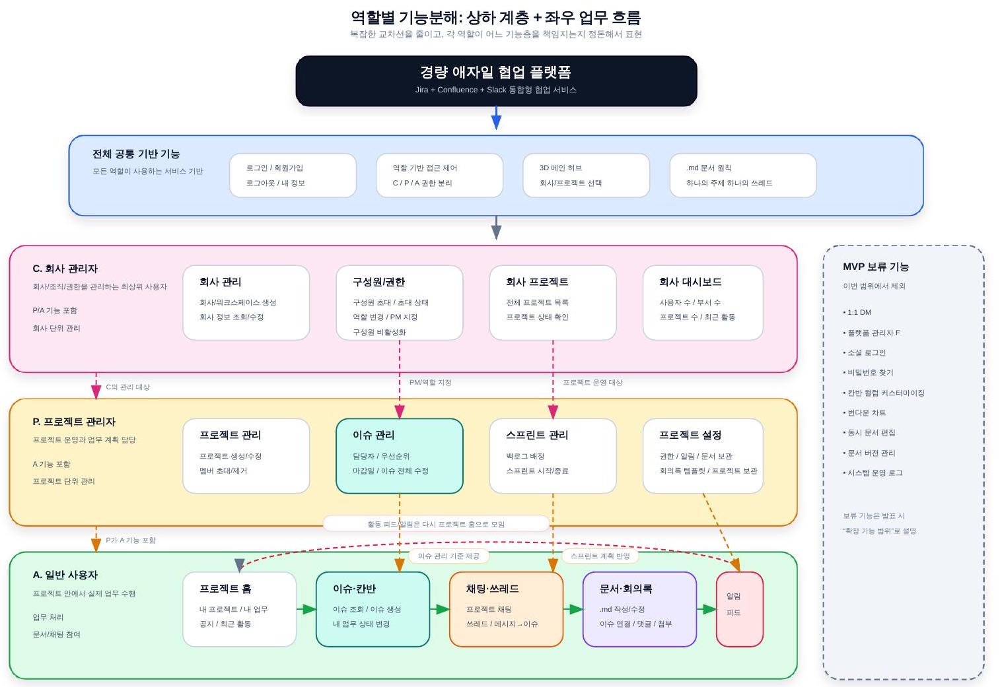

# 기능분해-계층다이어그램

## 정돈형 역할벌 기능분해 계총 다이어그램

상하 관계와 위치를 우선해 재배치한 버전입니다. 권한 계층은 위에서 아래로, 기능 도메인은 왼쪽 에서 오른쪽으로 흐르도록 구성했습니다.

## 상하 구조

공통 기반 → 회사 관 리자 → 프로젝트 관 리자 → 일반 사용자 순서

## 권한 포함

C 는 $\mathrm{P} / \mathrm{A}$ 기능 포함, P 는 A기능 포함

## 업무 흐름

프로젝트 홈 → 이슈 → 채팅/쓰레드 → 문 서 → 알림

## 범위 통제

보류 기능은 오른쪽 별도 영역으로 분리

핵심 흐름: 프로젝트 흠 → 이슈•칸반 → 채팅•쓰레드 → 문서•회의록 → 알림

$/$

활동 피드

## 이번 버전의 정돈 기준

- 상하 관계: 전체 공통 기반을 위에 두고, $\mathrm{C} \rightarrow \mathrm{P} \rightarrow \mathrm{A}$ 순서로 권한 계층을 배치했다.
- 좌우 흐름: 일반 사용자 행에서 프로젝트 홈부터 알림까지 실제 업무 흐름을 왼쪽에 서 오른쪽으로 배치했다.
- 연결선 최소화: 교차선을 줄이고, 관리 관계는 세로 점선, 업무 흐름은 가로 실선으 로 구분했다.
- 보류 범위 분리: MVP에서 제외할 기능은 오른쪽 별도 영역으로 분리했다.

[합치기 전 임시](%ED%95%A9%EC%B9%98%EA%B8%B0%20%EC%A0%84%20%EC%9E%84%EC%8B%9C%2037c41e4c75a0805ba009d010d6280819.md)

[우리기능분해표-상세버전.csv](%EC%9A%B0%EB%A6%AC%EA%B8%B0%EB%8A%A5%EB%B6%84%ED%95%B4%ED%91%9C-%EC%83%81%EC%84%B8%EB%B2%84%EC%A0%84%20csv%2037c41e4c75a080449538d9db687cd946.csv)