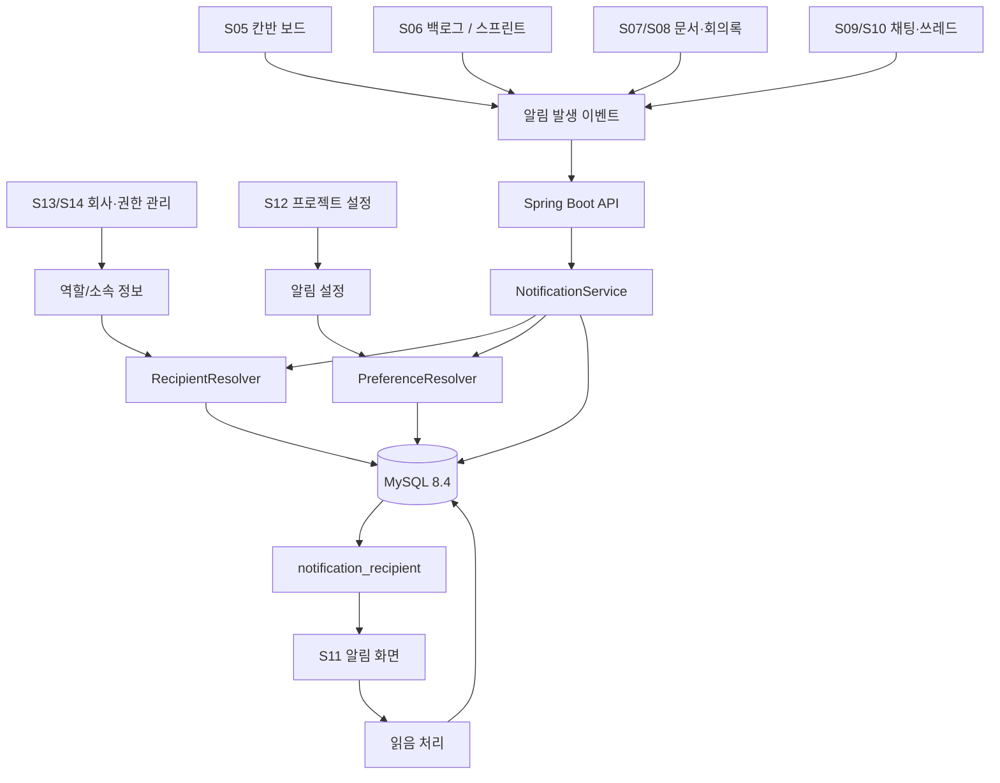
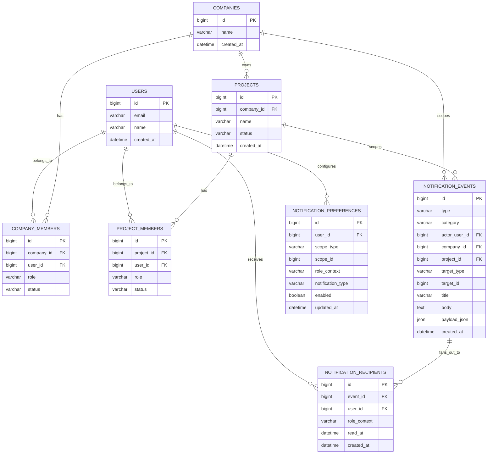
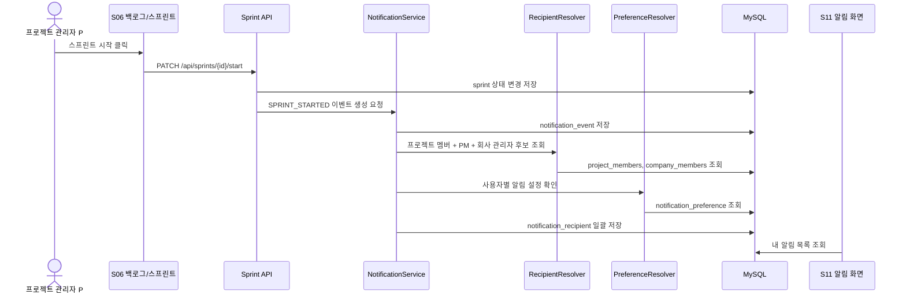
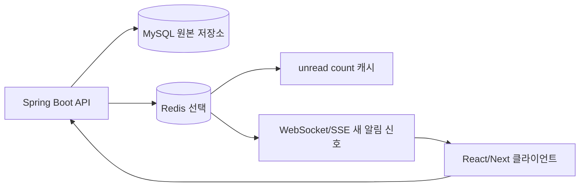

# MySQL 기반 알림기능 구조 예시

## 1. 결론

현재 2주차 진행 상황과 확정 기술 스택을 기준으로 보면 알림 기능은 **MySQL 8.4 단독 구조로 먼저 구현하는 것이 가장 안전하다.**

이유는 다음과 같다.

- 현재 확정 stack이 `Spring Boot + MySQL 8.4 + React/Next + AWS EC2/RDS/S3`이다.
- 알림은 `S11 알림` 화면, `S12 프로젝트 알림 설정`, `S13/S14 회사/권한 관리`와 연결된다.
- 6주 MVP에서는 Redis, NoSQL, 분산 DB까지 넣으면 기능 구현보다 운영 복잡도가 커진다.
- 읽음/안읽음, 사용자별 수신 여부, 역할별 on/off 설정은 관계형 DB의 `JOIN`, `UNIQUE`, `INDEX`로 충분히 관리할 수 있다.

> [!note]
> 이 문서는 비정형 DB 도입을 부정하는 문서가 아니라, **MVP 1차 구현은 MySQL 중심으로 잡고 Redis/NoSQL은 확장 단계로 남기는 설계안**이다.

---

## 2. 현재 화면 흐름과 알림 위치

1차 분업 자료 기준으로 알림은 다음 화면들과 연결된다.

| 화면 | 알림과의 관계 |
|---|---|
| S03 3D 사무실 | 상단바 알림 아이콘에서 S11로 진입 |
| S05 칸반 보드 | 이슈 생성, 담당자 지정, 상태 변경 알림 발생 |
| S06 백로그 / 스프린트 | 스프린트 시작/종료, 백로그 변경 알림 발생 |
| S07 문서·회의록 목록 | 새 문서, 새 회의록 등록 알림 발생 |
| S08 문서 편집기 | 문서 수정, 문서 댓글, 문서-이슈 연결 알림 발생 |
| S09 채팅 | DM, 채팅 언급, 쓰레드 연결 알림 발생 |
| S10 쓰레드 | 댓글, @멘션, 의사결정 요청 알림 발생 |
| S11 알림 | 모든 알림 조회, 필터, 읽음 처리, on/off 설정 |
| S12 프로젝트 설정 | 프로젝트별 알림 설정 |
| S13 회사 관리 | 회사 전체 현황 확인 |
| S14 구성원·권한 관리 | C/P/A 역할 변경에 따른 알림 수신 범위 변경 |

---

## 3. MySQL 기반 전체 구조



핵심은 알림을 하나의 테이블에 전부 넣지 않고, 다음 세 가지로 분리하는 것이다.

| 구분 | 역할 |
|---|---|
| `notification_event` | 어떤 일이 발생했는지 저장 |
| `notification_recipient` | 그 알림을 누가 받았고 읽었는지 저장 |
| `notification_preference` | 사용자가 어떤 유형의 알림을 받을지 on/off 저장 |

---

## 4. 핵심 ERD 예시



---

## 5. 테이블별 역할

### 5.1 `notification_event`

하나의 사건을 저장한다.

예를 들어 `정철진이 Sprint 1을 시작했습니다`라는 알림이 생기면, 이 사건은 한 번만 저장한다.

| 컬럼 | 예시 | 설명 |
|---|---|---|
| `type` | `SPRINT_STARTED` | 알림 유형 |
| `category` | `PROJECT` | 프로젝트/회사/시스템 범위 |
| `actor_user_id` | `정철진 user_id` | 행동을 발생시킨 사용자 |
| `company_id` | `TechFlow id` | 회사 범위 |
| `project_id` | `프론트엔드 프로젝트 id` | 프로젝트 범위 |
| `target_type` | `SPRINT` | 이동 대상 객체 종류 |
| `target_id` | `Sprint 1 id` | 이동 대상 객체 ID |
| `title` | `Sprint 1 시작` | 알림 제목 |
| `body` | `정철진이 Sprint 1을 시작했습니다.` | 알림 본문 |
| `payload_json` | `{ "screen": "S06" }` | 화면 이동 등에 필요한 추가 데이터 |

### 5.2 `notification_recipient`

하나의 알림을 누가 받았는지 저장한다.

같은 이벤트라도 회사 관리자, 프로젝트 관리자, 일반 사용자가 각각 받을 수 있으므로 event와 recipient를 분리한다.

| 컬럼 | 예시 | 설명 |
|---|---|---|
| `event_id` | `1001` | 발생한 알림 이벤트 |
| `user_id` | `황스일 user_id` | 수신자 |
| `role_context` | `COMPANY_ADMIN` | 어떤 역할 맥락으로 받은 알림인지 |
| `read_at` | `NULL` | 읽지 않았으면 NULL, 읽었으면 시간 저장 |

### 5.3 `notification_preference`

사용자별, 역할별, 범위별 on/off 설정을 저장한다.

| 컬럼 | 예시 | 설명 |
|---|---|---|
| `scope_type` | `PROJECT` | `GLOBAL`, `COMPANY`, `PROJECT` |
| `scope_id` | `프로젝트 id` | 특정 회사/프로젝트 범위 |
| `role_context` | `PROJECT_ADMIN` | 일반 사용자/PM/회사 관리자 역할 맥락 |
| `notification_type` | `ISSUE_STATUS_CHANGED` | 알림 유형 |
| `enabled` | `true` | 수신 여부 |

> [!tip]
> 모든 사용자에 대해 preference row를 미리 만들 필요는 없다. 기본 정책은 코드에 두고, 사용자가 S11/S12에서 값을 바꾼 경우만 DB에 저장하면 초기 구현이 단순해진다.

---

## 6. 역할별 기본 수신 정책

| 알림 유형 | 일반 사용자 A | 프로젝트 관리자 P | 회사 관리자 C |
|---|---:|---:|---:|
| @멘션 | ON | ON | ON |
| 내 이슈 담당자 지정 | ON | ON | ON |
| 내가 담당한 이슈 상태 변경 | ON | ON | OFF |
| 프로젝트 전체 이슈 상태 변경 | OFF | ON | 선택 |
| 스프린트 시작/종료 | ON | ON | ON |
| 새 문서/회의록 등록 | ON | ON | ON |
| 문서 수정 | 선택 | ON | 선택 |
| 쓰레드 댓글 | ON | ON | 선택 |
| DM/채팅 | 선택 | 선택 | 선택 |
| 구성원 권한 변경 | OFF | 선택 | ON |
| 프로젝트 생성/완료 | OFF | ON | ON |

회사 관리자는 모든 프로젝트에 접근할 수 있지만, 모든 상세 변경을 기본 ON으로 두면 알림 피로가 생긴다. 따라서 C 권한의 기본값은 **공지, 스프린트, 문서/회의록, 프로젝트 상태, 권한 변경** 중심으로 두는 것이 안전하다.

---

## 7. 알림 생성 흐름 예시

### 7.1 스프린트 시작 알림



### 7.2 회사 관리자 수신 예시

```text
정철진(P)이 프론트엔드 프로젝트 Sprint 1 시작
│
├─ 프론트엔드 프로젝트 멤버 A에게 알림
│  └─ "Sprint 1이 시작되었습니다"
│
├─ 프론트엔드 프로젝트 관리자 P에게 알림
│  └─ "Sprint 1이 시작되었습니다"
│
└─ 회사 관리자 C에게 알림
   └─ "프론트엔드 프로젝트에서 Sprint 1이 시작되었습니다"
```

---

## 8. 조회 API 예시

| 기능 | Method | Endpoint | 설명 |
|---|---|---|---|
| 내 알림 목록 | GET | `/api/notifications` | 로그인 사용자의 알림 목록 |
| 읽지 않은 알림만 조회 | GET | `/api/notifications?unreadOnly=true` | `read_at is null` 기준 |
| 알림 유형 필터 | GET | `/api/notifications?type=MENTION` | S11 유형별 탭 필터 |
| 알림 읽음 처리 | PATCH | `/api/notifications/{id}/read` | 단일 알림 읽음 처리 |
| 모두 읽음 처리 | PATCH | `/api/notifications/read-all` | 전체 알림 읽음 처리 |
| 알림 설정 조회 | GET | `/api/notification-preferences` | 사용자별 on/off 설정 |
| 알림 설정 변경 | PATCH | `/api/notification-preferences` | S11/S12 토글 저장 |

---

## 9. MySQL 쿼리 관점 예시

### 9.1 내 읽지 않은 알림

```sql
SELECT nr.id,
       ne.type,
       ne.title,
       ne.body,
       ne.target_type,
       ne.target_id,
       nr.created_at
FROM notification_recipient nr
JOIN notification_event ne ON ne.id = nr.event_id
WHERE nr.user_id = :userId
  AND nr.read_at IS NULL
ORDER BY nr.created_at DESC
LIMIT 20;
```

### 9.2 추천 인덱스

```sql
CREATE INDEX idx_notification_recipient_user_read
ON notification_recipient (user_id, read_at, created_at);

CREATE INDEX idx_notification_event_project_type
ON notification_event (project_id, type, created_at);

CREATE UNIQUE INDEX uk_notification_recipient_event_user
ON notification_recipient (event_id, user_id);

CREATE UNIQUE INDEX uk_notification_preference_scope
ON notification_preference (user_id, scope_type, scope_id, role_context, notification_type);
```

---

## 10. 장점과 단점

| 구분 | 내용 |
|---|---|
| 장점 | 현재 확정 stack과 일치한다. Spring Boot/JPA로 구현하기 쉽다. 읽음 여부, 수신자 중복 방지, 역할별 조회를 트랜잭션과 제약조건으로 관리할 수 있다. 팀원이 로컬에서 재현하기 쉽다. |
| 단점 | 대규모 실시간 fan-out에는 한계가 있다. 알림 이벤트가 매우 많아지면 인덱스와 보관 정책을 신경 써야 한다. 사용자별 unread count가 많아지면 캐시가 필요할 수 있다. |
| MVP 적합도 | 높음. 현재 6주 프로젝트에서는 기능 완성과 검증 가능성이 더 중요하다. |

---

## 11. 확장 단계에서 Redis를 붙이는 위치

MySQL 구조를 유지한 상태에서 Redis를 붙인다면 다음 위치가 적절하다.



Redis에 넣어도 되는 것:

- unread count 캐시
- WebSocket/SSE로 새 알림이 생겼다는 신호
- 짧은 TTL의 중복 요청 방지

Redis에 넣으면 안 되는 것:

- 알림 본문 원본
- 읽음/안읽음의 유일한 저장소
- 사용자별 알림 설정의 유일한 저장소

---

## 12. MVP 구현 순서

1. `NotificationType` enum 정의
2. `notification_event`, `notification_recipient`, `notification_preference` 테이블 생성
3. S11 알림 목록 API 구현
4. 읽음 처리 API 구현
5. 이슈/스프린트/문서/쓰레드에서 알림 이벤트 생성
6. 기본 수신 정책 코드화
7. S11 또는 S12에서 on/off 설정 저장
8. 필요 시 unread count API 추가

---

## 13. 발표용 요약

```text
MySQL 기반 알림 구조는 이벤트와 수신자를 분리한다.

notification_event는 "무슨 일이 발생했는가"를 저장하고,
notification_recipient는 "누가 받았고 읽었는가"를 저장한다.
notification_preference는 A/P/C 역할과 회사/프로젝트 범위별 on/off 설정을 담당한다.

이 구조는 현재 확정 stack인 Spring Boot + MySQL 8.4와 맞고,
6주 MVP에서 구현 가능성과 검증 가능성이 가장 높다.
```
