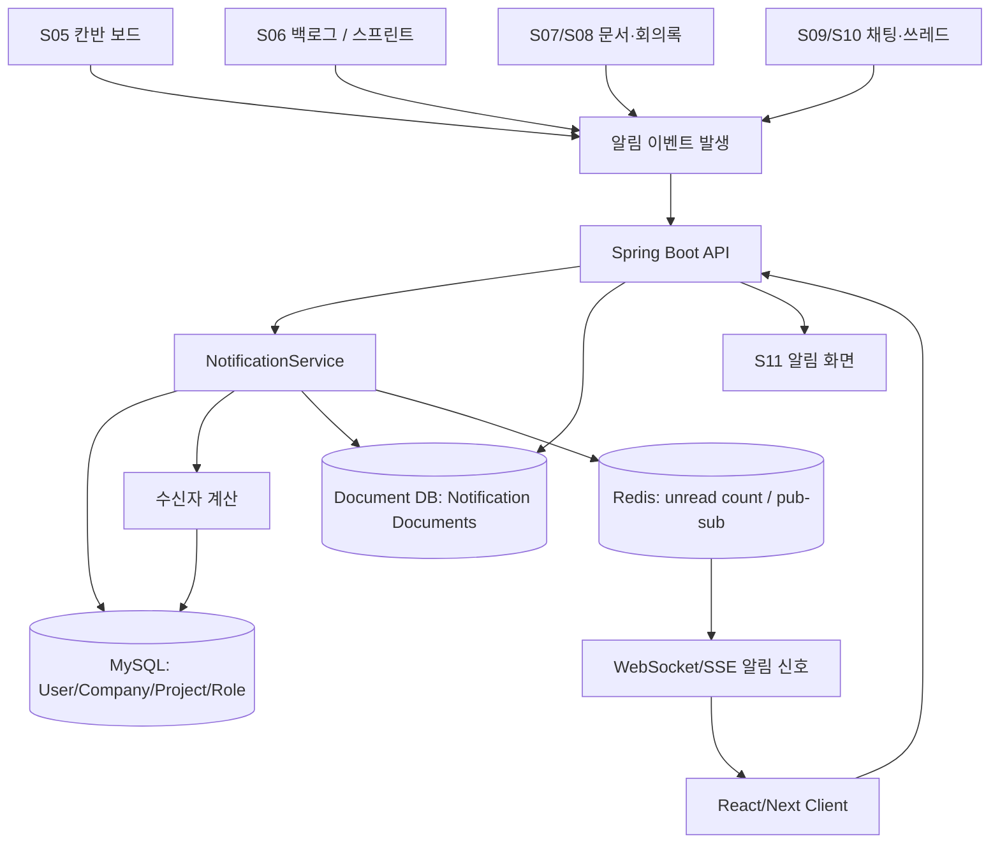
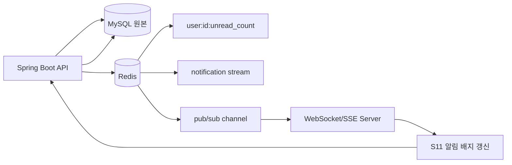
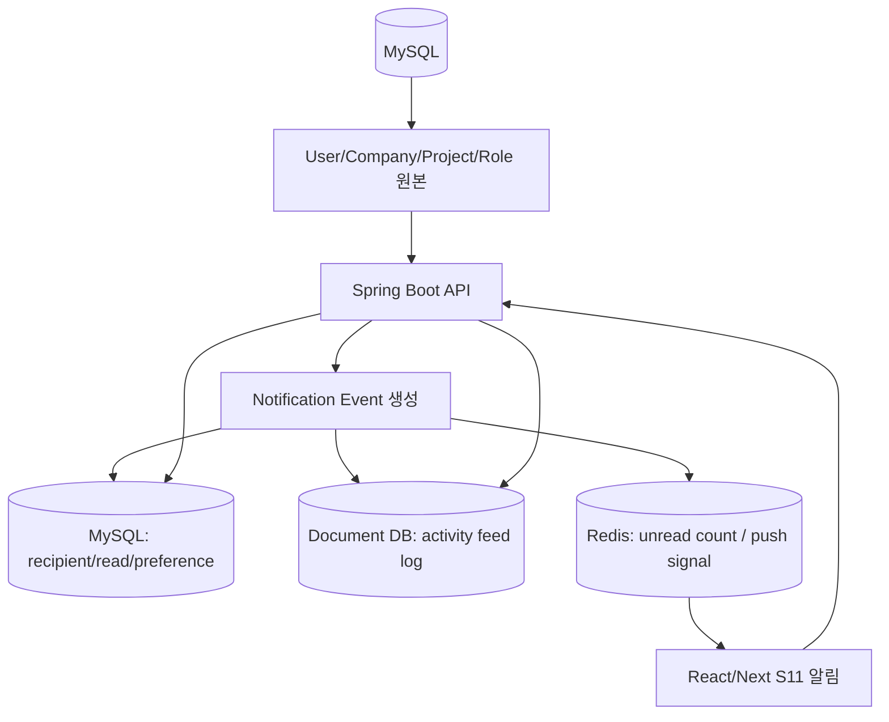

# 비정형 DB 기반 알림기능 구조 비교

## 1. 결론

비정형 DB를 사용하면 알림 payload를 유연하게 저장하고 대량 이벤트를 빠르게 쌓기 좋다. 하지만 현재 프로젝트가 2주차 진행 중이고 확정 stack이 `Spring Boot + MySQL 8.4`인 점을 고려하면, **MVP 1차 구현부터 비정형 DB를 도입하는 것은 과설계에 가깝다.**

권장 판단은 다음과 같다.

| 단계 | 추천 구조 | 판단 |
|---|---|---|
| MVP | MySQL 중심 | 구현, 검증, 발표가 쉽다. |
| 확장 1단계 | MySQL + Redis | unread count, 실시간 알림 신호를 보조한다. |
| 확장 2단계 | MySQL + MongoDB/DynamoDB 등 | 대량 활동 로그, 장기 이벤트 저장, 분석용 피드가 필요할 때 검토한다. |

> [!warning]
> Redis는 캐시와 실시간 신호 전달에는 좋지만, 알림 원본 저장소로 쓰기에는 위험하다. Redis만 사용하면 장애나 재시작 시 데이터 유실, 읽음 상태 불일치, 복구 어려움이 생길 수 있다.

---

## 2. 비정형 DB를 쓴다는 의미

여기서 말하는 비정형 DB는 주로 다음 유형이다.

| 유형 | 예시 | 알림 기능에서의 역할 |
|---|---|---|
| Document DB | MongoDB, DynamoDB | 알림 이벤트와 payload를 JSON 문서로 저장 |
| Key-Value Store | Redis | unread count 캐시, 세션, 실시간 알림 신호 |
| Wide-column / Log Store | Cassandra, Elasticsearch 계열 | 대량 이벤트 로그, 검색/분석 |

이 프로젝트에서는 현실적으로 다음 두 가지 정도만 검토 가치가 있다.

- `Redis`: 캐시/실시간 신호 보조
- `MongoDB 또는 DynamoDB`: 알림/활동 피드 문서 저장소

---

## 3. NoSQL 기반 전체 구조 예시



이 구조에서 MySQL은 완전히 사라지지 않는다. 사용자, 회사, 프로젝트, 권한, 멤버십은 관계형 데이터이기 때문에 여전히 MySQL에 두는 것이 자연스럽다.

---

## 4. Document DB 저장 구조 예시

Document DB를 사용하면 알림 하나를 JSON 문서 형태로 저장할 수 있다.

```json
{
  "notificationId": "noti_1001",
  "type": "SPRINT_STARTED",
  "category": "PROJECT",
  "companyId": 1,
  "projectId": 10,
  "actor": {
    "userId": 2,
    "name": "정철진",
    "role": "PROJECT_ADMIN"
  },
  "target": {
    "type": "SPRINT",
    "id": 31,
    "title": "Sprint 1"
  },
  "message": {
    "title": "Sprint 1 시작",
    "body": "정철진이 Sprint 1을 시작했습니다."
  },
  "recipients": [
    {
      "userId": 1,
      "roleContext": "COMPANY_ADMIN",
      "readAt": null,
      "enabled": true
    },
    {
      "userId": 4,
      "roleContext": "NORMAL_USER",
      "readAt": null,
      "enabled": true
    }
  ],
  "route": {
    "screen": "S06",
    "path": "/projects/10/sprints/31"
  },
  "createdAt": "2026-06-11T10:00:00Z"
}
```

이 방식은 알림 본문, 이동 경로, 대상 객체, 수신자 상태를 한 문서에 넣을 수 있어 직관적이다. 다만 수신자가 많아지면 문서가 커지고, 특정 사용자 알림만 빠르게 조회하려면 인덱스 설계가 까다로워진다.

---

## 5. 사용자별 Inbox 문서 구조

다른 방식으로는 사용자별 inbox를 별도 문서로 저장할 수 있다.

```json
{
  "userId": 1,
  "unreadCount": 3,
  "notifications": [
    {
      "notificationId": "noti_1001",
      "type": "SPRINT_STARTED",
      "projectId": 10,
      "title": "Sprint 1 시작",
      "body": "정철진이 Sprint 1을 시작했습니다.",
      "readAt": null,
      "createdAt": "2026-06-11T10:00:00Z"
    },
    {
      "notificationId": "noti_1002",
      "type": "MENTION",
      "projectId": 11,
      "title": "@멘션",
      "body": "여도현이 DB 스키마 설계 이슈에서 황스일을 언급했습니다.",
      "readAt": null,
      "createdAt": "2026-06-11T10:10:00Z"
    }
  ]
}
```

이 방식은 `S11 알림` 화면 조회가 빠르다. 하지만 알림이 계속 쌓이면 한 문서가 커지고, 오래된 알림 삭제/보관 처리가 필요하다.

---

## 6. Redis 중심 구조 예시

Redis는 다음처럼 보조 저장소로 사용하는 것이 적절하다.



Redis key 예시:

```text
user:1:notification:unread_count = 3
user:1:notification:latest = [1001, 1002, 1003]
project:10:notification:channel = pub/sub topic
```

Redis를 이렇게 사용하면 `S11 알림 아이콘 배지`, `새 알림 도착 신호`, `실시간 갱신`에는 도움이 된다. 하지만 실제 알림 목록과 읽음 상태의 최종 원본은 MySQL 또는 Document DB에 있어야 한다.

---

## 7. MySQL 구조와 NoSQL 구조 비교

| 항목 | MySQL 중심 | NoSQL 중심 | Redis 보조 |
|---|---|---|---|
| 주요 목적 | 정합성 있는 알림 원장 | 유연한 JSON 이벤트 저장 | 빠른 캐시/실시간 신호 |
| 저장 형태 | 정규화된 테이블 | JSON 문서 | key-value / stream |
| 읽음 상태 관리 | 안정적 | 설계 방식에 따라 다름 | 단독 사용 부적합 |
| 역할/권한 연동 | `JOIN`으로 자연스러움 | MySQL 역할 정보와 동기화 필요 | 원본 역할 관리 불가 |
| on/off 설정 | unique constraint로 안정적 | 문서 중복 가능성 있음 | 영구 설정 저장 부적합 |
| 조회 성능 | 인덱스 설계로 충분 | 사용자별 inbox 구조면 빠름 | 매우 빠름 |
| 확장성 | 중간 규모까지 충분 | 대량 이벤트에 유리 | 캐시/팬아웃에 유리 |
| 구현 난도 | 낮음 | 중간 이상 | 중간 |
| 운영 난도 | 낮음 | DB 추가로 상승 | 장애/캐시 무효화 고려 필요 |
| MVP 적합도 | 높음 | 낮음~중간 | 보조로만 중간 |

---

## 8. 장단점 정리

### 8.1 MySQL 기반

| 구분 | 내용 |
|---|---|
| 장점 | 현재 stack과 일치한다. 팀원이 이해하기 쉽다. 트랜잭션, 외래키, unique constraint로 알림 중복과 읽음 상태를 안정적으로 관리할 수 있다. Spring Boot/JPA와 궁합이 좋다. |
| 단점 | 대량 실시간 fan-out에는 한계가 있다. 알림 데이터가 많이 쌓이면 보관 정책과 인덱스 관리가 필요하다. unread count를 매번 계산하면 성능 부담이 생길 수 있다. |
| 적합한 시점 | MVP, 6주 프로젝트, 발표용 구현, 로컬 재현이 중요한 단계 |

### 8.2 Document DB 기반

| 구분 | 내용 |
|---|---|
| 장점 | 알림 payload가 유연하다. 이슈, 문서, 채팅, 스프린트 등 서로 다른 이벤트 구조를 JSON으로 쉽게 저장할 수 있다. 활동 피드처럼 다양한 이벤트를 한 컬렉션에 쌓기 좋다. |
| 단점 | 사용자/회사/프로젝트/권한은 여전히 관계형 구조가 필요하다. MySQL과 Document DB 사이에 데이터 중복과 동기화 문제가 생긴다. 팀원이 새 DB를 학습해야 하고 배포 환경도 복잡해진다. |
| 적합한 시점 | 통합 활동 피드, 감사 로그, 대량 이벤트 저장, 분석 기능이 MVP 이후 핵심 기능이 될 때 |

### 8.3 Redis 기반

| 구분 | 내용 |
|---|---|
| 장점 | 매우 빠르다. unread count, 새 알림 배지, WebSocket/SSE fan-out에 적합하다. TTL 기반 임시 데이터 관리가 쉽다. |
| 단점 | 영구 저장소로 쓰기 어렵다. 장애나 재시작 시 데이터 유실 가능성을 고려해야 한다. 캐시와 DB 정합성 문제가 생긴다. Pub/Sub은 메시지 전달 보장을 강하게 기대하기 어렵다. |
| 적합한 시점 | MySQL 알림 구조가 먼저 구현된 뒤, 실시간 알림이나 배지 count 성능 개선이 필요할 때 |

---

## 9. 비정형 DB 사용 시 발생하는 추가 고민

비정형 DB를 추가하면 다음 설계 질문에 답해야 한다.

| 질문 | 설명 |
|---|---|
| 원본 데이터는 어디인가? | MySQL과 Document DB 중 어떤 DB가 최종 원본인지 정해야 한다. |
| 읽음 상태는 어디에 저장하는가? | 사용자별 read 상태가 Document 안에 있으면 업데이트 충돌을 고려해야 한다. |
| 알림 삭제/보관 정책은 어떻게 하는가? | 사용자별 inbox 문서가 커지는 문제를 해결해야 한다. |
| 권한 변경 시 기존 알림은 어떻게 되는가? | 회사 관리자에서 일반 사용자로 바뀐 사람의 과거 알림 접근 범위를 정해야 한다. |
| 테스트 환경은 어떻게 구성하는가? | MySQL 외에 Redis/MongoDB/DynamoDB local 환경이 필요해진다. |
| 배포는 누가 관리하는가? | EC2에 직접 설치할지, AWS managed service를 쓸지 결정해야 한다. |

---

## 10. NoSQL을 쓴다면 가능한 하이브리드 구조

MVP 이후에 NoSQL을 도입한다면 다음 구조가 가장 현실적이다.



이 구조의 원칙은 다음과 같다.

- 사용자, 회사, 프로젝트, 권한은 MySQL이 원본이다.
- 알림 수신자와 읽음 상태도 MySQL이 원본이다.
- Document DB는 다양한 활동 로그와 피드 표시용으로 사용한다.
- Redis는 빠른 배지 count와 새 알림 도착 신호에만 사용한다.

---

## 11. 알림 유형별 저장소 추천

| 알림/이벤트 | MySQL | Document DB | Redis |
|---|---:|---:|---:|
| @멘션 알림 | 원본 | 선택 | 새 알림 신호 |
| 이슈 담당자 지정 | 원본 | 선택 | unread count |
| 칸반 상태 변경 | 원본 | 활동 로그 적합 | 선택 |
| 스프린트 시작/종료 | 원본 | 활동 로그 적합 | 새 알림 신호 |
| 새 문서/회의록 | 원본 | 활동 로그 적합 | 선택 |
| 문서 수정 기록 | 선택 | 적합 | 부적합 |
| 채팅/DM 메시지 | 별도 메시지 테이블 필요 | 적합 가능 | 실시간 신호 |
| 회사 관리자 활동 로그 | 선택 | 적합 | 부적합 |
| 알림 on/off 설정 | 원본 | 부적합 | 부적합 |
| 읽음/안읽음 | 원본 | 가능하지만 주의 | 부적합 |

---

## 12. 프로젝트 기준 추천안

현재 CoWork 프로젝트 기준 추천은 다음과 같다.

```text
1차 MVP
Spring Boot + MySQL 8.4
notification_event / notification_recipient / notification_preference
S11 알림 목록 + 읽음 처리 + on/off 설정

2차 확장
Redis 추가
unread count 캐시 + WebSocket/SSE 새 알림 신호

3차 확장
Document DB 검토
통합 활동 피드, 회사 전체 활동 로그, 분석/검색 기능 강화
```

---

## 13. 발표용 요약

```text
비정형 DB는 다양한 알림 payload를 유연하게 저장할 수 있고,
활동 피드나 대량 이벤트 로그에는 장점이 있다.

하지만 현재 프로젝트는 2주차 MVP 기반 구축 단계이고,
확정 기술 스택도 Spring Boot + MySQL 8.4이다.

따라서 1차 구현은 MySQL로 알림 원장과 읽음 상태를 안정적으로 만들고,
Redis는 unread count나 실시간 push가 필요해졌을 때 붙이는 것이 안전하다.
NoSQL은 통합 활동 피드와 대량 로그가 실제 요구사항이 된 뒤 검토하는 확장안으로 두는 것이 좋다.
```

---

## 14. 최종 판단표

| 선택지 | 추천도 | 이유 |
|---|---:|---|
| MySQL-only | 높음 | 현재 stack과 맞고, 구현/검증/발표가 쉽다. |
| MySQL + Redis | 중간 | 실시간 배지와 캐시에 좋지만, 1차 구현 후 붙이는 편이 안전하다. |
| MySQL + Document DB | 낮음 | 활동 피드에는 좋지만 6주 MVP에는 운영 부담이 크다. |
| Redis-only | 매우 낮음 | 데이터 유실과 정합성 문제가 커서 알림 원본 저장소로 부적합하다. |
| NoSQL-only | 낮음 | 권한, 멤버십, 프로젝트 관계가 많아 관계형 DB 없이 설계하기 어렵다. |
