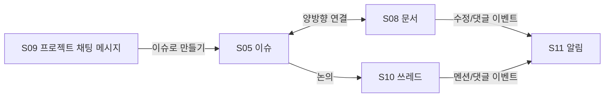

# 기능 분해표

## 1. 문서 목적

이 문서는 사용자 시나리오와 화면 정의서를 연결하는 최종 기능 범위표다. Day 3의 ERD, API, Architecture 설계에서 기능 누락과 범위 과대를 막기 위한 기준으로 사용한다.

관련 문서:

- [[사용자 시나리오]]
- [[화면 정의서]]

## 2. 기능 분류 기준

| 우선순위 | 기준 |
|---|---|
| MVP | 없으면 핵심 시연 흐름이 성립하지 않는 기능 |
| 선택 | 시간이 남으면 붙일 수 있으나 핵심 흐름에는 필수는 아닌 기능 |
| 보류 | 구현 리스크가 크거나 MVP 범위를 넓히는 기능 |

## 3. 최종 범위 결정

| 항목 | 결정 | 기능 분해 반영 |
|---|---|---|
| F/S15 플랫폼 관리자 | MVP 보류 | `DEFER-01`로 분리 |
| 칸반 컬럼 | 백로그/할일/진행중/검토중/완료 | `KANBAN-01` 기준 |
| 1:1 DM | 선택 기능 | `CHAT-02`로 분리 |
| 알림 | MySQL 기반 1차 구현 | `NOTI-01`, `NOTI-02` 기준 |
| Redis/NoSQL | 이후 검토 | `DEFER-02`로 분리 |
| S13 회사 정보 | 조회 + 생성/수정 form | `COMPANY-01`, `COMPANY-02` 기준 |
| 프로젝트 생성 필드 | 아직 확정하지 않음 | `PROJECT-02` Day 3 설계 영향에 명시 |
| 문서-이슈-메시지 연결 | 명시 포함 | `LINK-01`, `LINK-02`, `LINK-03` 기준 |

## 4. 기능 분해표

| ID | 대분류 | 세부 기능 | 사용자 | 우선순위 | 연결 화면 | Day 3 설계 영향 |
|---|---|---|---|---|---|---|
| AUTH-01 | 인증 | 회원가입 | 비로그인 | MVP | S02 | User, 인증 API |
| AUTH-02 | 인증 | 로그인/로그아웃 | 비로그인, A/P/C | MVP | S01, S03 | 인증 방식, session/JWT 결정 |
| RBAC-01 | 권한 | A/P/C 역할 기반 접근 제어 | A/P/C | MVP | 전체 | CompanyMember, ProjectMember 권한 모델 |
| HUB-01 | 공통 진입 | 3D 메인 허브 | A/P/C | MVP | S03 | 메뉴 노출 권한, 화면 라우팅 |
| NAV-01 | 공통 진입 | 회사/프로젝트 선택 | A/P/C | MVP | S03, S04 | 사용자의 소속 회사/프로젝트 조회 |
| COMPANY-01 | 회사 관리 | 회사 정보 조회 | C | MVP | S13 | Company entity, 회사 조회 API |
| COMPANY-02 | 회사 관리 | 회사 정보 생성/수정 form | C | MVP | S13 | 회사명, 대표자, 설명, 업종, 로고 저장 구조 |
| COMPANY-03 | 회사 관리 | 부서 목록/생성 | C | 선택 | S13 | Department entity 여부 검토 |
| MEMBER-01 | 구성원 관리 | 회사 구성원 목록 조회 | C | MVP | S14 | CompanyMember 조회 API |
| MEMBER-02 | 구성원 관리 | 구성원 초대 | C | MVP | S14 | 초대 상태, 초대 token/메일 여부 결정 |
| MEMBER-03 | 권한 관리 | 구성원 역할 변경 | C | MVP | S14 | A/P/C 권한 변경 정책 |
| MEMBER-04 | 권한 관리 | 프로젝트 관리자 지정 | C | MVP | S14, S12 | ProjectMember.role 정책 |
| PROJECT-01 | 프로젝트 | 내/회사 프로젝트 목록 조회 | A/P/C | MVP | S04 | Project 목록 API, 상태 enum |
| PROJECT-02 | 프로젝트 | 프로젝트 생성 | P/C | MVP | S04, S12 | 생성 form 필드는 Day 3에서 확정 |
| PROJECT-03 | 프로젝트 | 프로젝트 기본 정보 수정 | P/C | MVP | S12 | Project 상태/수정 API |
| PROJECT-04 | 프로젝트 | 프로젝트 아카이빙 | P/C | 선택 | S12 | 삭제 대신 보관 정책 검토 |
| PROJECT-MEMBER-01 | 프로젝트 멤버 | 프로젝트 멤버 조회/초대 | P/C | MVP | S12 | 회사 구성원만 프로젝트에 배정 |
| PROJECT-MEMBER-02 | 프로젝트 권한 | 프로젝트 내부 역할 변경 | P/C | MVP | S12 | 프로젝트 관리자 최소 1명 정책 |
| ISSUE-01 | 이슈 | 업무/이슈 생성 | A/P/C | MVP | S05 | Issue entity, 생성 API |
| ISSUE-02 | 이슈 | 이슈 상세 조회/수정 | A/P/C | MVP | S05, S10 | A는 담당/참여 범위 제한, P/C는 관리 |
| ISSUE-03 | 이슈 | 담당자/우선순위/마감일 지정 | P/C | MVP | S05 | 담당자가 프로젝트 멤버인지 검증 |
| ISSUE-04 | 이슈 | 이슈 삭제/보관 | P/C | 선택 | S05 | 삭제보다 보관 우선 |
| KANBAN-01 | 칸반 | 5컬럼 칸반 보드 | A/P/C | MVP | S05 | 상태 enum: 백로그/할일/진행중/검토중/완료 |
| KANBAN-02 | 칸반 | 카드 상태 변경 | A/P/C | MVP | S05 | 상태 전이 규칙, 변경 이력 |
| SPRINT-01 | Sprint | 백로그 조회/관리 | A/P/C | MVP | S06 | Sprint 미배정 이슈 조회 |
| SPRINT-02 | Sprint | Sprint 생성/시작/종료 | P/C | MVP | S06 | Sprint 상태, 기간, 목표 API |
| THREAD-01 | 쓰레드 | 이슈/문서/메시지 단위 쓰레드 | A/P/C | MVP | S10 | target_type, target_id 기반 Thread |
| THREAD-02 | 쓰레드 | 하나의 대상 하나의 쓰레드 원칙 | A/P/C | MVP | S10 | unique constraint 검토 |
| CHAT-01 | 채팅 | 프로젝트 채팅/채널 메시지 | A/P/C | MVP | S09 | Message entity, project scope |
| CHAT-02 | 채팅 | 1:1 DM | A/P/C | 선택 | S09 | 시간 여유 시 구현, 고도화는 보류 |
| DOC-01 | 문서 | 문서/회의록 목록 조회 | A/P/C | MVP | S07 | Document 목록 API |
| DOC-02 | 문서 | `.md` 문서 작성/수정 | A/P/C | MVP | S08 | Markdown 저장, 렌더링 |
| DOC-03 | 문서 | 회의록 작성/수정 | A/P/C | MVP | S08 | 회의록 type/category |
| DOC-04 | 문서 | 문서 댓글 | A/P/C | 선택 | S08, S10 | 문서 단위 의견 기능 |
| LINK-01 | 연결 기능 | 메시지에서 이슈 생성 | A/P/C | MVP | S09, S05 | 원본 message_id를 이슈에 연결 |
| LINK-02 | 연결 기능 | 이슈와 문서 양방향 연결 | A/P/C | MVP | S05, S08 | issue_document 링크 테이블 |
| LINK-03 | 연결 기능 | 문서 수정/댓글 알림 연결 | A/P/C | MVP | S08, S11 | 문서 이벤트 → 알림 이벤트 |
| NOTI-01 | 알림 | MySQL 기반 알림 목록/읽음 처리 | A/P/C | MVP | S11 | notification_event, recipient |
| NOTI-02 | 알림 | 알림 기본 on/off 설정 | A/P/C | MVP | S11, S12 | notification_preference |
| NOTI-03 | 알림 | 알림 세부 설정 | A/P/C | 선택 | S11, S12 | 유형별 세분화는 후순위 |
| FEED-01 | 활동 | 프로젝트 활동 피드 | A/P/C | 선택 | S04, S11 | 알림과 분리할지 Day 3 이후 검토 |
| SEARCH-01 | 검색 | 통합 검색 | A/P/C | 선택 | 미정 | 이슈/문서/메시지 통합 검색은 후순위 |
| ATTACH-01 | 첨부 | 파일/이미지 첨부 | A/P/C | 선택 | S05, S08, S09 | AWS S3 연결 가능 |
| DEFER-01 | 운영 | 플랫폼 관리자 F/S15 | F | 보류 | S15 | MVP 제외 |
| DEFER-02 | 알림 확장 | Redis/NoSQL 알림 확장 | A/P/C | 보류 | S11 | MySQL 1차 구현 후 검토 |
| DEFER-03 | 칸반 확장 | 칸반 컬럼 커스터마이징 | P/C | 보류 | S05 | 기본 5컬럼 고정 |
| DEFER-04 | 문서 확장 | 동시 문서 편집 | A/P/C | 보류 | S08 | 충돌 처리와 실시간 구현 부담 |
| DEFER-05 | DM 확장 | 다자간 DM, DM 읽음 처리 고도화 | A/P/C | 보류 | S09 | 1:1 DM도 선택 기능이므로 확장 제외 |

## 5. 역할별 핵심 기능

### 5.1 A 일반 사용자

| 기능 묶음 | 포함 기능 | 연결 화면 |
|---|---|---|
| 업무 확인 | 내 프로젝트, 내 이슈, 알림 확인 | S04, S05, S11 |
| 업무 처리 | 이슈 상태 변경, 댓글/쓰레드 작성 | S05, S10 |
| 협업 | 프로젝트 채팅, 메시지에서 이슈 생성 | S09, S05 |
| 문서화 | `.md` 문서 작성, 이슈와 문서 연결 | S07, S08 |

### 5.2 P 프로젝트 관리자

| 기능 묶음 | 포함 기능 | 연결 화면 |
|---|---|---|
| 프로젝트 운영 | 프로젝트 설정, 멤버 관리, 권한 지정 | S12 |
| Sprint 운영 | 백로그 관리, Sprint 생성/시작/종료 | S06 |
| 이슈 관리 | 담당자/우선순위/마감일 지정, 검토중 처리 | S05 |
| 산출물 관리 | 문서/회의록 관리, 프로젝트 종료 문서 정리 | S07, S08 |

### 5.3 C 회사 관리자

| 기능 묶음 | 포함 기능 | 연결 화면 |
|---|---|---|
| 회사 관리 | 회사 정보 생성/조회/수정, 요약 통계 | S13 |
| 구성원 관리 | 구성원 초대, 역할 변경, PM 지정 | S14 |
| 프로젝트 조망 | 회사 전체 프로젝트 목록과 상태 확인 | S04 |
| 의사결정 | 알림에서 이슈로 진입, 쓰레드에 결정 기록 | S11, S10 |

## 6. 문서-이슈-메시지 연결 기능

이 프로젝트의 차별점은 채팅, 업무, 문서가 따로 남지 않고 연결되는 것이다.

| 연결 | MVP 동작 |
|---|---|
| 메시지 → 이슈 | 채팅 메시지를 이슈로 만들고 원본 메시지 링크를 보존 |
| 이슈 → 쓰레드 | 이슈별 하나의 대표 쓰레드에서 논의 |
| 이슈 ↔ 문서 | 이슈에서 관련 문서를 열고, 문서에서 관련 이슈 상태 확인 |
| 문서/쓰레드 → 알림 | 수정, 댓글, 멘션 이벤트가 MySQL 알림으로 저장 |

## 7. MySQL 알림 기능 범위

| 기능 | MVP 범위 | 이후 확장 |
|---|---|---|
| 알림 원본 저장 | MySQL `notification_event` | 대량 이벤트 분석 시 Document DB 검토 |
| 사용자별 수신/읽음 | MySQL `notification_recipient` | unread count 캐시 필요 시 Redis 검토 |
| 사용자별 설정 | MySQL `notification_preference` | 설정 세분화는 선택 기능 |
| 실시간 신호 | 1차 구현에서는 인앱 조회 중심 | WebSocket/SSE + Redis는 추후 검토 |

## 8. MVP 보류 기능

| 기능 | 보류 사유 |
|---|---|
| 플랫폼 관리자 F/S15 | 전체 플랫폼 운영 범위가 커서 6주 MVP에 부적합 |
| Redis/NoSQL 알림 저장 | 현재 stack과 구현 난이도를 고려해 MySQL 1차 구현 우선 |
| 칸반 컬럼 커스터마이징 | 기본 5컬럼을 고정해야 설계가 단순해짐 |
| 동시 문서 편집 | 충돌 처리와 실시간 동기화 부담이 큼 |
| 다자간 DM/DM 고도화 | 1:1 DM 자체도 선택 기능이므로 확장 제외 |
| 소셜 로그인/비밀번호 찾기 | 인증 부가 기능으로 후순위 |

## 9. Day 3 ERD/API 입력값

| 영역 | 후보 |
|---|---|
| Core Entity | User, Company, CompanyMember, Project, ProjectMember |
| Work Entity | Issue, Sprint, IssueStatusHistory |
| Collaboration Entity | Thread, ThreadComment, Message |
| Document Entity | Document, DocumentIssueLink |
| Notification Entity | NotificationEvent, NotificationRecipient, NotificationPreference |
| 주요 API | `/auth`, `/companies`, `/company-members`, `/projects`, `/project-members`, `/issues`, `/sprints`, `/documents`, `/threads`, `/messages`, `/notifications` |
| 남은 결정 | 프로젝트 생성 form 필드, 프로젝트 상태 enum, 알림 세부 설정 범위 |
