# Threadia ERD 초안 v1.4

> 작성일: 2026-06-12 / 수정일: 2026-06-12
> 기준 문서: ERD 초안 - DAO 최종수정본 (v1.3 QAO 분석 반영)
> **v1.4 변경 사항:** `display_name` → `nickname` 으로 변경 / `Invitation` 테이블 제거 (즉시 등록 정책 확정) / v1.3 양식으로 재정리

---

## 1. 엔티티 목록 요약

| 엔티티 | 테이블명 | 설명 |
|--------|----------|------|
| 사용자 | `users` | 로그인 가능한 개인 계정 |
| 회사 | `companies` | 회사 workspace |
| 부서 | `departments` | 회사 하위 부서 (단일 depth) |
| 회사 구성원 | `company_members` | User-Company 소속 및 회사 권한 |
| 프로젝트 | `projects` | 회사 하위 프로젝트 |
| 프로젝트 구성원 | `project_members` | User-Project 소속 및 프로젝트 권한 |
| 스프린트 | `sprints` | 스프린트 목표/기간/상태 |
| 이슈 | `issues` | 칸반 카드/업무 단위 |
| 이슈 상태 이력 | `issue_status_history` | 이슈 상태 변경 이력 |
| 문서 | `documents` | Markdown 문서 및 회의록 |
| 문서-이슈 연결 | `document_issue_links` | 문서와 이슈 양방향 연결 (그래프 edge) |
| 프로젝트 메시지 | `messages` | 프로젝트 채팅 메시지 |
| 프로젝트 채팅 읽음 상태 | `project_chat_member_states` | 프로젝트 채팅 사용자별 읽음 위치 |
| DM 방 | `direct_message_rooms` | 1:1 DM 방 |
| DM 메시지 | `direct_messages` | DM 메시지 |
| DM 읽음 상태 | `dm_room_user_states` | DM 사용자별 읽음 위치 |
| 쓰레드 | `threads` | Issue/Document/Message 대표 논의 공간 |
| 쓰레드 댓글 | `thread_comments` | 쓰레드 댓글/결정 표시 |
| 활동 이벤트 | `activity_events` | 주요 변경 원장 (선택/권장) |
| 알림 이벤트 | `notification_events` | 알림 사건 원본 |
| 알림 수신자 | `notification_recipients` | 사용자별 수신/읽음 상태 |
| 알림 설정 | `notification_preferences` | 개인 알림 설정 |

---

## 2. Mermaid ERD

```mermaid
erDiagram
    users ||--o{ company_members : "소속"
    companies ||--o{ company_members : "보유"
    companies ||--o{ departments : "보유"
    companies ||--o{ projects : "소유"

    users ||--o{ project_members : "참여"
    projects ||--o{ project_members : "보유"
    projects ||--o{ sprints : "보유"
    projects ||--o{ issues : "보유"
    projects ||--o{ documents : "보유"
    projects ||--o{ messages : "보유"
    projects ||--o{ project_chat_member_states : "읽음추적"
    projects ||--o{ threads : "보유"

    sprints ||--o{ issues : "포함"
    issues ||--o{ issue_status_history : "이력"
    users ||--o{ issues : "등록"
    messages ||--o{ issues : "원본"

    issues ||--o{ document_issue_links : "연결"
    documents ||--o{ document_issue_links : "연결"

    threads ||--o{ thread_comments : "보유"
    users ||--o{ thread_comments : "작성"

    companies ||--o{ direct_message_rooms : "범위"
    direct_message_rooms ||--o{ direct_messages : "보유"
    direct_message_rooms ||--o{ dm_room_user_states : "읽음추적"
    users ||--o{ direct_messages : "발송"

    companies ||--o{ activity_events : "기록(선택)"
    activity_events ||--o{ notification_events : "생성"
    notification_events ||--o{ notification_recipients : "수신"
    users ||--o{ notification_recipients : "수신"
    users ||--o{ notification_preferences : "설정"

    users {
        BIGINT id PK
        VARCHAR email UK
        VARCHAR password_hash
        VARCHAR nickname
        VARCHAR avatar_url
        ENUM status
        DATETIME created_at
        DATETIME updated_at
    }

    companies {
        BIGINT id PK
        VARCHAR name
        VARCHAR representative_name
        TEXT description
        VARCHAR industry_category
        VARCHAR logo_url
        BIGINT created_by_user_id FK
        DATETIME created_at
        DATETIME updated_at
    }

    departments {
        BIGINT id PK
        BIGINT company_id FK
        VARCHAR name
        DATETIME created_at
        DATETIME updated_at
    }

    company_members {
        BIGINT id PK
        BIGINT company_id FK
        BIGINT user_id FK
        BIGINT department_id FK
        ENUM role
        ENUM status
        BIGINT added_by_user_id FK
        DATETIME joined_at
        DATETIME created_at
        DATETIME updated_at
    }

    projects {
        BIGINT id PK
        BIGINT company_id FK
        VARCHAR project_key UK
        VARCHAR name
        TEXT description
        ENUM status
        DATE start_date
        DATE end_date
        BIGINT created_by_user_id FK
        DATETIME archived_at
        BIGINT archived_by_user_id FK
        DATETIME created_at
        DATETIME updated_at
    }

    project_members {
        BIGINT id PK
        BIGINT project_id FK
        BIGINT user_id FK
        ENUM role
        ENUM status
        BIGINT added_by_user_id FK
        DATETIME created_at
        DATETIME updated_at
    }

    sprints {
        BIGINT id PK
        BIGINT project_id FK
        VARCHAR name
        TEXT goal
        ENUM status
        DATETIME starts_at
        DATETIME ends_at
        BIGINT created_by_user_id FK
        DATETIME created_at
        DATETIME updated_at
    }

    issues {
        BIGINT id PK
        BIGINT project_id FK
        BIGINT sprint_id FK
        VARCHAR issue_key
        VARCHAR title
        TEXT description
        ENUM status
        ENUM priority
        BIGINT reporter_user_id FK
        BIGINT assignee_user_id FK
        DATE due_date
        ENUM source_type
        BIGINT source_message_id FK
        DATETIME trashed_at
        BIGINT trashed_by_user_id FK
        DATETIME created_at
        DATETIME updated_at
    }

    issue_status_history {
        BIGINT id PK
        BIGINT issue_id FK
        ENUM from_status
        ENUM to_status
        BIGINT changed_by_user_id FK
        DATETIME changed_at
    }

    documents {
        BIGINT id PK
        BIGINT project_id FK
        VARCHAR title
        LONGTEXT body_markdown
        ENUM document_type
        BIGINT author_user_id FK
        BIGINT last_editor_user_id FK
        DATETIME trashed_at
        BIGINT trashed_by_user_id FK
        DATETIME created_at
        DATETIME updated_at
    }

    document_issue_links {
        BIGINT id PK
        BIGINT project_id FK
        BIGINT issue_id FK
        BIGINT document_id FK
        BIGINT linked_by_user_id FK
        ENUM link_type
        DATETIME created_at
    }

    messages {
        BIGINT id PK
        BIGINT project_id FK
        BIGINT author_user_id FK
        TEXT body
        DATETIME created_at
        DATETIME updated_at
    }

    project_chat_member_states {
        BIGINT id PK
        BIGINT project_id FK
        BIGINT user_id FK
        BIGINT last_read_message_id FK
        DATETIME last_read_at
        DATETIME updated_at
    }

    direct_message_rooms {
        BIGINT id PK
        BIGINT company_id FK
        BIGINT user1_id FK
        BIGINT user2_id FK
        DATETIME created_at
    }

    direct_messages {
        BIGINT id PK
        BIGINT room_id FK
        BIGINT sender_user_id FK
        TEXT body
        DATETIME created_at
    }

    dm_room_user_states {
        BIGINT id PK
        BIGINT room_id FK
        BIGINT user_id FK
        BIGINT last_read_message_id FK
        DATETIME last_read_at
        DATETIME updated_at
    }

    threads {
        BIGINT id PK
        BIGINT project_id FK
        ENUM target_type
        BIGINT target_id
        VARCHAR topic
        BIGINT created_by_user_id FK
        DATETIME created_at
        DATETIME updated_at
    }

    thread_comments {
        BIGINT id PK
        BIGINT thread_id FK
        BIGINT author_user_id FK
        TEXT body
        BOOLEAN decision_flag
        DATETIME created_at
        DATETIME updated_at
    }

    activity_events {
        BIGINT id PK
        BIGINT company_id FK
        BIGINT project_id FK
        BIGINT actor_user_id FK
        ENUM event_type
        ENUM target_type
        BIGINT target_id
        JSON metadata_json
        DATETIME created_at
    }

    notification_events {
        BIGINT id PK
        BIGINT activity_event_id FK
        ENUM type
        BIGINT company_id FK
        BIGINT project_id FK
        BIGINT actor_user_id FK
        ENUM target_type
        BIGINT target_id
        VARCHAR title
        TEXT body
        VARCHAR route
        JSON payload_json
        DATETIME created_at
    }

    notification_recipients {
        BIGINT id PK
        BIGINT event_id FK
        BIGINT user_id FK
        DATETIME read_at
        DATETIME created_at
    }

    notification_preferences {
        BIGINT id PK
        BIGINT user_id FK
        ENUM scope_type
        ENUM notification_type
        BOOLEAN enabled
        DATETIME updated_at
    }
```



---

## 3. 테이블 상세 정의

### 3.1 users

| 컬럼 | 타입 | 제약 | 설명 |
|------|------|------|------|
| id | BIGINT | PK, NOT NULL, AUTO_INCREMENT | 사용자 고유 식별자 |
| email | VARCHAR(255) | UNIQUE, NOT NULL | 로그인 이메일 |
| password_hash | VARCHAR(255) | NOT NULL | 해시된 비밀번호 |
| nickname | VARCHAR(100) | NOT NULL | 표시 이름 |
| avatar_url | VARCHAR(500) | NULL | 프로필 이미지 URL (MVP 확정, nullable) |
| status | ENUM('ACTIVE','SUSPENDED','DELETED') | NOT NULL, DEFAULT 'ACTIVE' | 계정 상태 |
| created_at | DATETIME | NOT NULL | 생성 시각 |
| updated_at | DATETIME | NOT NULL | 수정 시각 |

> `User.role` 필드는 만들지 않는다. 권한은 `company_members.role` 및 `project_members.role`로 판정한다.

---

### 3.2 companies

| 컬럼 | 타입 | 제약 | 설명 |
|------|------|------|------|
| id | BIGINT | PK, NOT NULL, AUTO_INCREMENT | 회사 고유 식별자 |
| name | VARCHAR(100) | NOT NULL | 회사명 |
| representative_name | VARCHAR(100) | NOT NULL | 대표자명 |
| description | TEXT | NULL | 회사 설명 |
| industry_category | VARCHAR(100) | NULL | 업종 분류 |
| logo_url | VARCHAR(500) | NULL | 회사 로고 URL |
| created_by_user_id | BIGINT | FK → users.id, NOT NULL | 회사 생성자 |
| created_at | DATETIME | NOT NULL | 생성 시각 |
| updated_at | DATETIME | NOT NULL | 수정 시각 |

---

### 3.3 departments

| 컬럼 | 타입 | 제약 | 설명 |
|------|------|------|------|
| id | BIGINT | PK, NOT NULL, AUTO_INCREMENT | 부서 고유 식별자 |
| company_id | BIGINT | FK → companies.id, NOT NULL | 소속 회사 |
| name | VARCHAR(100) | NOT NULL | 부서명 |
| created_at | DATETIME | NOT NULL | 생성 시각 |
| updated_at | DATETIME | NOT NULL | 수정 시각 |

- UNIQUE KEY (`company_id`, `name`)

> MVP는 단일 depth. hierarchy(상위 부서) 구조는 MVP 이후 검토.
> 부서 삭제 시 해당 부서 소속 `company_members.department_id = NULL` 처리.

---

### 3.4 company_members

| 컬럼 | 타입 | 제약 | 설명 |
|------|------|------|------|
| id | BIGINT | PK, NOT NULL, AUTO_INCREMENT | 구성원 고유 식별자 |
| company_id | BIGINT | FK → companies.id, NOT NULL | 소속 회사 |
| user_id | BIGINT | FK → users.id, NOT NULL | 소속 사용자 |
| department_id | BIGINT | FK → departments.id, NULL | 소속 부서 (미지정 가능) |
| role | ENUM('COMPANY_ADMIN','MEMBER') | NOT NULL, DEFAULT 'MEMBER' | 회사 내 역할 (C=COMPANY_ADMIN, A=MEMBER) |
| status | ENUM('ACTIVE','SUSPENDED','LEFT') | NOT NULL, DEFAULT 'ACTIVE' | 재직 상태 |
| added_by_user_id | BIGINT | FK → users.id, NULL | 등록한 관리자 |
| joined_at | DATETIME | NOT NULL, DEFAULT NOW() | 등록(합류) 시각 |
| created_at | DATETIME | NOT NULL | 생성 시각 |
| updated_at | DATETIME | NOT NULL | 수정 시각 |

- UNIQUE KEY (`company_id`, `user_id`)

> **즉시 등록 정책:** `Invitation` 테이블 없음. C가 이메일 입력 시 가입된 사용자이면 즉시 `company_members` 생성. 미가입 이메일이면 400 Bad Request. 이미 소속된 이메일 재등록 시 409 Conflict.

---

### 3.5 projects

| 컬럼 | 타입 | 제약 | 설명 |
|------|------|------|------|
| id | BIGINT | PK, NOT NULL, AUTO_INCREMENT | 프로젝트 고유 식별자 |
| company_id | BIGINT | FK → companies.id, NOT NULL | 소속 회사 |
| project_key | VARCHAR(20) | UNIQUE, NOT NULL | 프로젝트 식별 키 (예: "THD-001") |
| name | VARCHAR(100) | NOT NULL | 프로젝트명 |
| description | TEXT | NULL | 프로젝트 설명 |
| status | ENUM('PLANNING','ACTIVE','PAUSED','COMPLETED','ARCHIVED') | NOT NULL, DEFAULT 'PLANNING' | 프로젝트 상태 |
| start_date | DATE | NULL | 시작일 |
| end_date | DATE | NULL | 종료일 |
| created_by_user_id | BIGINT | FK → users.id, NOT NULL | 프로젝트 생성자 |
| archived_at | DATETIME | NULL | 아카이브 시각 |
| archived_by_user_id | BIGINT | FK → users.id, NULL | 아카이브 처리자 |
| created_at | DATETIME | NOT NULL | 생성 시각 |
| updated_at | DATETIME | NOT NULL | 수정 시각 |

> **생성 권한:** C(COMPANY_ADMIN) only. 설정/아카이빙: P/C.

---

### 3.6 project_members

| 컬럼 | 타입 | 제약 | 설명 |
|------|------|------|------|
| id | BIGINT | PK, NOT NULL, AUTO_INCREMENT | 프로젝트 구성원 고유 식별자 |
| project_id | BIGINT | FK → projects.id, NOT NULL | 소속 프로젝트 |
| user_id | BIGINT | FK → users.id, NOT NULL | 소속 사용자 |
| role | ENUM('PROJECT_ADMIN','MEMBER') | NOT NULL, DEFAULT 'MEMBER' | 프로젝트 내 역할 (P=PROJECT_ADMIN, A=MEMBER) |
| status | ENUM('ACTIVE','REMOVED') | NOT NULL, DEFAULT 'ACTIVE' | 참여 상태 |
| added_by_user_id | BIGINT | FK → users.id, NULL | 추가한 관리자 |
| created_at | DATETIME | NOT NULL | 생성 시각 |
| updated_at | DATETIME | NOT NULL | 수정 시각 |

- UNIQUE KEY (`project_id`, `user_id`)

> 추가 대상은 같은 회사의 active `company_members` 사용자만 가능.

---

### 3.7 sprints

| 컬럼 | 타입 | 제약 | 설명 |
|------|------|------|------|
| id | BIGINT | PK, NOT NULL, AUTO_INCREMENT | 스프린트 고유 식별자 |
| project_id | BIGINT | FK → projects.id, NOT NULL | 소속 프로젝트 |
| name | VARCHAR(100) | NOT NULL | 스프린트명 |
| goal | TEXT | NULL | 스프린트 목표 |
| status | ENUM('PLANNED','ACTIVE','COMPLETED') | NOT NULL, DEFAULT 'PLANNED' | 스프린트 상태 |
| starts_at | DATETIME | NULL | 시작 시각 |
| ends_at | DATETIME | NULL | 종료 시각 |
| created_by_user_id | BIGINT | FK → users.id, NOT NULL | 생성자 |
| created_at | DATETIME | NOT NULL | 생성 시각 |
| updated_at | DATETIME | NOT NULL | 수정 시각 |

---

### 3.8 issues

| 컬럼 | 타입 | 제약 | 설명 |
|------|------|------|------|
| id | BIGINT | PK, NOT NULL, AUTO_INCREMENT | 이슈 고유 식별자 |
| project_id | BIGINT | FK → projects.id, NOT NULL | 소속 프로젝트 |
| sprint_id | BIGINT | FK → sprints.id, NULL | 소속 스프린트 (NULL이면 백로그) |
| issue_key | VARCHAR(20) | NOT NULL | 이슈 키 (예: "THD-001") |
| title | VARCHAR(255) | NOT NULL | 이슈 제목 |
| description | TEXT | NULL | 이슈 설명 |
| status | ENUM('BACKLOG','TODO','IN_PROGRESS','IN_REVIEW','DONE') | NOT NULL, DEFAULT 'BACKLOG' | 이슈 상태 |
| priority | ENUM('LOW','MEDIUM','HIGH','URGENT') | NOT NULL, DEFAULT 'MEDIUM' | 우선순위 |
| reporter_user_id | BIGINT | FK → users.id, NOT NULL | 등록자 |
| assignee_user_id | BIGINT | FK → users.id, NULL | 담당자 |
| due_date | DATE | NULL | 마감일 |
| source_type | ENUM('MANUAL','MESSAGE') | NOT NULL, DEFAULT 'MANUAL' | 생성 출처 |
| source_message_id | BIGINT | FK → messages.id, NULL | 메시지에서 생성 시 원본 메시지 ID |
| trashed_at | DATETIME | NULL | 휴지통 이동 시각 (NULL이면 정상) |
| trashed_by_user_id | BIGINT | FK → users.id, NULL | 휴지통 이동 처리자 |
| created_at | DATETIME | NOT NULL | 생성 시각 |
| updated_at | DATETIME | NOT NULL | 수정 시각 |

> **휴지통 권한:** P/C 또는 `reporter_user_id = currentUserId` (본인 등록 이슈).
> DM 메시지는 이슈 생성 원본이 될 수 없다.

---

### 3.9 issue_status_history

| 컬럼 | 타입 | 제약 | 설명 |
|------|------|------|------|
| id | BIGINT | PK, NOT NULL, AUTO_INCREMENT | 이력 고유 식별자 |
| issue_id | BIGINT | FK → issues.id, NOT NULL | 대상 이슈 |
| from_status | ENUM('BACKLOG','TODO','IN_PROGRESS','IN_REVIEW','DONE') | NULL | 이전 상태 (최초 생성 시 NULL) |
| to_status | ENUM('BACKLOG','TODO','IN_PROGRESS','IN_REVIEW','DONE') | NOT NULL | 변경된 상태 |
| changed_by_user_id | BIGINT | FK → users.id, NOT NULL | 변경자 |
| changed_at | DATETIME | NOT NULL, DEFAULT NOW() | 변경 시각 |

---

### 3.10 documents

| 컬럼 | 타입 | 제약 | 설명 |
|------|------|------|------|
| id | BIGINT | PK, NOT NULL, AUTO_INCREMENT | 문서 고유 식별자 |
| project_id | BIGINT | FK → projects.id, NOT NULL | 소속 프로젝트 |
| title | VARCHAR(255) | NOT NULL | 문서 제목 |
| body_markdown | LONGTEXT | NULL | Markdown 본문 |
| document_type | ENUM('DOC','MEETING_NOTE') | NOT NULL, DEFAULT 'DOC' | 문서 유형 |
| author_user_id | BIGINT | FK → users.id, NOT NULL | 작성자 |
| last_editor_user_id | BIGINT | FK → users.id, NULL | 최종 수정자 |
| trashed_at | DATETIME | NULL | 휴지통 이동 시각 |
| trashed_by_user_id | BIGINT | FK → users.id, NULL | 휴지통 이동 처리자 |
| created_at | DATETIME | NOT NULL | 생성 시각 |
| updated_at | DATETIME | NOT NULL | 수정 시각 |

> **휴지통 권한:** P/C 또는 `author_user_id = currentUserId` (본인 작성 문서).

---

### 3.11 document_issue_links

| 컬럼 | 타입 | 제약 | 설명 |
|------|------|------|------|
| id | BIGINT | PK, NOT NULL, AUTO_INCREMENT | 링크 고유 식별자 |
| project_id | BIGINT | FK → projects.id, NOT NULL | 소속 프로젝트 (조회 성능/스코프 검증용) |
| issue_id | BIGINT | FK → issues.id, NOT NULL | 연결된 이슈 |
| document_id | BIGINT | FK → documents.id, NOT NULL | 연결된 문서 |
| linked_by_user_id | BIGINT | FK → users.id, NOT NULL | 연결 처리자 |
| link_type | ENUM('REFERENCE') | NOT NULL, DEFAULT 'REFERENCE' | 연결 유형 |
| created_at | DATETIME | NOT NULL | 생성 시각 |

- UNIQUE KEY (`issue_id`, `document_id`)

> `issue.project_id = document.project_id = link.project_id` 는 트랜잭션/애플리케이션 레이어에서 검증.

---

### 3.12 messages

| 컬럼 | 타입 | 제약 | 설명 |
|------|------|------|------|
| id | BIGINT | PK, NOT NULL, AUTO_INCREMENT | 메시지 고유 식별자 |
| project_id | BIGINT | FK → projects.id, NOT NULL | 소속 프로젝트 |
| author_user_id | BIGINT | FK → users.id, NOT NULL | 작성자 |
| body | TEXT | NOT NULL | 메시지 본문 |
| created_at | DATETIME | NOT NULL | 생성 시각 |
| updated_at | DATETIME | NOT NULL | 수정 시각 |

> **삭제 불가 정책:** 삭제 API 미제공. 이슈 원본(`source_message_id`) 보존 목적.

---

### 3.13 project_chat_member_states

| 컬럼 | 타입 | 제약 | 설명 |
|------|------|------|------|
| id | BIGINT | PK, NOT NULL, AUTO_INCREMENT | 고유 식별자 |
| project_id | BIGINT | FK → projects.id, NOT NULL | 소속 프로젝트 |
| user_id | BIGINT | FK → users.id, NOT NULL | 대상 사용자 |
| last_read_message_id | BIGINT | FK → messages.id, NULL | 마지막으로 읽은 메시지 ID |
| last_read_at | DATETIME | NULL | 마지막 읽음 시각 (표시/보조 계산용) |
| updated_at | DATETIME | NOT NULL | 수정 시각 |

- UNIQUE KEY (`project_id`, `user_id`)

> unread count = `last_read_message_id` 이후의 메시지 수.

---

### 3.14 direct_message_rooms

| 컬럼 | 타입 | 제약 | 설명 |
|------|------|------|------|
| id | BIGINT | PK, NOT NULL, AUTO_INCREMENT | DM 방 고유 식별자 |
| company_id | BIGINT | FK → companies.id, NOT NULL | 소속 회사 |
| user1_id | BIGINT | FK → users.id, NOT NULL | 참여자 1 (항상 min(user_id)) |
| user2_id | BIGINT | FK → users.id, NOT NULL | 참여자 2 (항상 max(user_id)) |
| created_at | DATETIME | NOT NULL | 생성 시각 |

- UNIQUE KEY (`company_id`, `user1_id`, `user2_id`)

> `user1_id < user2_id` 정렬 규칙으로 중복 방 생성 방지.
> 두 사용자는 같은 회사의 active `company_members`여야 함.
> 방 생성 API는 get-or-create로 처리.

---

### 3.15 direct_messages

| 컬럼 | 타입 | 제약 | 설명 |
|------|------|------|------|
| id | BIGINT | PK, NOT NULL, AUTO_INCREMENT | DM 메시지 고유 식별자 |
| room_id | BIGINT | FK → direct_message_rooms.id, NOT NULL | 소속 DM 방 |
| sender_user_id | BIGINT | FK → users.id, NOT NULL | 발신자 |
| body | TEXT | NOT NULL | 메시지 본문 |
| created_at | DATETIME | NOT NULL | 생성 시각 |

> **삭제 불가 정책:** 삭제 API 미제공.
> DM→Issue 전환 불가.
> `source_thread_comment_id`는 MVP 보류 (스레드 댓글→DM 공유 액션 확정 시 추가).

---

### 3.16 dm_room_user_states

| 컬럼 | 타입 | 제약 | 설명 |
|------|------|------|------|
| id | BIGINT | PK, NOT NULL, AUTO_INCREMENT | 고유 식별자 |
| room_id | BIGINT | FK → direct_message_rooms.id, NOT NULL | 소속 DM 방 |
| user_id | BIGINT | FK → users.id, NOT NULL | 대상 사용자 |
| last_read_message_id | BIGINT | FK → direct_messages.id, NULL | 마지막으로 읽은 DM ID |
| last_read_at | DATETIME | NULL | 마지막 읽음 시각 (표시/보조 계산용) |
| updated_at | DATETIME | NOT NULL | 수정 시각 |

- UNIQUE KEY (`room_id`, `user_id`)

---

### 3.17 threads

| 컬럼 | 타입 | 제약 | 설명 |
|------|------|------|------|
| id | BIGINT | PK, NOT NULL, AUTO_INCREMENT | 쓰레드 고유 식별자 |
| project_id | BIGINT | FK → projects.id, NOT NULL | 소속 프로젝트 |
| target_type | ENUM('ISSUE','DOCUMENT','MESSAGE') | NOT NULL | 쓰레드 대상 유형 |
| target_id | BIGINT | NOT NULL | 쓰레드 대상 ID (polymorphic) |
| topic | VARCHAR(255) | NULL | 쓰레드 주제 |
| created_by_user_id | BIGINT | FK → users.id, NOT NULL | 생성자 |
| created_at | DATETIME | NOT NULL | 생성 시각 |
| updated_at | DATETIME | NOT NULL | 수정 시각 |

- UNIQUE KEY (`target_type`, `target_id`) — 하나의 대상 = 하나의 대표 쓰레드

> polymorphic target은 DB FK 강제 불가. 애플리케이션 레이어에서 검증.

---

### 3.18 thread_comments

| 컬럼 | 타입 | 제약 | 설명 |
|------|------|------|------|
| id | BIGINT | PK, NOT NULL, AUTO_INCREMENT | 댓글 고유 식별자 |
| thread_id | BIGINT | FK → threads.id, NOT NULL | 소속 쓰레드 |
| author_user_id | BIGINT | FK → users.id, NOT NULL | 작성자 |
| body | TEXT | NOT NULL | 댓글 본문 |
| decision_flag | BOOLEAN | NOT NULL, DEFAULT false | 결정 표시 여부 |
| created_at | DATETIME | NOT NULL | 생성 시각 |
| updated_at | DATETIME | NOT NULL | 수정 시각 |

> **삭제 불가 정책:** 삭제 API 미제공. 결정 맥락 보존 목적.

---

### 3.19 activity_events (선택/권장 내부 원장)

| 컬럼 | 타입 | 제약 | 설명 |
|------|------|------|------|
| id | BIGINT | PK, NOT NULL, AUTO_INCREMENT | 이벤트 고유 식별자 |
| company_id | BIGINT | FK → companies.id, NOT NULL | 소속 회사 |
| project_id | BIGINT | FK → projects.id, NULL | 관련 프로젝트 |
| actor_user_id | BIGINT | FK → users.id, NULL | 행위자 |
| event_type | ENUM('ISSUE_CREATED','ISSUE_ASSIGNED','ISSUE_STATUS_CHANGED','MESSAGE_CREATED_ISSUE','DOCUMENT_CREATED','DOCUMENT_UPDATED','DOCUMENT_LINKED_TO_ISSUE','THREAD_COMMENTED','THREAD_MENTIONED','SPRINT_STARTED','SPRINT_ENDED','PROJECT_ARCHIVED','MEMBER_INVITED','ROLE_CHANGED','PROJECT_MESSAGE_SENT','DIRECT_MESSAGE_SENT') | NOT NULL | 이벤트 유형 |
| target_type | ENUM('ISSUE','DOCUMENT','MESSAGE','THREAD','PROJECT','SPRINT') | NOT NULL | 대상 유형 |
| target_id | BIGINT | NOT NULL | 대상 ID |
| metadata_json | JSON | NULL | 추가 메타데이터 |
| created_at | DATETIME | NOT NULL | 생성 시각 |

> 외부 API 계약에는 필수가 아님. 구현 여력에 따라 `notification_events`와 통합 가능.

---

### 3.20 notification_events

| 컬럼 | 타입 | 제약 | 설명 |
|------|------|------|------|
| id | BIGINT | PK, NOT NULL, AUTO_INCREMENT | 알림 이벤트 고유 식별자 |
| activity_event_id | BIGINT | FK → activity_events.id, NULL | 연관된 활동 이벤트 |
| type | ENUM('ISSUE_ASSIGNED','ISSUE_STATUS_CHANGED','THREAD_COMMENTED','MENTIONED','DOCUMENT_UPDATED','DOCUMENT_LINKED_TO_ISSUE','SPRINT_STARTED','SPRINT_ENDED','PROJECT_MESSAGE','DIRECT_MESSAGE','MEMBER_ADDED','ROLE_CHANGED') | NOT NULL | 알림 유형 |
| company_id | BIGINT | FK → companies.id, NOT NULL | 소속 회사 |
| project_id | BIGINT | FK → projects.id, NULL | 관련 프로젝트 |
| actor_user_id | BIGINT | FK → users.id, NULL | 행위자 |
| target_type | ENUM('ISSUE','DOCUMENT','MESSAGE','THREAD','DIRECT_MESSAGE_ROOM','PROJECT','SPRINT') | NOT NULL | 알림 클릭 이동 대상 유형 |
| target_id | BIGINT | NOT NULL | 알림 클릭 이동 대상 ID |
| title | VARCHAR(255) | NOT NULL | 알림 제목 |
| body | TEXT | NULL | 알림 본문 |
| route | VARCHAR(500) | NULL | 이동 경로 (예: /projects/1/issues/5) |
| payload_json | JSON | NULL | 추가 페이로드 |
| created_at | DATETIME | NOT NULL | 생성 시각 |

> `target_type`은 `threads.target_type`(ISSUE/DOCUMENT/MESSAGE)과 별도의 알림 클릭 이동용 타입.
> DIRECT_MESSAGE 알림의 target은 `DIRECT_MESSAGE_ROOM`으로 통일.

---

### 3.21 notification_recipients

| 컬럼 | 타입 | 제약 | 설명 |
|------|------|------|------|
| id | BIGINT | PK, NOT NULL, AUTO_INCREMENT | 수신자 고유 식별자 |
| event_id | BIGINT | FK → notification_events.id, NOT NULL | 알림 이벤트 |
| user_id | BIGINT | FK → users.id, NOT NULL | 수신자 |
| read_at | DATETIME | NULL | 읽음 시각 (NULL이면 미읽음) |
| created_at | DATETIME | NOT NULL | 생성 시각 |

- UNIQUE KEY (`event_id`, `user_id`)

---

### 3.22 notification_preferences

| 컬럼 | 타입 | 제약 | 설명 |
|------|------|------|------|
| id | BIGINT | PK, NOT NULL, AUTO_INCREMENT | 설정 고유 식별자 |
| user_id | BIGINT | FK → users.id, NOT NULL | 설정 사용자 |
| scope_type | ENUM('GLOBAL') | NOT NULL, DEFAULT 'GLOBAL' | 설정 범위 (PROJECT scope는 MVP 제외) |
| notification_type | ENUM('ISSUE','THREAD_MENTION','DOCUMENT','PROJECT_CHAT','DIRECT_MESSAGE','MEMBER','ROLE') | NOT NULL | 알림 유형 |
| enabled | BOOLEAN | NOT NULL, DEFAULT true | 활성화 여부 |
| updated_at | DATETIME | NOT NULL | 수정 시각 |

- UNIQUE KEY (`user_id`, `scope_type`, `notification_type`)

> MVP는 `GLOBAL` scope만 허용. `PROJECT` scope 저장 금지.
> 전체 알림 on/off는 GLOBAL preference row 일괄 update로 처리.
> 외부 API의 `notification_type=ALL` 노출 금지.

---

## 4. 권한 정책 요약

| 역할 | company_members.role | project_members.role | 비고 |
|------|---------------------|---------------------|------|
| 일반 사용자 (A) | MEMBER | MEMBER | 소속 프로젝트 기능 사용 |
| 프로젝트 관리자 (P) | MEMBER | PROJECT_ADMIN | 스프린트/멤버/이슈 휴지통 관리 |
| 회사 관리자 (C) | COMPANY_ADMIN | PROJECT_ADMIN | 회사·구성원·프로젝트·부서 전체 관리, 프로젝트 생성 C-only |
| 플랫폼 관리자 (F) | — | — | MVP 제외 |

---

## 5. 핵심 연결 흐름 (차별 기능)

```
[메시지 → 이슈 생성]
messages.id ──────────────────► issues.source_message_id
                                 (source_type = 'MESSAGE')

[이슈 ↔ 문서 양방향 연결 그래프]
issues ◄──────────────────────► documents
         document_issue_links
         (link_type = REFERENCE)

[대상별 대표 쓰레드]
issues      ─┐
documents   ──┼──► threads (target_type / target_id)
messages    ─┘         │
                        ▼
                 thread_comments
                 (decision_flag, 멘션)

[알림 발송 흐름]
도메인 변경 발생
    │
    ▼ (선택)
activity_events
    │
    ▼
notification_events
    │
    ▼
notification_recipients ──► 개인 읽음 상태 (read_at)
    │
    ▼ (필터)
notification_preferences (GLOBAL scope, enabled)

[읽음 상태 추적]
project_chat_member_states.last_read_message_id
  → unread count = 이후 messages 수

dm_room_user_states.last_read_message_id
  → unread count = 이후 direct_messages 수
```

---

*검토 필요 사항:*
- [ ] `issues` 정렬용 position 필드 관리 방식 (정수 간격 vs reorder API)
- [ ] `threads` 자동 생성(이슈/문서 생성 시) vs 수동 생성 정책
- [ ] `activity_events`와 `notification_events` 통합 여부

*선택사항 (MVP 이후 검토):*
- [ ] attachments — S3 presigned URL, 파일 권한/삭제 정책 (Issue/Document/Message/ThreadComment 범용)
- [ ] `direct_messages.source_thread_comment_id` — 스레드 댓글→DM 공유 액션 확정 시 추가
- [ ] `notification_preferences`의 PROJECT scope (`scope_type=PROJECT`) — MVP 보류
- [ ] Thread→Issue 추가 연결 (`linked_issue_id` 또는 link table)
- [ ] 범용 `issue_history` — 담당자/우선순위/마감일 변경 감사 (MVP는 `issue_status_history`만)
