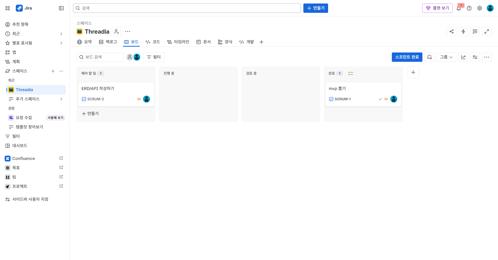
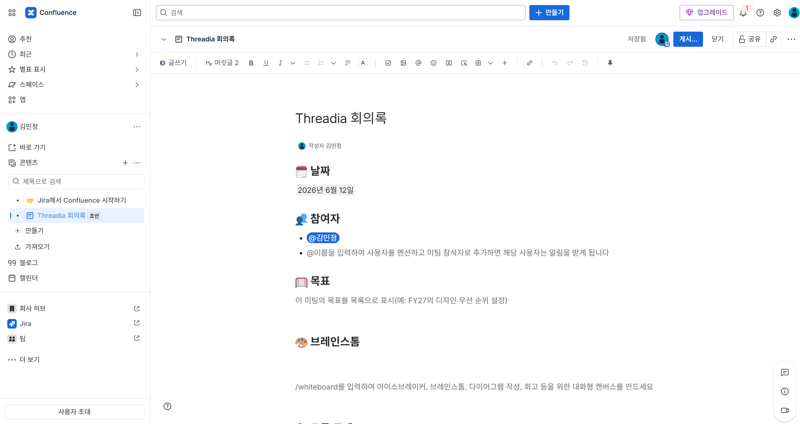
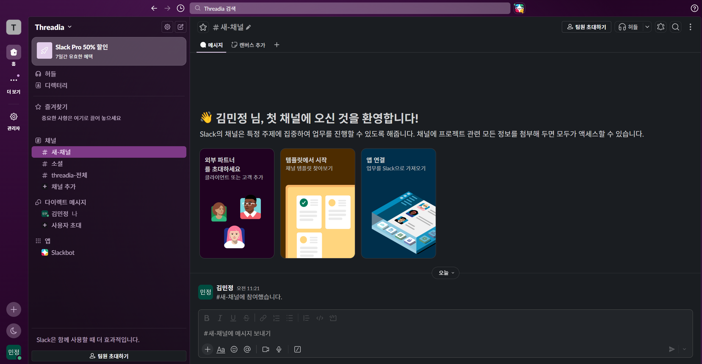

# Threadia 프로젝트 기획서

> Thread + idea/area — 모든 논의가 쓰레드로 남고, 문서·이슈와 이어지는 협업 플랫폼

---

## 목차

1. [프로젝트 개요](#1-프로젝트-개요)
2. [기획 배경 및 목적](#2-기획-배경-및-목적)
3. [서비스 소개](#3-서비스-소개)
4. [팀 구성](#4-팀-구성)
5. [기술 스택](#5-기술-스택)
6. [사용자 정의](#6-사용자-정의)
7. [주요 기능](#7-주요-기능)
8. [사용자 시나리오 요약](#8-사용자-시나리오-요약)
9. [화면 구성](#9-화면-구성)
10. [개발 일정 및 MVP 범위](#10-개발-일정-및-mvp-범위)
11. [기대 효과](#11-기대-효과)

---

## 1. 프로젝트 개요

| 항목 | 내용 |
|---|---|
| **프로젝트명** | Threadia |
| **부제** | 개발팀을 위한 경량 통합 협업 플랫폼 |
| **개발 기간** | 2026년 6월 10일 ~ 2026년 7월 26일 (총 6주) |
| **개발 인원** | 6명 |
| **주요 참고 서비스** | Jira, Confluence, Slack |
| **핵심 차별점** | 채팅·이슈·문서를 오가지 않고 하나의 흐름에서 연결 |

### 1.1 프로젝트명 Threadia의 의미

**Threadia**는 **Thread** + **idea / area** 를 합성한 이름이다.

| 구성 요소 | 의미 |
|---|---|
| **Thread** | 이슈·문서·메시지가 모두 쓰레드 하나에 연결되는 핵심 구조를 직접 가리킴 |
| **idea** | 채팅에서 나온 아이디어가 이슈로, 이슈가 문서로 이어지는 흐름 — 논의가 생각으로 끝나지 않고 실행으로 남는 것 |
| **area** | 프로젝트·채팅·문서가 분산되지 않고 하나의 공간(area) 안에서 연결된다는 통합 협업 공간 개념 |

Jira, Confluence, Slack을 오가며 맥락이 단절되는 기존 방식과 달리, Threadia는 **모든 논의가 쓰레드로 남고 문서·이슈와 이어지는** 구조를 이름 자체에 담는다. Linear, Figma처럼 기능을 직접 나열하지 않으면서도 서비스 정체성이 느껴지는 부드러운 SaaS 이름을 지향했다.

---

## 2. 기획 배경 및 목적

### 2.1 문제 정의

현업 개발팀은 일반적으로 Jira(이슈 관리), Confluence(문서화), Slack(채팅)을 각각 사용한다. 세 도구는 독립적으로는 우수하지만 실제 업무 흐름에서는 다음과 같은 **맥락 단절(Context Switching)** 문제가 반복된다.

| 문제 | 내용 |
|---|---|
| 맥락 소실 | Slack 대화는 이슈와 분리되어 결정 근거가 남지 않음 |
| 중복 작업 | 채팅 내용을 Jira에 다시 옮겨 입력해야 함 |
| 도구 피로 | 3개 이상의 도구를 동시에 유지하는 비용 |
| 진입 장벽 | 중·소규모 팀에 비해 운영 비용이 과함 |

### 2.2 주제 선정 이유

팀 내 협업 도구를 직접 사용하면서 느낀 불편함에서 출발했다. 채팅에서 나온 중요한 결정이 대화 흐름에 묻혀 사라지거나, 이슈를 등록하기 위해 여러 탭을 오가는 과정이 반복되었다. 이를 해결하기 위해 **채팅·이슈·문서·알림을 하나의 흐름으로 연결하는 경량 협업 플랫폼**을 직접 설계·구현하는 것을 목표로 주제를 선정했다.

### 2.3 개발 목적

- 채팅 메시지에서 이슈를 바로 생성해 맥락(원본 대화)을 보존한다.
- 이슈·문서·쓰레드를 서로 연결해 결정 근거가 흩어지지 않게 한다.
- Jira·Confluence·Slack 3종 도구의 핵심 기능을 단일 서비스로 통합해 중·소규모 팀의 도구 운영 비용을 낮춘다.

---

## 3. 서비스 소개

> Jira + Confluence + Slack의 핵심 기능을 하나로 잇는 개발팀용 경량 협업 플랫폼

```
기존 흐름
Slack 논의 → Jira 이슈 등록 → Confluence 문서화 → 다시 Jira에 링크 복사
→ 누가 어디서 결정했는지 추적 불가

Threadia 흐름
채팅 메시지 → 이슈 생성(원본 링크 보존) → 쓰레드에서 논의 보존
→ 문서에 결정사항 정리 → 알림으로 변경사항 회수
```

---

## 4. 팀 구성

> 아래 담당 업무는 현재까지 수행한 업무 기준이며, 개발 착수 이후 최종 역할은 별도로 확정한다.

| 이름 | 역할 | 현재까지 담당 업무 |
|---|---|---|
| 황스일 | 팀장 | 기획 검토, repo 세팅, README |
| 정철진 | 부팀장 / Front-end 전담 | 화면 설계도, 화면 정의서 |
| 여도현 | 팀원 | 기능 분해도 작성 |
| 김태준 | 팀원 | 기능 분해도 작성 |
| 김민정 | 팀원 | 사용자별 시나리오 작성, 기획안 작성 |
| 김민경 | 팀원 | 사용자별 시나리오 작성 |

---

## 5. 기술 스택

| 영역 | 기술 |
|---|---|
| **Frontend** | React, Next.js, Three.js |
| **Backend** | Spring Boot |
| **Database** | MySQL 8.4 |
| **Infra** | AWS EC2, AWS S3 |
| **문서 형식** | Markdown (.md) |

| 기술 | 선택 이유 |
|---|---|
| Three.js | 3D 사무실 메인 허브(S03) 구현 |
| MySQL | 알림·권한 등 관계형 데이터 중심 구조, Redis/NoSQL은 MVP 이후 검토 |
| AWS S3 | 회사 로고·파일 첨부 저장 |
| Markdown | 전체 문서를 `.md` 형식으로 통일해 렌더링 일관성 확보 |

---

## 6. 사용자 정의

> 권한은 사용자 계정에 고정하지 않고 **회사 소속·프로젝트 소속 관계**에 부여한다.
> 같은 사용자가 어느 회사에서는 C, 다른 프로젝트에서는 A일 수 있다.

| 코드 | 유형 | 관리 범위 | 주요 역할 |
|---|---|---|---|
| **A** | 일반 사용자 | 소속 프로젝트 | 이슈 처리, 문서 작성, 알림 확인 |
| **P** | 프로젝트 관리자 | 특정 프로젝트 | Sprint 운영, 멤버 관리, 검토 승인 |
| **C** | 회사 관리자 | 특정 회사 | 회사·구성원·권한 관리, 프로젝트 조망 |
| **F** | 플랫폼 관리자 | 전체 플랫폼 | 전체 회사·서비스 운영 (**MVP 보류**) |

---

## 7. 주요 기능

| # | 기능 | 설명 |
|---|---|---|
| 1 | 3D 메인 허브 | Three.js 기반 3D 사무실에서 프로젝트·채팅·알림 진입 |
| 2 | 칸반 보드 | 백로그/할일/진행중/검토중/완료 5단계 이슈 관리 |
| 3 | Sprint 관리 | 백로그 정리, Sprint 생성·시작·종료 |
| 4 | Markdown 문서 | `.md` 기반 문서·회의록 작성 및 이슈 연결 |
| 5 | 프로젝트 채팅 | 채팅 메시지에서 이슈 원클릭 생성, 원본 링크 보존 |
| 6 | 쓰레드 | 이슈·문서·메시지마다 대표 쓰레드로 논의 보존 |
| 7 | 알림 | 업무·문서·멘션·권한 변경 알림 통합 관리 (MySQL 기반) |
| 8 | 권한 관리 | A / P / C 역할 기반 접근 제어 |

### 핵심 차별 기능 — 문서·이슈·메시지 연결

이 서비스의 핵심은 채팅, 업무, 문서가 따로 남지 않고 **서로 연결**되는 것이다.

```
채팅 메시지 ──이슈로 만들기──▶ 이슈
                                  │
                              쓰레드(논의 보존)
                                  │
                          ◀── 양방향 연결 ──▶ 문서
                                                │
                                          수정/댓글 이벤트
                                                │
                                              알림
```

| 연결 | 동작 |
|---|---|
| 메시지 → 이슈 | 채팅 메시지를 이슈로 생성, 원본 메시지 링크 보존 |
| 이슈 → 쓰레드 | 이슈별 대표 쓰레드에서 논의 기록 |
| 이슈 ↔ 문서 | 이슈에서 관련 문서 열기, 문서에서 이슈 상태 확인 |
| 문서/쓰레드 → 알림 | 수정·댓글·멘션 이벤트가 MySQL 알림으로 저장 |

> 상세 기능 목록은 별첨 **기능 분해표.md** 참조

---

## 8. 사용자 시나리오 요약

| ID | Actor | 목표 |
|---|---|---|
| SC-C-01 | C 회사 관리자 | 최초 로그인 후 회사 정보 등록, 구성원 초대, 권한 위임 |
| SC-C-02 | C 회사 관리자 | 여러 프로젝트 현황 파악, 이슈 쓰레드에 의사결정 기록 |
| SC-P-01 | P 프로젝트 관리자 | Sprint 구성, 이슈 관리, 문서·쓰레드 운영 |
| SC-A-01 | A 일반 사용자 | 담당 이슈 수행, 채팅·쓰레드·문서 한 흐름으로 처리 |
| SC-LINK-01 | A / P / C | 채팅 메시지 → 이슈 생성 → 문서 연결 → 알림 회수 |

> 각 시나리오의 Main Flow와 Success Condition은 별첨 **사용자 시나리오.md** 참조

---

## 9. 화면 구성

### 전체 화면 흐름

```
서비스 진입
└── S01 로그인
    ├── S02 회원가입
    └── S03 3D 사무실 메인 허브
        ├── S04 프로젝트 목록
        │   ├── S05 칸반 보드 ── S10 쓰레드
        │   ├── S06 백로그 / 스프린트
        │   ├── S07 문서·회의록 목록 ── S08 문서 편집기
        │   └── S12 프로젝트 설정
        ├── S09 프로젝트 채팅 / 1:1 DM(선택) ── S10 쓰레드
        ├── S11 알림
        └── S13 회사 관리 (C 전용)
            └── S14 구성원·권한 관리

MVP 보류
└── S15 플랫폼 관리자 대시보드
```

### 화면 목록

| ID | 화면명 | 접근 사용자 | MVP 상태 |
|---|---|---|---|
| S01 | 로그인 | 비로그인 | MVP |
| S02 | 회원가입 | 비로그인 | MVP |
| S03 | 3D 사무실 메인 허브 | A/P/C | MVP |
| S04 | 프로젝트 목록 | A/P/C | MVP |
| S05 | 칸반 보드 | A/P/C | MVP |
| S06 | 백로그 / 스프린트 | A/P/C | MVP |
| S07 | 문서·회의록 목록 | A/P/C | MVP |
| S08 | 문서 편집기 | A/P/C | MVP |
| S09 | 프로젝트 채팅 / 1:1 DM | A/P/C | MVP(채팅) / 선택(DM) |
| S10 | 쓰레드 | A/P/C | MVP |
| S11 | 알림 | A/P/C | MVP |
| S12 | 프로젝트 설정 | P/C | MVP |
| S13 | 회사 관리 | C | MVP |
| S14 | 구성원·권한 관리 | C | MVP |
| S15 | 플랫폼 관리자 대시보드 | F | 보류 |

> 각 화면의 목적·데이터·액션·연결 기능 상세는 별첨 **화면 정의서.md** 참조

---

## 10. 개발 일정 및 MVP 범위

### 개발 일정

전체 개발 기간은 총 5주로 구성하며, 1주차에 기획 및 문서 작업을 완료한 후 2~4주차에 집중 개발을 진행하고, 5주차에 디버깅 및 발표 준비를 마무리한다.

#### 1주차 — 기획 및 문서 작업 완료 (Day 1 ~ Day 5)

| 일차 | 주요 내용 | 산출물 |
|---|---|---|
| Day 1 | 프로젝트 주제 선정, 벤치마킹 분석, 팀 역할 분담 | 프로젝트 방향 문서, 팀 분업표 |
| Day 2 | 기능 분해도·화면 정의서·사용자 시나리오 1차 분업 작성 및 통합 정리 | 기능 분해표, 사용자 시나리오, 화면 정의서 |
| Day 3 | 최종본 교차 검토, 프로젝트명 확정, ERD·API·권한 정책 설계 착수 | 기획서 초안, ERD 초안, API 명세서 초안, 권한 범위 문서, GitHub repository |
| Day 4 | AWS 사용 범위 정리, 보류 기능 최종 확정, 기획 산출물 전체 리뷰 | AWS 판단표, 보류 기능 최종표 |
| Day 5 | 전체 기획 문서 최종 확정 및 개발 착수 준비 | 기획 최종 확정본 전체 |

#### 2~4주차 — 집중 개발 (총 3주)

| 주차 | 주요 내용 |
|---|---|
| 2주차 (개발 1주차) | 인증(로그인·회원가입), RBAC, 회사·구성원 관리, 3D 메인 허브 구현 |
| 3주차 (개발 2주차) | 프로젝트·칸반·Sprint 기능, Markdown 문서 편집기, 이슈 관리 구현 |
| 4주차 (개발 3주차) | 프로젝트 채팅, 쓰레드, 알림, 문서·이슈·메시지 연결 기능 구현 |

#### 5주차 — 디버깅 및 발표 준비

| 구분 | 주요 내용 |
|---|---|
| 디버깅 | 기능별 통합 테스트, 버그 수정, AWS EC2 배포 확인 |
| 발표 준비 | 시연 시나리오 구성, 발표 자료 제작, 최종 점검 |

### MVP 범위 요약

| 구분 | 기능 |
|---|---|
| **MVP** | 인증, RBAC, 3D 허브, 프로젝트 관리, 칸반, Sprint, 문서, 채팅, 쓰레드, 알림, 회사·구성원 관리 |
| **선택** | 1:1 DM, 문서 댓글, 알림 세부 설정, 통합 검색, 파일 첨부, 활동 피드 |
| **보류** | 플랫폼 관리자(F/S15), Redis/NoSQL 알림, 칸반 컬럼 커스터마이징, 동시 문서 편집 |

---

## 11. 기대 효과

| 효과 | 내용 |
|---|---|
| 맥락 단절 해소 | 채팅·이슈·문서·알림이 연결되어 결정 근거가 흩어지지 않음 |
| 도구 통합 | Jira·Confluence·Slack 3개 도구를 단일 서비스로 대체 |
| 역할 기반 접근 | A/P/C 권한 분리로 팀 내 역할에 맞는 정보만 접근 가능 |
| 추적 가능한 의사결정 | 모든 결정이 쓰레드에 남아 프로젝트 히스토리 관리 용이 |
| 경량 운영 | 중·소규모 개발팀에 맞는 가벼운 협업 도구 제공 |

---

*별첨 문서: 기능 분해표.md · 사용자 시나리오.md · 화면 정의서.md*

---

## 12. 참고 사이트

본 프로젝트는 아래 서비스의 핵심 기능을 분석·벤치마킹하여 서비스 기획의 기초 자료로 활용하였다.

| 서비스 | 역할 | 링크 |
|---|---|---|
| **Jira** | 이슈 관리 및 칸반·Sprint 운영 참고 | [https://www.atlassian.com/software/jira](https://www.atlassian.com/software/jira) |
| **Confluence** | 문서·회의록 편집기 및 이슈 연결 구조 참고 | [https://www.atlassian.com/software/confluence](https://www.atlassian.com/software/confluence) |
| **Slack** | 프로젝트 채팅, 쓰레드, 알림 구조 참고 | [https://slack.com](https://slack.com) |

**Jira**


**Confluence**


**Slack**

