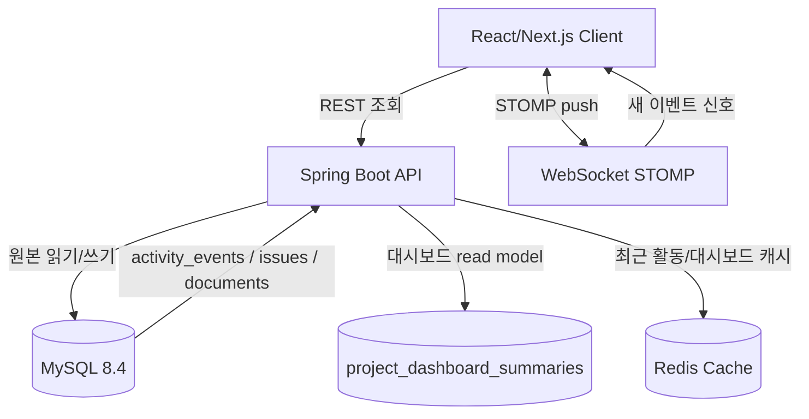

# FEED/SEARCH/DASH 조건부 확장 계획서

> **작성자**: Threadia 팀  
> **작성일**: 2026-06-15  
> **최종 수정**: 2026-06-15  
> **버전**: v1.0  
> **상태**: 검토 중  
> **대상 스택**: Spring Boot 3.x + MySQL 8.4 + React/Next.js

---

## 1. 배경

기존 기능 분해표에서는 `FEED-01`, `SEARCH-01`, `DASH-01~04`가 선택 기능으로 분류되어 있다. 그러나 이 세 기능을 MVP 또는 Sprint 1 범위에 정식 편입할 경우, 기존 `Spring Boot + MySQL 8.4` 중심 구조를 유지하되 일부 조건부 확장 요소를 함께 계획해야 한다.

이 문서는 다음 조건을 전제로 한다.

- `FEED-01` 프로젝트 활동 피드를 Sprint 1 범위에 포함한다.
- `SEARCH-01` 통합 검색은 1차 구현 범위를 제한하고, 별도 검색 엔진은 보류한다.
- `DASH-01~04` 프로젝트 홈/대시보드는 집계 API 중심으로 구현한다.
- `STOMP push`, `Redis cache`, `summary table`은 조건부 확장 요소로 채택한다.
- `Typesense` 또는 `Meilisearch`는 Sprint 1 이후 보류 항목으로 넘긴다.

---

## 2. 최종 방향

| 영역 | Sprint 1 적용 | 조건부 확장 | 보류 |
|---|---|---|---|
| 활동 피드 | `activity_events` MySQL 원장 | STOMP push, Redis cache | NoSQL feed store |
| 통합 검색 | MySQL 기반 제한 검색 | MySQL FULLTEXT 검토 | Typesense, Meilisearch |
| 대시보드 | MySQL aggregate API | summary table, Redis cache | 별도 OLAP/검색 엔진 |
| 실시간 갱신 | REST 조회 + 필요한 이벤트만 push | WebSocket STOMP push | 외부 message broker |

결론적으로 Sprint 1은 MySQL을 최종 원본으로 유지한다. Redis는 원본 저장소가 아니라 캐시와 push 보조 계층으로만 사용한다. 검색 전용 엔진은 MVP 범위를 넘는 운영 요소로 보고 보류한다.

---

## 3. 기능별 구현 계획

### 3.1 `FEED-01` 프로젝트 활동 피드

활동 피드는 `activity_events` 테이블을 기준으로 구현한다. 이 테이블은 "누가, 어떤 프로젝트에서, 무엇을 했다"를 기록하는 append-only 원장이다.

```text
activity_events
  - id
  - project_id
  - actor_id
  - event_type
  - target_type
  - target_id
  - payload JSON
  - created_at
```

#### 1차 구현

- 이슈 상태 변경, 담당자 변경, 문서 생성/수정, 댓글/멘션, Sprint 시작/종료 이벤트를 기록한다.
- 클라이언트는 `GET /api/v1/projects/{projectId}/activity-events`로 최신 활동을 조회한다.
- 조회 기준은 `project_id`, `created_at`, `event_type` 인덱스를 우선 사용한다.
- feed 목록은 cursor 또는 `created_at` 기반 pagination으로 제공한다.

#### 조건부 확장: STOMP push

활동 이벤트 저장 후 WebSocket STOMP로 새 이벤트 신호를 push한다.

```text
이벤트 발생
  -> MySQL activity_events INSERT
  -> /topic/projects.{projectId}.activity 로 STOMP push
  -> Client는 push 수신 후 REST API로 최신 feed 재조회
```

STOMP 메시지에는 전체 feed payload를 싣지 않는다. push는 "새 활동이 생겼다"는 신호로 제한하고, 실제 목록은 REST API와 MySQL 원장을 기준으로 다시 조회한다.

#### 조건부 확장: Redis cache

Redis는 최근 활동 목록 캐시로 사용한다.

```text
activity:project:{projectId}:latest = 최근 activity event id 목록
```

- 자료구조는 Sorted Set 또는 List를 사용한다.
- score는 `created_at` timestamp를 사용한다.
- 캐시 miss 또는 장애 시 MySQL에서 다시 조회한다.
- Redis에 저장된 값은 원본이 아니며, 재생성 가능한 캐시로 취급한다.

---

### 3.2 `SEARCH-01` 통합 검색

Sprint 1의 통합 검색은 별도 검색 엔진 없이 MySQL 기반 제한 검색으로 구현한다. 검색 대상은 프로젝트 내부의 핵심 객체로 제한한다.

#### 1차 검색 대상

| 대상 | 검색 필드 | 비고 |
|---|---|---|
| Issue | title, description | 프로젝트 권한 필터 필수 |
| Document | title, content | 휴지통/삭제 상태 제외 |
| Thread | title, comment body | 접근 가능한 프로젝트 범위만 검색 |
| Message | content | 프로젝트 채팅 메시지 우선, DM은 제외 가능 |

#### 1차 구현

- `GET /api/v1/search?q={keyword}&projectId={projectId}` 형태로 시작한다.
- 검색 결과는 `type`, `id`, `title`, `snippet`, `updatedAt` 형태로 통일한다.
- SQL `LIKE` 또는 MySQL FULLTEXT를 사용한다.
- 검색 정확도보다 MVP 시연 가능한 통합 진입점을 우선한다.

#### 보류: Typesense 또는 Meilisearch

`Typesense` 또는 `Meilisearch`는 Sprint 1에서 도입하지 않는다.

보류 사유는 다음과 같다.

- 별도 검색 서버 운영과 배포 구성이 추가된다.
- MySQL 원본 데이터와 검색 index 동기화 로직이 필요하다.
- 한글 검색 품질, typo tolerance, facet, highlighting 요구가 아직 확정되지 않았다.
- Sprint 1에서는 검색 품질보다 핵심 협업 흐름 완성이 우선이다.

도입 검토 시점은 다음 조건이 발생했을 때로 제한한다.

- MySQL FULLTEXT 또는 `LIKE` 검색 품질이 발표/사용성 기준을 충족하지 못한다.
- 검색이 Threadia의 핵심 차별 기능으로 재정의된다.
- 이슈, 문서, 메시지 데이터가 증가해 MySQL 검색 응답 시간이 명확히 느려진다.
- typo tolerance, facet, highlighting, search-as-you-type가 필수 요구사항으로 확정된다.

---

### 3.3 `DASH-01~04` 프로젝트 홈/대시보드

대시보드는 별도 분석 DB 없이 MySQL aggregate query로 구현한다. Sprint 1에서는 프로젝트 운영에 필요한 요약 정보를 제공하는 수준으로 제한한다.

#### 포함 범위

| 기능 | 구현 방식 |
|---|---|
| `DASH-01` 프로젝트 진행률 조회 | issue status별 count, sprint 진행률 계산 |
| `DASH-02` 최근 이슈 조회 | `issues.updated_at` 기준 latest query |
| `DASH-03` 최근 문서 조회 | `documents.updated_at` 기준 latest query |
| `DASH-04` 최근 활동/Sprint 상태 조회 | `activity_events`, `sprints` aggregate query |

#### 1차 구현

- `GET /api/v1/projects/{projectId}/dashboard` 단일 summary API를 제공한다.
- 응답은 progress, recentIssues, recentDocuments, recentActivities, sprintSummary로 나눈다.
- 각 항목은 5~10개 이내로 제한한다.
- 모든 조회에는 프로젝트 멤버 권한 검사를 적용한다.

#### 조건부 확장: summary table

대시보드 집계 쿼리가 복잡해지거나 반복 호출이 많아지면 summary table을 도입한다.

```text
project_dashboard_summaries
  - project_id
  - issue_total_count
  - issue_done_count
  - issue_in_progress_count
  - document_count
  - activity_count_today
  - sprint_id
  - sprint_progress_rate
  - refreshed_at
```

summary table은 원본이 아니라 read model이다. 원본은 `issues`, `documents`, `activity_events`, `sprints` 테이블이다.

갱신 방식은 다음 중 하나를 선택한다.

| 방식 | 설명 | Sprint 1 적합도 |
|---|---|---:|
| 요청 시 계산 | API 호출 시 MySQL aggregate query 실행 | 높음 |
| 이벤트 발생 시 갱신 | 이슈/문서/활동 이벤트 발생 시 summary row 갱신 | 중간 |
| 주기적 갱신 | scheduler로 일정 주기마다 summary row 재계산 | 중간 |

Sprint 1에서는 요청 시 계산을 기본으로 하고, 성능 문제가 확인되면 summary table을 추가한다.

#### 조건부 확장: Redis cache

대시보드 응답 전체 또는 일부 count 값을 Redis에 캐시한다.

```text
dashboard:project:{projectId}:summary = dashboard summary JSON
```

- TTL은 30~60초로 짧게 둔다.
- Sprint 시연 기준에서는 약간의 지연 허용이 가능하다.
- 캐시 무효화는 이슈 상태 변경, 문서 수정, 활동 이벤트 생성 시 수행한다.
- Redis 장애 시 MySQL aggregate query로 fallback한다.

---

## 4. 조건부 확장 구조



이 구조에서 MySQL은 최종 원본이다. Redis와 summary table은 조회 성능과 사용자 경험을 위한 보조 계층이다. STOMP push는 실시간 신호 전달에만 사용한다.

---

## 5. 채택/보류 판단표

| 기술/구조 | 판단 | 이유 |
|---|---|---|
| MySQL `activity_events` | 채택 | 활동 피드 원장으로 적합하고 기존 ERD 방향과 일치한다. |
| MySQL aggregate query | 채택 | Sprint 1 대시보드 규모에서는 별도 분석 DB가 필요하지 않다. |
| STOMP push | 조건부 채택 | 채팅/알림 WebSocket 채널과 함께 사용할 수 있고 실시간 신호에 적합하다. |
| Redis cache | 조건부 채택 | unread count, 최근 활동, dashboard summary 캐시에 적합하다. 단, 원본 저장소로 쓰지 않는다. |
| summary table | 조건부 채택 | 대시보드 반복 집계 비용이 커질 때 read model로 사용한다. |
| Typesense | 보류 | 검색 서버 운영과 index 동기화 비용이 Sprint 1 범위를 넘는다. |
| Meilisearch | 보류 | 검색 품질 고도화 시 검토할 수 있으나 Sprint 1 필수 요소는 아니다. |
| Elasticsearch/OpenSearch | 제외 | 6주 MVP에 비해 운영, 튜닝, 배포 부담이 크다. |
| NoSQL feed store | 제외 | 프로젝트 단위 활동 피드는 MySQL + 인덱스로 충분하다. |
| Supabase Realtime | 제외 | PostgreSQL 중심 구조라 현재 MySQL 스택과 맞지 않는다. |

---

## 6. Sprint 1 구현 순서

### Step 1. MySQL 원장 확정

- `activity_events` 테이블을 생성한다.
- `notification_events`와 역할을 분리한다.
- 주요 이벤트 발생 지점에서 activity event를 저장한다.

### Step 2. REST API 구현

- 활동 피드 조회 API를 구현한다.
- 통합 검색 API를 제한 범위로 구현한다.
- 프로젝트 대시보드 summary API를 구현한다.

### Step 3. STOMP push 연결

- activity event 생성 후 프로젝트 topic으로 새 이벤트 신호를 보낸다.
- 클라이언트는 push 수신 후 REST API로 최신 데이터를 다시 조회한다.
- push 실패가 데이터 손실로 이어지지 않도록 MySQL 원장을 기준으로 복구 가능하게 한다.

### Step 4. Redis cache 추가

- 최근 활동 목록 캐시를 추가한다.
- dashboard summary cache를 추가한다.
- unread count cache는 알림 기능과 연결해 별도 key로 관리한다.

### Step 5. summary table 도입 여부 판단

- dashboard aggregate query가 느려질 경우 `project_dashboard_summaries`를 추가한다.
- 성능 문제가 없으면 Sprint 1에서는 aggregate query만 유지한다.

### Step 6. 검색 엔진 보류 기록

- `Typesense`, `Meilisearch`는 Sprint 1 backlog에서 제외한다.
- 검색 품질 문제가 확인되면 Sprint 2 이후 기술 검토 항목으로 재등록한다.

---

## 7. 리스크와 대응

| 리스크 | 영향 | 대응 |
|---|---|---|
| Redis 장애 | 캐시 miss, push 지연 | MySQL 원장 조회로 fallback한다. |
| STOMP 연결 끊김 | 실시간 신호 누락 | 클라이언트 재연결 후 REST API로 최신 상태를 동기화한다. |
| dashboard aggregate query 지연 | 프로젝트 홈 응답 지연 | summary table 또는 Redis cache를 추가한다. |
| MySQL 검색 품질 부족 | 통합 검색 만족도 하락 | Sprint 2 이후 Typesense/Meilisearch 검토로 넘긴다. |
| 활동 이벤트 중복 저장 | feed 중복 노출 | 이벤트 생성 지점과 idempotency key를 정의한다. |

---

## 8. 발표용 요약

```text
FEED, SEARCH, DASH를 Sprint 1 범위로 올리더라도 MySQL을 최종 원본으로 유지한다.
활동 피드는 activity_events 테이블에 저장하고, STOMP push는 새 이벤트 신호 전달에만 사용한다.
대시보드는 MySQL aggregate query로 시작하되, 반복 조회 비용이 커지면 Redis cache와 summary table을 추가한다.
통합 검색은 MySQL 기반 제한 검색으로 구현하고, Typesense 또는 Meilisearch는 검색 품질 고도화가 필요해진 뒤 검토한다.
```

---

## 9. 참고 문서

- [실시간-아키텍처-연구.md](./실시간-아키텍처-연구.md)
- [비정형 DB 기반 알림기능 구조 비교.md](../../02_기획주간_2일차_자료/알림기능/비정형%20DB%20기반%20알림기능%20구조%20비교.md)
- [기능 분해표 v2.md](../../03_기획주간_3일차_자료/최종%20산출물/기능%20분해표%20v2.md)
