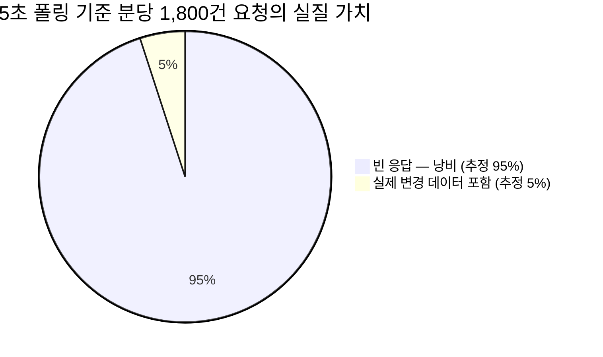
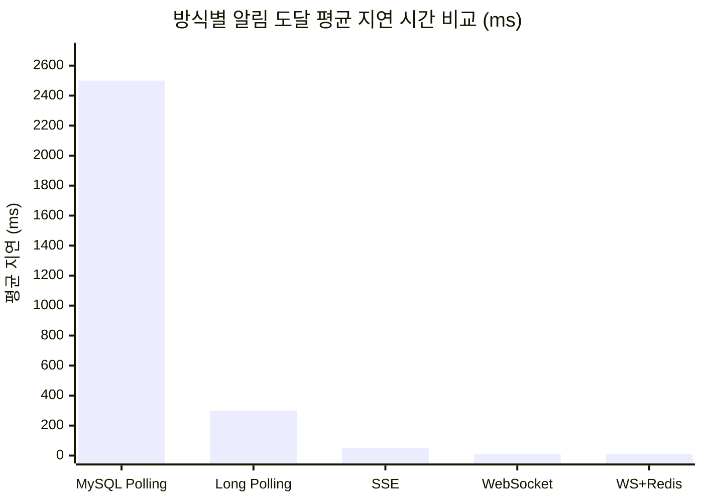
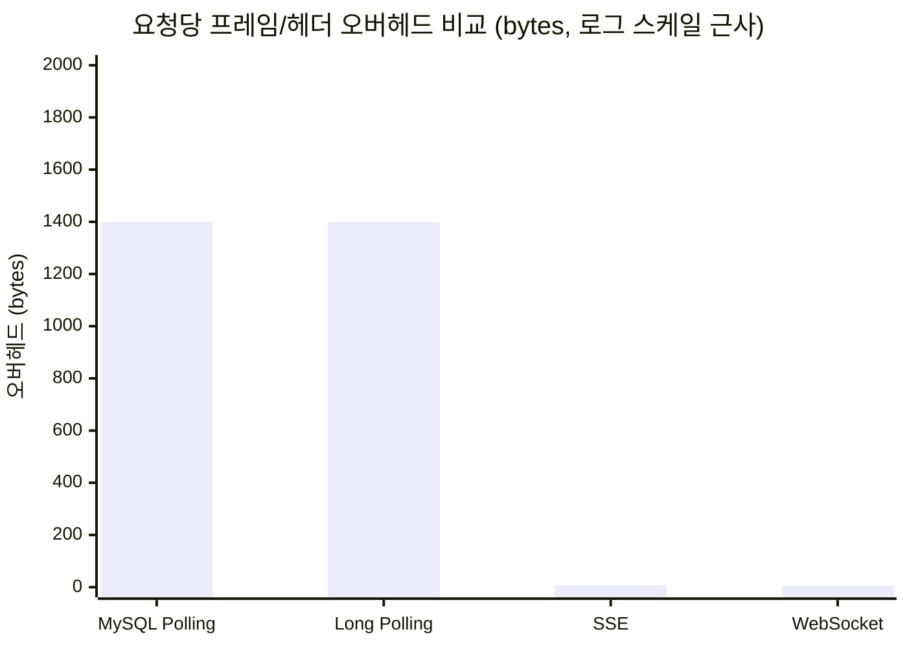
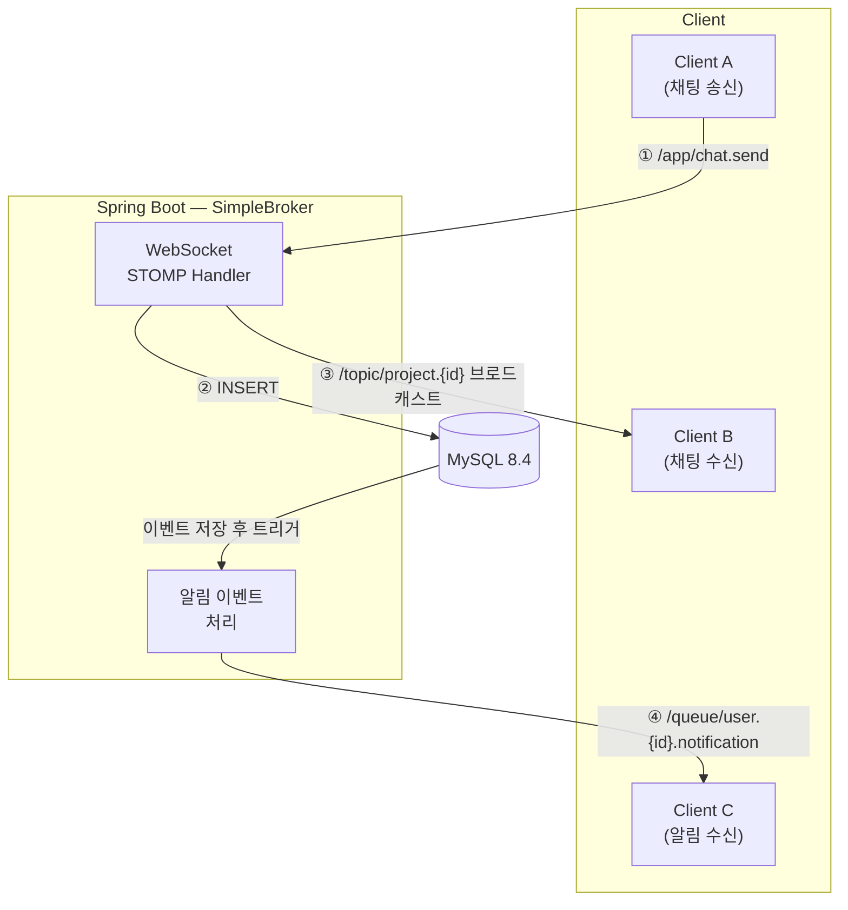
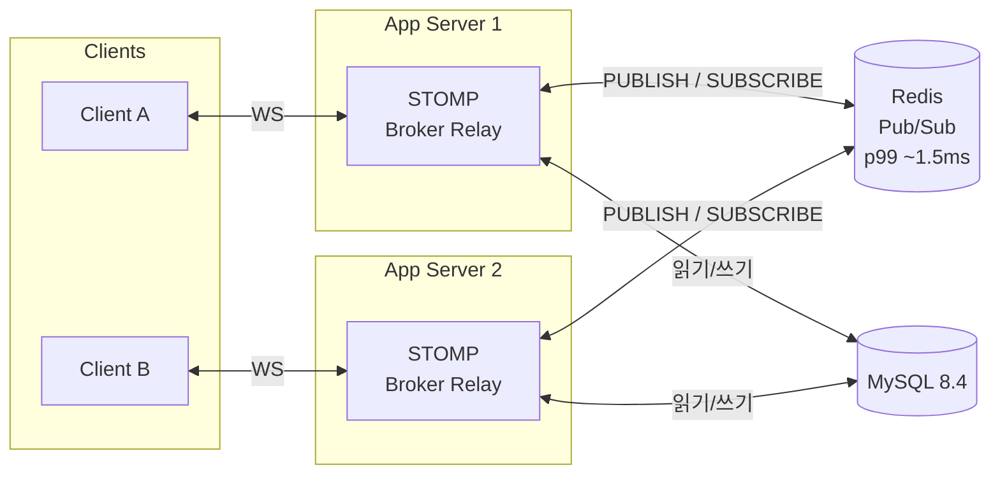

# Threadia 실시간 아키텍처 연구

> **주제**: MySQL Polling의 한계와 실시간 알림/활동 피드 아키텍처 선택  
> **작성일**: 2026-06-15  
> **대상 스택**: Spring Boot 3.x + MySQL 8.4 + React/Next.js  
> **프로젝트 규모**: 6주 MVP, 소규모 팀

---

## 1. 문제 제기

### 1-1. 현재 MVP 설계의 한계

Threadia MVP는 알림·채팅 읽지 않은 메시지 수를 REST API 폴링(setInterval)으로 처리하는 방향으로 초안이 잡혀 있다.  
구체적으로 실시간 처리가 필요한 영역은 4가지다.

| 영역 | 현재 MVP 방법 | 문제 |
|---|---|---|
| 채팅 읽지 않은 수 (`project_chat_member_states`) | n초마다 GET 폴링 | DB SELECT 반복, 지연 발생 |
| DM 읽지 않은 수 (`dm_room_user_states`) | n초마다 GET 폴링 | 동일 |
| 프로젝트 알림 (`notification_events`) | n초마다 GET 폴링 | 알림이 늦게 뜸 |
| 활동 피드 (`activity_events`, MVP 보류) | 미구현 | 확장 시 N+1 문제 예정 |

**핵심 문제**: 클라이언트가 5초 간격으로 폴링한다고 가정하면, 동시 접속자 50명 × 3개 엔드포인트(채팅/DM/알림) 기준 **분당 1,800건**의 HTTP 요청이 발생한다. HTTP 요청 1건당 헤더 오버헤드가 평균 **800B~2KB**이므로, 데이터 변경이 없는 상태에서도 지속적인 네트워크 트래픽이 낭비된다. 실제로 대부분의 요청은 "변경 없음" 빈 응답이다.



### 1-2. ERD v1.4가 남긴 질문

ERD v1.4에서 `activity_events` 테이블을 **"선택/권장 내부 원장"** 으로 정의하고,  
"구현 여력에 따라 `notification_events`와 통합 가능"이라는 주석을 달았다.

이는 다음 기술 선택을 예고한다:
- MySQL 단일 테이블로 통합할 것인가?
- 별도 스트림(Redis / NoSQL)으로 분리할 것인가?
- 실시간 Push를 어떤 방식으로 구현할 것인가?

---

## 2. 기술 조사

### 2-1. 방식별 비교 개요

```
MySQL Polling → Long Polling → SSE → WebSocket+Redis → Supabase Realtime → NoSQL Stream
    단순 ◀─────────────────────────────────────────────────────▶ 복잡
    저성능 ◀────────────────────────────────────────────────────▶ 고성능
```

---

### 2-2. MySQL Short Polling (현재 MVP 방향)

**동작 방식**  
클라이언트가 `setInterval`로 주기적으로 REST API를 호출한다.

```
Client ──[GET /notifications?since=lastTs]──▶ Spring Boot ──▶ MySQL SELECT
Client ◀──[200 OK, data: []]─────────────────────────────────── (변경 없음)
   ↑  (5초 후 반복)
```

**장점**
- 구현이 가장 단순 (REST API만 있으면 됨)
- Spring Boot, MySQL 추가 설정 없음

**단점**
- 대부분의 요청이 빈 응답 → DB 부하 낭비
- 알림 지연 = 폴링 간격 전체 (5초 간격 기준 최대 **5,000ms**, 평균 **2,500ms** 지연)
- HTTP 요청당 헤더 오버헤드 평균 800B~2KB → WebSocket 프레임(2~10 bytes) 대비 최대 **1,000배** 낭비
- 100,000 클라이언트가 10초마다 폴링 시 대역폭 **66 Mbps** 소비 (WebSocket 동일 규모 대비 약 423배)
- 동시 접속자 증가 시 선형적으로 DB 부하 증가



**적합한 경우**: 동시 접속자 < 20명, 즉각적인 알림 응답이 필요하지 않은 내부 도구

---

### 2-3. Long Polling

**동작 방식**  
클라이언트가 요청을 보내면 서버는 새 이벤트가 생길 때까지 응답을 보류한다.

```
Client ──[GET /notifications/poll]──▶ Spring Boot (연결 유지, 최대 30초)
                                              │
                                     이벤트 발생 시 즉시 응답
Client ◀──[200 OK, data: [새 알림]]──────────┘
   └──▶ 즉시 다음 요청 전송
```

**장점**
- Short Polling 대비 응답 지연 대폭 감소 (이벤트 발생 즉시 응답)
- 추가 인프라 불필요

**단점**
- 서버가 연결을 유지해야 → 스레드 점유 (Spring MVC 기준)
- Spring WebFlux(비동기)로 전환하면 완화되나 학습 비용 증가
- 연결이 끊기면 재연결 로직 필요

**실측치**: PHP/MySQL 스택 연구에서 Short Polling 대비 평균 응답 시간이 0.38s로 줄어든 것을 확인  
(출처: [Evaluation of Long-Held HTTP Polling for PHP/MySQL Architecture](https://www.researchgate.net/publication/311289465_Evaluation_of_Long-Held_HTTP_Polling_for_PHP_MySQL_Architecture))

---

### 2-4. SSE (Server-Sent Events)

**동작 방식**  
HTTP 연결을 한 번 맺고, 서버가 단방향으로 이벤트를 스트리밍한다.

```
Client ──[GET /notifications/stream]──▶ Spring Boot (연결 유지)
Client ◀──[event: notification\ndata: {...}]── (서버 → 클라이언트 단방향)
Client ◀──[event: notification\ndata: {...}]──
Client ◀──[event: unread-count\ndata: {...}]──
```

**Spring Boot 구현 예시**
```java
@GetMapping(value = "/notifications/stream", produces = MediaType.TEXT_EVENT_STREAM_VALUE)
public SseEmitter streamNotifications(@AuthenticationPrincipal UserDetails user) {
    SseEmitter emitter = new SseEmitter(Long.MAX_VALUE);
    sseService.register(user.getUsername(), emitter);
    return emitter;
}
```

**장점**
- HTTP/1.1 기반으로 별도 프로토콜 불필요
- 자동 재연결 내장 (EventSource API)
- Spring MVC에서 `SseEmitter` 로 비교적 간단 구현
- 알림처럼 **서버 → 클라이언트 단방향** 에 최적

**단점**
- 단방향만 지원 (채팅 메시지 전송에는 별도 REST POST 필요)
- 멀티 서버 인스턴스 환경에서 연결이 분산됨 → Redis 없이는 크로스 인스턴스 브로드캐스트 불가
- 최대 동시 연결 수 제한 (브라우저당 도메인 6개 HTTP/1.1 한계 → HTTP/2로 완화)

**적합한 경우**: 알림 및 읽지 않은 메시지 수 Push에 SSE, 채팅 메시지 전송에는 REST POST 혼용

---

### 2-5. WebSocket + Redis Pub/Sub (Spring STOMP)

**동작 방식**  
WebSocket으로 양방향 채널을 유지하고, Redis가 멀티 인스턴스 간 메시지 브로커 역할을 한다.

```
Client A ──[WS 연결]──▶ App Server 1 ──[PUBLISH]──▶ Redis
Client B ──[WS 연결]──▶ App Server 2 ──[SUBSCRIBE]──▶ Redis
                                               │
                          App Server 2 ◀──[메시지]── Redis
                          Client B ◀──[WS 전달]──
```

**Spring Boot 핵심 설정**
```java
@Configuration
@EnableWebSocketMessageBroker
public class WebSocketConfig implements WebSocketMessageBrokerConfigurer {
    @Override
    public void configureMessageBroker(MessageBrokerRegistry registry) {
        registry.enableStompBrokerRelay("/topic", "/queue")
                .setRelayHost("localhost").setRelayPort(6379); // Redis
        registry.setApplicationDestinationPrefixes("/app");
    }
}
```

**Redis 성능 수치**
- 메시지 전달 p99 지연: **~1.5ms** (Pub/Sub 기준)
- 구독자 O(1) 라우팅: 구독자 1명 → 10,000명으로 늘어도 **처리 성능 동일** (해시 테이블 조회)

**Redis 역할 분리**

| 용도 | Redis 자료구조 | 내용 |
|---|---|---|
| 실시간 브로드캐스트 | Pub/Sub | 채팅 메시지, 알림 Push |
| 읽지 않은 수 캐시 | Hash / Counter | `unread:{userId}:{roomId}` |
| 온라인 상태 | Set | `online_users` |
| 활동 피드 캐시 | Sorted Set (score=timestamp) | 최근 활동 캐싱 |

**장점**
- 채팅 + 알림 + 활동 피드 모두 하나의 WS 연결로 처리
- WebSocket 프레임 오버헤드 **2~10 bytes** → HTTP 헤더(800B~2KB) 대비 최대 1,000배 경량
- 100,000 클라이언트 기준 대역폭 **156 Kbps** (HTTP 폴링 66 Mbps 대비 약 **423배 절감**)
- 단일 서버 최적화 시 **64MB 메모리**로 동시 WebSocket 연결 **10만 개** 처리 가능
- Redis Sorted Set은 활동 피드 타임라인 구조에 자연스럽게 맞음
- Spring Boot 공식 지원 (`spring-boot-starter-websocket`, `spring-boot-starter-data-redis`)
- 멀티 인스턴스 스케일아웃 가능

**단점**
- Redis 별도 설치·운영 필요
- STOMP 프로토콜 학습 비용
- 연결 상태 관리(reconnect, session) 로직 직접 구현 필요

**참고**: [Spring WebSocket and Redis Pub/Sub](https://dgempiuc.medium.com/spring-websocket-and-redis-pub-sub-a02af0dabddb), [spring-redis-websocket GitHub](https://github.com/RawSanj/spring-redis-websocket)

---

### 2-6. Supabase Realtime

**동작 방식**  
Elixir 기반 서버가 PostgreSQL WAL(Write-Ahead Log)을 읽어 변경 이벤트를 WebSocket으로 브로드캐스트한다.

```
PostgreSQL ──[WAL 변경]──▶ Supabase Realtime (Elixir) ──[WebSocket]──▶ Client
```

**주요 제한사항** (포트폴리오 핵심 포인트)

| 제한 | 내용 |
|---|---|
| Postgres 전용 | MySQL, MariaDB 연동 불가. **Threadia는 MySQL → 사용 불가** |
| DB 병목 | 구독자 100명 × 1 INSERT = DB에 100번 권한 확인 쿼리 발생 |
| 커넥션 수 제한 | Free 플랜: 200 connections, 메시지 처리량 제한 있음 |
| Delete 필터링 불가 | DELETE 이벤트는 WHERE 필터 적용 불가 |
| 지연 | WAL 처리 고유 지연 50~200ms |
| 벤더 종속 | Supabase 인프라에 종속 |
| RLS 복잡도 | Row Level Security 잘못 설계 시 전체 Realtime 오작동 |

**결론**: Supabase Realtime은 Supabase(PostgreSQL) 풀스택을 쓸 때만 합리적. Spring Boot + MySQL 조합에서는 **채택 불가**.

**참고**: [Supabase Realtime Limits](https://supabase.com/docs/guides/realtime/limits), [Why I ditched Supabase's Realtime](https://medium.com/@khushidiwan953/why-i-ditched-supabases-realtime-and-built-my-own-a6fc20c542d4), [Supabase Realtime in Production](https://www.agilesoftlabs.com/blog/2026/05/supabase-realtime-in-production-what)

---

### 2-7. NoSQL 활동 피드 (Fan-out 패턴)

활동 피드는 "누가 무엇을 했다"를 타임라인으로 보여주는 기능이다.  
Fan-out 방식은 두 가지로 나뉜다.

**Fan-out on Write (Push 모델)**
```
이벤트 발생 ──▶ 팔로워 전원의 피드 테이블에 즉시 INSERT
읽기 = O(1) (이미 쓰여있음)
쓰기 = O(팔로워 수) ← 팔로워가 많으면 폭발적
```

**Fan-out on Read (Pull 모델)**
```
이벤트 발생 ──▶ 이벤트 원장에 INSERT 1건
읽기 = O(팔로우 수) ← 구독 대상 전부 JOIN
쓰기 = O(1)
```

**Threadia 맥락에서의 활동 피드 규모**  
- 프로젝트 단위 피드 (멤버 최대 수십 명)
- "인스타그램/트위터"와 같은 수백만 팔로워 시나리오가 아님
- MySQL의 `activity_events` 테이블 + Fan-out on Read로 충분히 커버 가능

**NoSQL(MongoDB/Firestore)이 필요한 시점**  
- 이벤트가 초당 수천 건 이상 발생
- 스키마가 이벤트마다 달라 정규화 불가능한 경우
- Threadia MVP 규모에서는 MySQL + 인덱싱으로 충분

**참고**: [Fan-Out on Read System Architecture](https://scalabrix.medium.com/architecting-a-high-performance-fan-out-on-read-system-b0c7a5a58536), [News Feed System Design](https://liuzhenglaichn.gitbook.io/system-design/news-feed/design-a-news-feed-system)

---

## 3. 비교 요약표

| | MySQL Polling | Long Polling | SSE | WS + Redis | Supabase RT | NoSQL |
|---|---|---|---|---|---|---|
| **알림 지연** | 최대 5,000ms | ~즉시 | 즉시 | < 10ms | < 200ms | - |
| **양방향** | ✗ | ✗ | ✗ | ✅ | ✅ | - |
| **MySQL 호환** | ✅ | ✅ | ✅ | ✅ | ✗ | ✅ |
| **Spring 지원** | ✅ | ✅ | ✅ | ✅ (공식) | ✗ | ✅ |
| **추가 인프라** | 없음 | 없음 | 없음 | Redis 필요 | Supabase | NoSQL DB |
| **프레임 오버헤드** | 800B~2KB | 800B~2KB | 8 bytes | 2~10 bytes | 2~10 bytes | - |
| **구현 복잡도** | 낮음 | 낮음 | 중간 | 높음 | 매우 높음 | 높음 |


| **스케일아웃** | ✗ | △ | △ | ✅ | ✅ | ✅ |
| **MVP 적합도** | △ | △ | △ (단방향 한계) | ✅✅ (채택) | ✗ | ✗ |

---

## 4. 결론 및 Threadia 적용 방향

### 4-1. Supabase Realtime 탈락 이유

Threadia는 **MySQL 8.4 + Spring Boot** 스택이다.  
Supabase Realtime은 PostgreSQL WAL 기반으로 동작하며, MySQL 연동을 공식 지원하지 않는다.  
벤더 종속, DB 병목, 운영 복잡도까지 고려하면 MVP 단계에서 채택할 근거가 없다.

### 4-2. NoSQL 탈락 이유

Threadia의 활동 피드는 프로젝트 단위(최대 수십 명)로 범위가 제한된다.  
Fan-out on Read + MySQL 인덱스 조합으로 충분히 처리 가능한 규모이며,  
별도 NoSQL DB를 운영하는 비용(학습, 인프라, 동기화)이 이득보다 크다.  
ERD v1.4의 `activity_events` 테이블 설계를 그대로 유지한다.

### 4-3. 최종 선택: 단계별 적용

#### 선택 근거

SSE는 단방향(서버 → 클라이언트)이라 알림 Push에는 적합하지만, 채팅은 클라이언트가 메시지를 보내야 하는 양방향 기능이다. Threadia MVP에 채팅이 포함된 이상 WebSocket은 어차피 도입해야 한다. SSE와 WebSocket을 동시에 유지하면 프로토콜이 두 가지로 나뉘어 복잡도가 높아진다. 따라서 MVP부터 WebSocket 단일 채널로 채팅과 알림을 모두 처리한다.

#### Phase 1 — MVP (채택)
**WebSocket (STOMP), 단일 서버, Redis 없음**



- `spring-boot-starter-websocket` + STOMP 프로토콜
- 채팅·알림·읽지 않은 메시지 수를 하나의 WebSocket 연결로 처리
- 단일 서버 인스턴스 기준으로 동작, 추가 인프라 불필요
- 인메모리 브로커(`SimpleBroker`) 사용

#### Phase 2 — 확장 (보류)
**WebSocket (STOMP) + Redis Pub/Sub**



- 서버가 다중 인스턴스로 확장되는 시점에 도입
- 인메모리 브로커 → Redis 브로커 릴레이(`StompBrokerRelay`)로 교체
- `spring-boot-starter-data-redis` 추가, 나머지 WebSocket 코드는 유지

### 4-4. ERD v1.4 `activity_events` 최종 결정

```
activity_events (MySQL)
  ├── id, event_type, actor_id, target_type, target_id
  ├── project_id, payload (JSON)
  └── created_at

notification_events (MySQL)
  ├── id, recipient_id, event_type, ref_type, ref_id
  └── read_at, created_at
```

- **두 테이블 유지**: activity_events는 "무슨 일이 있었는가" 원장, notification_events는 "누구에게 알릴 것인가" 수신함
- **통합 보류**: 구현 여력이 부족할 경우 activity_events 미생성, notification_events만 사용
- **실시간 피드 확장 시**: activity_events를 Redis Sorted Set으로 캐싱하여 Fan-out on Read 지원

---

## 5. 포트폴리오 서술 요약

> **문제**: 5초 간격 REST 폴링 기준 동시 접속자 50명에서 분당 1,800건의 HTTP 요청이 발생하고, 대부분이 빈 응답이다. 요청당 헤더 오버헤드 평균 800B~2KB로, WebSocket 프레임(2~10 bytes) 대비 최대 1,000배의 불필요한 트래픽이 생긴다. 알림 지연도 평균 2,500ms(최대 5,000ms)에 달한다.
>
> **조사**: Supabase Realtime(MySQL 비호환), NoSQL 스트림(규모 초과), SSE(단방향 — 채팅 송신 불가), WebSocket+Redis(고성능, 다중 서버), WebSocket 단독(단일 서버)을 비교했다. 100,000 클라이언트 기준 HTTP 폴링은 66 Mbps 대역폭을 소비하는 반면 WebSocket은 156 Kbps로 약 423배 차이가 난다.
>
> **결론**: Threadia MVP에 채팅이 포함된 이상 WebSocket은 필수다. SSE를 병행하면 프로토콜이 두 가지로 나뉘어 복잡도만 높아진다. MVP에서는 WebSocket(STOMP) 단일 채널로 채팅·알림·읽지 않은 메시지 수를 통합 처리하고(알림 지연 < 10ms), 서버 다중화 시점에 Redis 브로커(p99 지연 ~1.5ms, O(1) 라우팅)를 추가하는 단계적 로드맵을 수립했다.

---

## 참고 자료

- [Supabase Realtime Architecture](https://supabase.com/docs/guides/realtime/architecture) — WAL 기반 동작 원리
- [Supabase Realtime Limits](https://supabase.com/docs/guides/realtime/limits) — 연결 수·처리량 제한
- [Why I ditched Supabase's Realtime](https://medium.com/@khushidiwan953/why-i-ditched-supabases-realtime-and-built-my-own-a6fc20c542d4)
- [Reactive Real-Time Notifications with SSE, Spring Boot, and Redis Pub/Sub (InfoQ)](https://www.infoq.com/articles/reactive-notification-system-server-sent-events/)
- [Spring WebSocket and Redis Pub/Sub (Medium)](https://dgempiuc.medium.com/spring-websocket-and-redis-pub-sub-a02af0dabddb)
- [spring-redis-websocket GitHub](https://github.com/RawSanj/spring-redis-websocket)
- [News Feed Fan-Out System Design](https://liuzhenglaichn.gitbook.io/system-design/news-feed/design-a-news-feed-system)
- [Fan-Out on Read Architecture](https://scalabrix.medium.com/architecting-a-high-performance-fan-out-on-read-system-b0c7a5a58536)
- [Polling vs Long Polling vs SSE vs WebSockets](https://blog.algomaster.io/p/polling-vs-long-polling-vs-sse-vs-websockets-webhooks)
