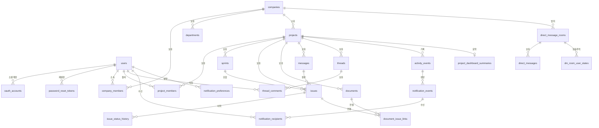

# Threadia ERD v2.0

> **작성자**: Threadia 팀  
> **작성일**: 2026-06-15  
> **최종 수정**: 2026-06-15  
> **버전**: v2.0  
> **상태**: 확정  
> **기준 문서**: ERD 초안 v1.4, 기능 분해표 v3.0, API 명세서 v2.0, 보류 기능 최종표 v1.0

---

## 1. v2.0 변경 요약

| 변경 항목 | 반영 내용 |
|---|---|
| 소셜 로그인 | `oauth_accounts` 추가 |
| 비밀번호 찾기 | `password_reset_tokens` 추가 |
| 프로필 사진 | `users.avatar_url` MVP 유지 |
| 활동 피드 | `activity_events`를 조건부 확장 원장으로 유지 |
| 대시보드 | `project_dashboard_summaries`를 조건부 read model로 추가 |
| Redis cache | DB 테이블이 아니라 외부 cache 계층으로 문서화 |
| 검색 엔진 | Typesense/Meilisearch는 ERD 범위 밖, 보류 |

---

## 2. 엔티티 목록 요약

| 영역 | 테이블 | 설명 | 상태 |
|---|---|---|---|
| 사용자 | `users` | 로그인 가능한 개인 계정 | MVP |
| 인증 | `oauth_accounts` | 소셜 로그인 계정 연결 | Sprint 1 확정 |
| 인증 | `password_reset_tokens` | 비밀번호 재설정 token | Sprint 1 확정 |
| 회사 | `companies` | 회사 workspace | MVP |
| 회사 | `departments` | 회사 하위 부서 | MVP |
| 회사 | `company_members` | User-Company 소속 및 권한 | MVP |
| 프로젝트 | `projects` | 회사 하위 프로젝트 | MVP |
| 프로젝트 | `project_members` | User-Project 소속 및 권한 | MVP |
| Sprint | `sprints` | Sprint 목표/기간/상태 | MVP |
| 이슈 | `issues` | 칸반 카드/업무 단위 | MVP |
| 이슈 | `issue_status_history` | 이슈 상태 변경 이력 | MVP |
| 문서 | `documents` | Markdown 문서 및 회의록 | MVP |
| 문서 | `document_issue_links` | 문서와 이슈 양방향 연결 | MVP |
| 채팅 | `messages` | 프로젝트 채팅 메시지 | MVP |
| 채팅 | `project_chat_member_states` | 프로젝트 채팅 읽음 위치 | MVP |
| DM | `direct_message_rooms` | 1:1 DM 방 | MVP |
| DM | `direct_messages` | DM 메시지 | MVP |
| DM | `dm_room_user_states` | DM 방별 읽음 위치 | MVP |
| 쓰레드 | `threads` | Issue/Document/Message 대표 논의 공간 | MVP |
| 쓰레드 | `thread_comments` | 쓰레드 댓글/결정 표시 | MVP |
| 활동 | `activity_events` | 주요 변경 원장 | 조건부 확장 |
| 알림 | `notification_events` | 알림 사건 원본 | MVP |
| 알림 | `notification_recipients` | 사용자별 수신/읽음 상태 | MVP |
| 알림 | `notification_preferences` | 개인 알림 설정 | MVP |
| 대시보드 | `project_dashboard_summaries` | 프로젝트 홈 read model | 조건부 확장 |

---

## 3. 핵심 ERD

---

## 4. 신규/변경 테이블 상세

### 4.1 users

| 컬럼 | 타입 | 제약 | 설명 |
|---|---|---|---|
| id | BIGINT | PK | 사용자 ID |
| email | VARCHAR(255) | UNIQUE, NOT NULL | 로그인 이메일 |
| password_hash | VARCHAR(255) | NULL | 로컬 로그인 비밀번호 hash. 소셜 전용 계정은 NULL 가능 |
| nickname | VARCHAR(100) | NOT NULL | 표시 이름 |
| avatar_url | VARCHAR(500) | NULL | 프로필 사진 URL |
| status | ENUM('ACTIVE','SUSPENDED','DELETED') | NOT NULL | 계정 상태 |
| created_at | DATETIME | NOT NULL | 생성 시각 |
| updated_at | DATETIME | NOT NULL | 수정 시각 |

`User.role` 필드는 만들지 않는다. 권한은 `company_members.role`과 `project_members.role`로 판정한다.

### 4.2 oauth_accounts

| 컬럼 | 타입 | 제약 | 설명 |
|---|---|---|---|
| id | BIGINT | PK | 소셜 계정 연결 ID |
| user_id | BIGINT | FK → users.id, NOT NULL | 연결된 사용자 |
| provider | ENUM('GOOGLE','KAKAO','NAVER') | NOT NULL | 소셜 provider |
| provider_user_id | VARCHAR(255) | NOT NULL | provider 내부 사용자 ID |
| provider_email | VARCHAR(255) | NULL | provider에서 받은 이메일 |
| created_at | DATETIME | NOT NULL | 연결 시각 |
| updated_at | DATETIME | NOT NULL | 수정 시각 |

- UNIQUE KEY (`provider`, `provider_user_id`).
- 같은 이메일의 로컬 계정이 있으면 계정 연결 정책을 적용한다.

### 4.3 password_reset_tokens

| 컬럼 | 타입 | 제약 | 설명 |
|---|---|---|---|
| id | BIGINT | PK | token ID |
| user_id | BIGINT | FK → users.id, NOT NULL | 대상 사용자 |
| token_hash | VARCHAR(255) | UNIQUE, NOT NULL | reset token hash |
| expires_at | DATETIME | NOT NULL | 만료 시각 |
| used_at | DATETIME | NULL | 사용 시각 |
| created_at | DATETIME | NOT NULL | 생성 시각 |

- token 원문은 저장하지 않는다.
- 같은 사용자의 미사용 token은 새 요청 시 만료 처리할 수 있다.

### 4.4 activity_events

| 컬럼 | 타입 | 제약 | 설명 |
|---|---|---|---|
| id | BIGINT | PK | 활동 이벤트 ID |
| company_id | BIGINT | FK → companies.id, NOT NULL | 소속 회사 |
| project_id | BIGINT | FK → projects.id, NULL | 관련 프로젝트 |
| actor_user_id | BIGINT | FK → users.id, NULL | 행위자 |
| event_type | ENUM | NOT NULL | 이벤트 유형 |
| target_type | ENUM | NOT NULL | 대상 유형 |
| target_id | BIGINT | NOT NULL | 대상 ID |
| metadata_json | JSON | NULL | 추가 메타데이터 |
| created_at | DATETIME | NOT NULL | 생성 시각 |

조건부 확장 기준 원장이다. `notification_events`와 통합하지 않고 역할을 분리한다.

### 4.5 project_dashboard_summaries

| 컬럼 | 타입 | 제약 | 설명 |
|---|---|---|---|
| project_id | BIGINT | PK, FK → projects.id | 프로젝트 ID |
| issue_total_count | INT | NOT NULL, DEFAULT 0 | 전체 이슈 수 |
| issue_done_count | INT | NOT NULL, DEFAULT 0 | 완료 이슈 수 |
| issue_in_progress_count | INT | NOT NULL, DEFAULT 0 | 진행 중 이슈 수 |
| document_count | INT | NOT NULL, DEFAULT 0 | 문서 수 |
| activity_count_today | INT | NOT NULL, DEFAULT 0 | 오늘 활동 수 |
| sprint_id | BIGINT | FK → sprints.id, NULL | 현재 Sprint |
| sprint_progress_rate | DECIMAL(5,2) | NULL | Sprint 진행률 |
| refreshed_at | DATETIME | NOT NULL | 갱신 시각 |

summary table은 원본이 아니라 read model이다. 원본은 `issues`, `documents`, `activity_events`, `sprints`다.

---

## 5. 기존 핵심 테이블 유지 기준

| 테이블 | v2.0 기준 |
|---|---|
| `companies` | 회사명, 대표자, 설명, 업종, 로고 URL 유지 |
| `departments` | 단일 depth, 삭제 시 구성원 `department_id = NULL` |
| `company_members` | Invitation 없이 가입된 사용자 즉시 등록 |
| `projects` | 삭제 대신 `ARCHIVED` 상태 사용 |
| `project_members` | 같은 회사 active 구성원만 프로젝트 멤버 가능 |
| `issues` | 5컬럼 상태, source message 연결, 휴지통/복원 |
| `documents` | Markdown 저장, 휴지통/복원 |
| `document_issue_links` | 문서-이슈 그래프 edge 역할 |
| `threads` | `target_type + target_id` 대표 쓰레드 unique |
| `messages` | 수정/삭제 API 미제공 |
| `direct_message_rooms` | 1:1 방만 허용, `user1_id < user2_id` unique |
| `notification_preferences` | Sprint 1은 GLOBAL scope만 허용 |

---

## 6. Redis와 검색 엔진의 위치

| 기술 | ERD 포함 여부 | 판단 |
|---|---|---|
| Redis cache | ERD 미포함 | DB가 아니라 cache 계층. 최근 활동, unread count, dashboard summary 캐시에 사용 |
| STOMP push | ERD 미포함 | 실시간 신호 전달 계층. 원본 데이터는 MySQL |
| Typesense/Meilisearch | ERD 미포함 | Sprint 1 보류. 검색 index는 추후 별도 설계 |
| NoSQL feed store | ERD 미포함 | Sprint 1 제외 |

---

## 7. 6일차 이월 검토 사항

- `issues` 정렬용 position 필드 관리 방식.
- `threads` 자동 생성 vs 수동 생성 정책.
- `activity_events`와 `notification_events`의 운영상 분리/통합 기준.
- 범용 attachments 테이블과 S3 presigned URL 상세 정책은 Sprint 1 이후 구현 단계에서 확정.
- Thread→Issue 추가 연결 방식.
- 범용 `issue_history` 도입 여부.
