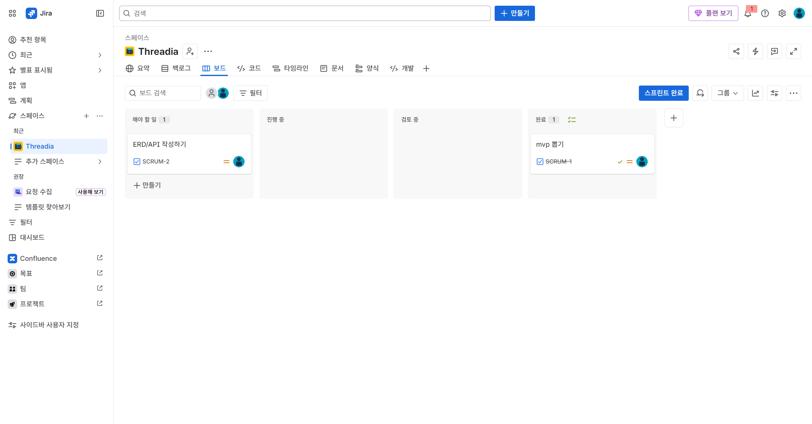
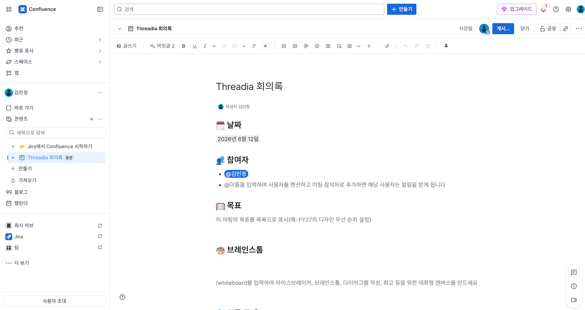
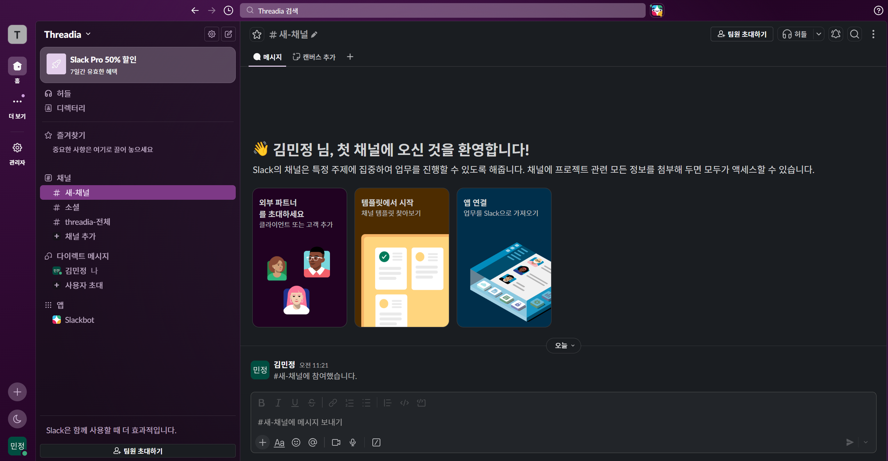

# Threadia 프로젝트 기획서 v2.0

> Thread + idea/area — 모든 논의가 쓰레드로 남고, 문서·이슈·메시지와 이어지는 개발팀용 경량 통합 협업 플랫폼

---

## 목차

1. [프로젝트 개요](#1-프로젝트-개요)
2. [기획 배경 및 목적](#2-기획-배경-및-목적)
3. [서비스 소개](#3-서비스-소개)
4. [팀 구성](#4-팀-구성)
5. [기술 스택](#5-기술-스택)
6. [사용자 정의](#6-사용자-정의)
7. [주요 기능](#7-주요-기능)
8. [사용자 시나리오 요약](#8-사용자-시나리오-요약)
9. [화면 구성](#9-화면-구성)
10. [API/ERD 설계 요약](#10-apierd-설계-요약)
11. [개발 일정 및 MVP 범위](#11-개발-일정-및-mvp-범위)
12. [보류/조건부 확장 기준](#12-보류조건부-확장-기준)
13. [협업 규칙](#13-협업-규칙)
14. [기대 효과](#14-기대-효과)
15. [참고 사이트](#15-참고-사이트)

---

## 1. 프로젝트 개요

| 항목 | 내용 |
|---|---|
| **프로젝트명** | Threadia |
| **부제** | 개발팀을 위한 경량 통합 협업 플랫폼 |
| **개발 기간** | 2026년 6월 10일 ~ 2026년 7월 26일 (총 6주) |
| **개발 인원** | 6명 |
| **주요 참고 서비스** | Jira, Confluence, Slack |
| **핵심 차별점** | 채팅·이슈·문서·알림을 오가지 않고 하나의 쓰레드와 연결 그래프에서 추적 |
| **4일차 기준 상태** | 기능/API/ERD/시나리오/보류표 v3/v2 기준 정합성 반영 |

### 1.1 프로젝트명 Threadia의 의미

**Threadia**는 **Thread** + **idea / area**를 합성한 이름이다.

| 구성 요소 | 의미 |
|---|---|
| **Thread** | 이슈·문서·메시지가 모두 대표 쓰레드로 연결되는 핵심 구조 |
| **idea** | 채팅에서 나온 아이디어가 이슈와 문서로 이어지고 실행 가능한 기록으로 남는 흐름 |
| **area** | 프로젝트, 채팅, 문서가 분산되지 않고 하나의 협업 공간 안에서 연결되는 개념 |

Jira, Confluence, Slack을 오가며 맥락이 단절되는 기존 방식과 달리, Threadia는 **논의가 쓰레드로 남고 문서·이슈·메시지와 이어지는 구조**를 서비스 정체성으로 삼는다.

---

## 2. 기획 배경 및 목적

### 2.1 문제 정의

현업 개발팀은 일반적으로 Jira, Confluence, Slack을 함께 사용한다. 각 도구는 독립적으로는 우수하지만 실제 업무 흐름에서는 다음 문제가 반복된다.

| 문제 | 내용 |
|---|---|
| 맥락 소실 | 채팅에서 결정된 근거가 이슈와 문서에 연결되지 않아 사라짐 |
| 중복 입력 | 채팅 내용을 다시 이슈로 옮기고, 문서 링크를 다시 복사해야 함 |
| 도구 피로 | 여러 도구와 탭을 동시에 관리해야 해 업무 집중도가 떨어짐 |
| 권한 관리 복잡도 | 회사/프로젝트 단위 권한과 실제 협업 흐름이 분리됨 |
| 운영 비용 | 중·소규모 팀에는 여러 SaaS를 병행하는 비용이 부담됨 |

### 2.2 주제 선정 이유

팀 내 협업 도구를 사용하면서 느낀 가장 큰 불편은 **결정 근거가 흩어지는 문제**였다. 채팅에서 논의한 내용이 이슈에 반영되지 않거나, 문서에 정리된 결정이 다시 업무와 연결되지 않는 상황이 반복되었다. Threadia는 이를 해결하기 위해 채팅, 이슈, 문서, 쓰레드, 알림을 하나의 업무 흐름으로 묶는다.

### 2.3 개발 목적

- 채팅 메시지에서 이슈를 바로 생성해 원본 대화 맥락을 보존한다.
- 이슈, 문서, 메시지마다 대표 쓰레드를 두어 결정 근거를 남긴다.
- 문서와 이슈를 양방향 연결하고 그래프 뷰로 관계를 확인한다.
- 알림을 통해 이슈, 문서, 쓰레드, 채팅/DM, 권한 변경 이벤트를 회수한다.
- 회사/프로젝트 소속 기반 RBAC로 A/P/C 역할에 맞는 업무 범위를 제공한다.

---

## 3. 서비스 소개

> Jira + Confluence + Slack의 핵심 기능을 하나로 잇는 개발팀용 경량 협업 플랫폼

```text
기존 흐름
Slack 논의 → Jira 이슈 등록 → Confluence 문서화 → 다시 Jira에 링크 복사
→ 누가 어디서 결정했는지 추적 불가

Threadia 흐름
프로젝트 채팅 메시지 → 이슈 생성(원본 링크 보존) → 대표 쓰레드에서 논의
→ Markdown 문서에 결정사항 정리 → 문서-이슈 그래프와 알림으로 회수
```

Threadia의 핵심 흐름은 다음과 같다.

```text
알림 수신
→ 이슈 확인
→ 이슈/문서/메시지 대표 쓰레드에서 논의
→ 필요 시 프로젝트 채팅 또는 1:1 DM으로 소통
→ 문서에 결정사항 정리
→ 문서와 이슈 연결
→ 그래프 뷰에서 연결 관계 확인
```

---

## 4. 팀 구성

> 아래 담당 업무는 기획주간 산출물 기준이며, 개발 착수 이후 실제 구현 담당은 Sprint 1 Backlog에서 조정한다.

| 이름 | 역할 | 현재까지 담당 업무 |
|---|---|---|
| 황스일 | 팀장 | 기획 검토, repo 세팅, README, 협업 규칙 정리 |
| 정철진 | 부팀장 / Front-end 전담 | 화면 설계도, 화면 정의서 |
| 여도현 | 팀원 | 기능 분해도 작성 |
| 김태준 | 팀원 | 기능 분해도 작성 |
| 김민정 | 팀원 | 사용자별 시나리오 작성, 기획안 작성 |
| 김민경 | 팀원 | 사용자별 시나리오 작성 |

---

## 5. 기술 스택

| 영역 | 기술 | 4일차 기준 |
|---|---|---|
| **Frontend** | React, Next.js, Three.js | 3D 메인 허브와 화면 라우팅 구현 |
| **Backend** | Spring Boot 3.x | REST API, 인증/인가, 도메인 로직 구현 |
| **Database** | MySQL 8.4 | 최종 원본 데이터 저장소 |
| **Realtime** | WebSocket STOMP | 조건부 push 신호 전달. 원본 데이터 저장소 아님 |
| **Cache** | Redis | 조건부 cache. unread count, 최근 활동, dashboard summary 보조 |
| **Infra** | AWS EC2, RDS, S3 | EC2 배포, RDS DB, S3 파일 저장 사용 확정. 실제 배포와 S3 파일 저장 구현은 Sprint 1 이후 |
| **문서 형식** | Markdown (.md) | 기획/회의록/프로젝트 문서 저장 기준 |

| 기술 | 선택 이유 |
|---|---|
| Three.js | 3D 사무실 메인 허브(S03) 구현 |
| Spring Boot | Java 기반 API 서버와 인증/인가 구현에 적합 |
| MySQL 8.4 | 권한, 이슈, 문서, 알림처럼 관계형 모델 중심의 MVP에 적합 |
| Redis | 원본 저장소가 아니라 조회 성능과 실시간 UX 보조에 적합 |
| STOMP push | 전체 payload가 아니라 새 이벤트 신호 전달에 적합 |
| Markdown | 문서·회의록을 가볍게 저장하고 렌더링하기 쉬움 |

> Typesense/Meilisearch, NoSQL feed store, Elasticsearch/OpenSearch, Supabase Realtime은 Sprint 1에서 제외하거나 보류한다.

---

## 6. 사용자 정의

권한은 사용자 계정에 고정하지 않고 **회사 소속과 프로젝트 소속 관계**에 부여한다. 같은 사용자가 어느 회사에서는 C이고, 다른 프로젝트에서는 A일 수 있다.

| 코드 | 유형 | 관리 범위 | 주요 역할 | Sprint 1 상태 |
|---|---|---|---|---|
| **A** | 일반 사용자 | 소속 프로젝트 | 이슈 처리, 문서 작성, 채팅/DM, 알림 확인 | MVP |
| **P** | 프로젝트 관리자 | 특정 프로젝트 | Sprint 운영, 멤버 관리, 이슈 검토, 문서·그래프 관리 | MVP |
| **C** | 회사 관리자 | 회사 전체 | 회사·부서·구성원·권한 관리, 프로젝트 생성과 조망 | MVP |
| **F** | 플랫폼 관리자 | 전체 플랫폼 | 전체 회사와 서비스 운영 | Sprint 1 제외, Sprint 2 최우선 후보 |

---

## 7. 주요 기능

### 7.1 MVP/Sprint 1 확정 기능

| # | 기능 | 설명 | 연결 기능 ID |
|---:|---|---|---|
| 1 | 인증과 프로필 | 이메일 로그인/회원가입, 소셜 로그인, 비밀번호 재설정, 프로필 사진 URL 관리 | AUTH-01~04, USER-01 |
| 2 | 3D 메인 허브 | 로그인 후 프로젝트, 문서, 채팅, 알림, 회사관리로 진입 | HUB-01, NAV-01 |
| 3 | RBAC | 회사/프로젝트 소속 기반 A/P/C 권한 판정 | RBAC-01 |
| 4 | 회사·부서·구성원 관리 | 회사 정보, 로고, 부서, 구성원, 권한 관리 | COMPANY, DEPT, MEMBER |
| 5 | 프로젝트·Sprint 관리 | 프로젝트 생성/수정/아카이빙, Sprint 생성/시작/종료 | PROJECT, SPRINT |
| 6 | 칸반/이슈 | 백로그/할일/진행중/검토중/완료 5컬럼 관리 | ISSUE, KANBAN |
| 7 | Markdown 문서·회의록 | `.md` 문서 작성/수정, 휴지통/복원 | DOC |
| 8 | 문서-이슈 그래프 | 문서와 이슈의 연결 관계를 그래프 뷰로 확인 | LINK, GRAPH |
| 9 | 프로젝트 채팅과 1:1 DM | 프로젝트 메시지, 같은 회사 구성원 간 1:1 DM, unread count | CHAT |
| 10 | 대표 쓰레드 | 이슈/문서/메시지별 논의 보존, @멘션 알림 | THREAD |
| 11 | 알림 | MySQL 기반 알림 목록/읽음 처리, 이벤트별 on/off | NOTI |

### 7.2 핵심 차별 기능 — 문서·이슈·메시지 연결

Threadia의 핵심은 채팅, 업무, 문서가 따로 남지 않고 서로 연결되는 것이다.

```text
프로젝트 채팅 메시지 ──이슈로 만들기──▶ 이슈
                                      │
                                  대표 쓰레드
                                      │
                              ◀── 양방향 연결 ──▶ 문서
                                                    │
                                            그래프 뷰 / 알림
```

| 연결 | 동작 |
|---|---|
| 메시지 → 이슈 | 프로젝트 채팅 메시지를 이슈로 생성하고 원본 메시지 링크를 보존 |
| 이슈 → 쓰레드 | 이슈별 대표 쓰레드에서 질문, 결정, blocker 기록 |
| 문서 → 쓰레드 | 문서 맥락의 논의를 별도 댓글 UI가 아니라 대표 쓰레드로 관리 |
| 이슈 ↔ 문서 | 문서와 이슈를 양방향 연결하고 그래프 edge로 반영 |
| 쓰레드/문서/이슈 → 알림 | 멘션, 상태 변경, 문서 수정, 권한 변경을 알림으로 회수 |

---

## 8. 사용자 시나리오 요약

| ID | Actor | 목표 | 핵심 기능 |
|---|---|---|---|
| SC-AUTH-01 | 비로그인, A/P/C | 계정 생성, 로그인, 소셜 로그인, 비밀번호 재설정, 프로필 사진 설정 | AUTH-01~04, USER-01 |
| SC-C-01 | C 회사 관리자 | 회사 정보 등록, 부서 구성, 구성원 추가, 권한 위임 | COMPANY, DEPT, MEMBER, RBAC |
| SC-C-02 | C 회사 관리자 | 여러 프로젝트 상태 확인과 의사결정 기록 | PROJECT, ISSUE, THREAD, NOTI |
| SC-P-01 | P 프로젝트 관리자 | 프로젝트 멤버, Sprint, 이슈, 문서, 그래프 운영 | PROJECT, SPRINT, ISSUE, DOC, GRAPH |
| SC-A-01 | A 일반 사용자 | 담당 이슈 확인, 논의, 문서화, 검토 요청 | KANBAN, THREAD, CHAT, DOC, LINK |
| SC-LINK-01 | A/P/C | 채팅 메시지, 이슈, 문서를 연결해 맥락 보존 | LINK, THREAD, GRAPH, NOTI |

> 상세 추적 관계는 `../기능-시나리오-API-ERD 추적표 v1.0.md`를 기준으로 한다.

---

## 9. 화면 구성

### 9.1 전체 화면 흐름

```text
서비스 진입
└── S01 로그인
    ├── S02 회원가입
    └── S03 3D 사무실 메인 허브
        ├── S04 프로젝트 목록
        │   ├── S05 칸반 보드
        │   │   └── S10 쓰레드
        │   ├── S06 백로그 / 스프린트
        │   ├── S07 문서·회의록 목록 / 그래프 뷰
        │   │   └── S08 문서 편집기 / 그래프 뷰
        │   └── S12 프로젝트 설정
        ├── S09 프로젝트 채팅 / 1:1 DM
        │   └── S10 쓰레드
        ├── S11 알림
        └── S13 회사 관리
            └── S14 구성원·권한 관리

MVP 보류
└── S15 플랫폼 관리자 대시보드

조건부 확장
├── 프로젝트 홈 / 대시보드
├── 활동 피드
└── 통합 검색
```

### 9.2 화면 목록

| ID | 화면명 | 접근 사용자 | 상태 |
|---|---|---|---|
| S01 | 로그인 | 비로그인 | MVP |
| S02 | 회원가입 | 비로그인 | MVP |
| S03 | 3D 사무실 메인 허브 | A/P/C | MVP |
| S04 | 프로젝트 목록 | A/P/C | MVP |
| S05 | 칸반 보드 | A/P/C | MVP |
| S06 | 백로그 / 스프린트 | A/P/C | MVP |
| S07 | 문서·회의록 목록 / 그래프 뷰 | A/P/C | MVP |
| S08 | 문서 편집기 / 그래프 뷰 | A/P/C | MVP |
| S09 | 프로젝트 채팅 / 1:1 DM | A/P/C | MVP |
| S10 | 쓰레드 | A/P/C | MVP |
| S11 | 알림 | A/P/C | MVP |
| S12 | 프로젝트 설정 | P/C | MVP |
| S13 | 회사 관리 | C | MVP |
| S14 | 구성원·권한 관리 | C | MVP |
| S15 | 플랫폼 관리자 대시보드 | F | 보류 |

---

## 10. API/ERD 설계 요약

### 10.1 API 범위

| 영역 | 주요 API |
|---|---|
| 인증 | `/auth/signup`, `/auth/login`, `/auth/logout`, `/auth/me`, OAuth redirect/callback, password reset |
| 사용자 | `/users/me/profile` |
| 회사/부서/구성원 | `/companies`, `/departments`, `/company-members` |
| 프로젝트/Sprint | `/projects`, `/project-members`, `/sprints` |
| 이슈/문서/그래프 | `/issues`, `/documents`, `/document-issue-links`, `/documents/graph` |
| 쓰레드/채팅/DM | `/threads`, `/messages`, `/direct-messages` |
| 알림 | `/notifications`, `/notification-preferences` |
| 조건부 확장 | `/activity-events`, `/search`, `/dashboard` |

### 10.2 ERD 핵심 테이블

| 영역 | 테이블 | 상태 |
|---|---|---|
| 사용자/인증 | `users`, `oauth_accounts`, `password_reset_tokens` | MVP / Sprint 1 확정 |
| 회사/권한 | `companies`, `departments`, `company_members`, `project_members` | MVP |
| 프로젝트/Sprint/이슈 | `projects`, `sprints`, `issues`, `issue_status_history` | MVP |
| 문서/연결 | `documents`, `document_issue_links` | MVP |
| 채팅/DM | `messages`, `project_chat_member_states`, `direct_message_rooms`, `direct_messages`, `dm_room_user_states` | MVP |
| 쓰레드 | `threads`, `thread_comments` | MVP |
| 알림 | `notification_events`, `notification_recipients`, `notification_preferences` | MVP |
| 조건부 확장 | `activity_events`, `project_dashboard_summaries` | 조건부 확장 |

### 10.3 데이터 설계 원칙

- `users.role`은 만들지 않고 `company_members.role`, `project_members.role`로 권한을 판정한다.
- 프로젝트는 삭제하지 않고 `ARCHIVED` 상태로 아카이빙한다.
- 이슈와 문서는 휴지통/복원까지만 제공하고 영구 삭제는 보류한다.
- `threads`는 `target_type + target_id` 기준으로 대상 1개당 대표 쓰레드 1개를 유지한다.
- Redis와 STOMP push는 ERD에 포함하지 않는다. MySQL을 최종 원본으로 유지한다.

---

## 11. 개발 일정 및 MVP 범위

### 11.1 개발 일정

전체 개발 기간은 총 6주로 구성한다. 1주차에 기획 및 개발 착수 준비를 완료하고, 이후 Sprint 단위로 핵심 기능을 구현한다.

| 구분 | 주요 내용 | 산출물/검증 |
|---|---|---|
| 기획주간 Day 1~3 | 주제 선정, 기능/시나리오/화면/API/ERD 초안 작성 | 3일차 최종 산출물 |
| 기획주간 Day 4 | 기능/API/ERD/시나리오 정합성 보정, 보류 기능 확정, PR/CI/AI 규칙 확정 | 4일차 최종 산출물 |
| 기획주간 Day 5~6 | 6일차 이월 기술 검토, 개발 착수 기준 확정 | Backlog, skeleton, 검증 기준 |
| 개발 1주차 | 인증, RBAC, 회사/구성원 관리, 3D 메인 허브 | Backend/Frontend skeleton, 기본 로그인 흐름 |
| 개발 2주차 | 프로젝트, 칸반, Sprint, 문서/그래프 | 프로젝트 운영 핵심 흐름 |
| 개발 3주차 | 채팅, DM, 쓰레드, 알림, 연결 기능 | 문서-이슈-메시지 통합 흐름 |
| 마무리 | 통합 테스트, 버그 수정, EC2/RDS/S3 배포 확인, 발표 준비 | 시연 시나리오, 최종 발표 자료 |

### 11.2 MVP 범위 요약

| 구분 | 기능 |
|---|---|
| **MVP** | 이메일 인증, 프로필, RBAC, 3D 허브, 회사/구성원, 프로젝트, 칸반, Sprint, 문서, 그래프, 채팅, 1:1 DM, 쓰레드, 알림 |
| **Sprint 1 확정** | 소셜 로그인, 비밀번호 찾기/재설정 |
| **조건부 확장** | 활동 피드, 통합 검색, 프로젝트 홈/대시보드, Redis cache, STOMP push, summary table |
| **선택** | 파일/이미지 첨부 |
| **보류** | 플랫폼 관리자, NoSQL feed store, 칸반 컬럼 커스터마이징, 동시 문서 편집, 다자간 DM, DM 상대 read receipt, 영구 삭제, 프로젝트 복원, PROJECT scope 알림 설정 |

---

## 12. 보류/조건부 확장 기준

| 항목 | 최종 판단 | 기준 |
|---|---|---|
| 소셜 로그인 | Sprint 1 확정 | `AUTH-03`, `oauth_accounts`, OAuth API 반영 |
| 비밀번호 찾기/재설정 | Sprint 1 확정 | `AUTH-04`, `password_reset_tokens`, reset API 반영 |
| 활동 피드 | 조건부 확장 | `activity_events` 원장 + STOMP push + Redis cache 계획 확정 |
| 통합 검색 | 조건부 확장 | MySQL 기반 제한 검색 우선, Typesense/Meilisearch 보류 |
| 프로젝트 홈/대시보드 | 조건부 확장 | MySQL aggregate + `project_dashboard_summaries` + Redis cache 계획 확정 |
| Redis | 조건부 보조 계층 | 원본 저장소 금지, cache/push 보조로만 사용 |
| NoSQL feed store | 제외 | MySQL 원장으로 충분, Sprint 1 범위 초과 |
| 플랫폼 관리자 F/S15 | 보류 | Sprint 2 최우선 후보 |

AWS 계정은 직접 생성하고 비용은 본인이 부담한다. EC2/RDS/S3 사용은 확정하지만, 실제 배포와 S3 파일 저장 구현은 Sprint 1 이후로 배치한다.

---

## 13. 협업 규칙

### 13.1 PR 기준

- PR Template에는 작업 내용, 변경 유형, 관련 문서/이슈, 검증, AI 사용 여부, 보안/승인 체크를 포함한다.
- Backend 변경은 `./gradlew test`를 우선 기준으로 삼고, 안정화 후 `./gradlew build`로 확대한다.
- Frontend 변경은 초기에는 브라우저에서 route와 주요 액션을 직접 확인한다.
- DB, 배포, 인증/인가, 보안 변경은 팀 승인 기준을 따른다.

### 13.2 AI 사용 기준

- PR에서 AI를 사용했다면 사용 여부와 범위를 적는다.
- `.env`, API key, token, password, 개인정보는 AI 도구에 입력하지 않는다.
- AI가 만든 코드, 문서, 설정은 작성자가 직접 이해하고 검토한 뒤 제출한다.
- GitHub collaborator, author, co-author, reviewer, assignee에는 AI 도구 이름을 남기지 않는다.

### 13.3 CI 기준

- 실제 GitHub Actions workflow는 Backend/Frontend skeleton이 잡힌 뒤 생성한다.
- 초기 Backend CI 기준은 `./gradlew test`다.
- 안정화 후 compile, test, packaging까지 포함하는 `./gradlew build`로 확대한다.
- 문서 변경은 링크, 버전, 관련 문서명 확인을 필수 검증으로 둔다.

---

## 14. 기대 효과

| 효과 | 내용 |
|---|---|
| 맥락 단절 해소 | 채팅, 이슈, 문서, 쓰레드, 알림이 연결되어 결정 근거가 흩어지지 않음 |
| 도구 통합 | Jira, Confluence, Slack의 핵심 흐름을 단일 서비스로 통합 |
| 추적 가능한 의사결정 | 모든 결정이 이슈/문서/메시지의 대표 쓰레드에 남음 |
| 역할 기반 접근 | A/P/C 권한 분리로 팀 내 역할에 맞는 정보만 접근 가능 |
| 경량 운영 | 중·소규모 개발팀에 맞는 가벼운 협업 도구 제공 |
| 개발 착수 용이성 | 기능, 시나리오, API, ERD, 화면이 4일차 기준으로 연결되어 Sprint 1 Backlog 작성 가능 |

---

## 15. 참고 사이트

본 프로젝트는 아래 서비스의 핵심 기능을 분석·벤치마킹하여 서비스 기획의 기초 자료로 활용하였다.

| 서비스 | 역할 | 링크 |
|---|---|---|
| **Jira** | 이슈 관리, 칸반, Sprint 운영 참고 | [https://www.atlassian.com/software/jira](https://www.atlassian.com/software/jira) |
| **Confluence** | 문서·회의록 편집기와 이슈 연결 구조 참고 | [https://www.atlassian.com/software/confluence](https://www.atlassian.com/software/confluence) |
| **Slack** | 프로젝트 채팅, 쓰레드, 알림 구조 참고 | [https://slack.com](https://slack.com) |

**Jira**



**Confluence**



**Slack**



---

## 별첨 문서

- 기능 분해표 v3.0
- 사용자 시나리오 v3.0
- 화면정의서_v3
- API 명세서 v2.0
- ERD v2.0
- 보류 기능 최종표 v1.0
- 기능-시나리오-API-ERD 추적표 v1.0
- PR Template v1.0
- CI 기준 확정 v1.0
- AI 사용 규칙 v1.0
