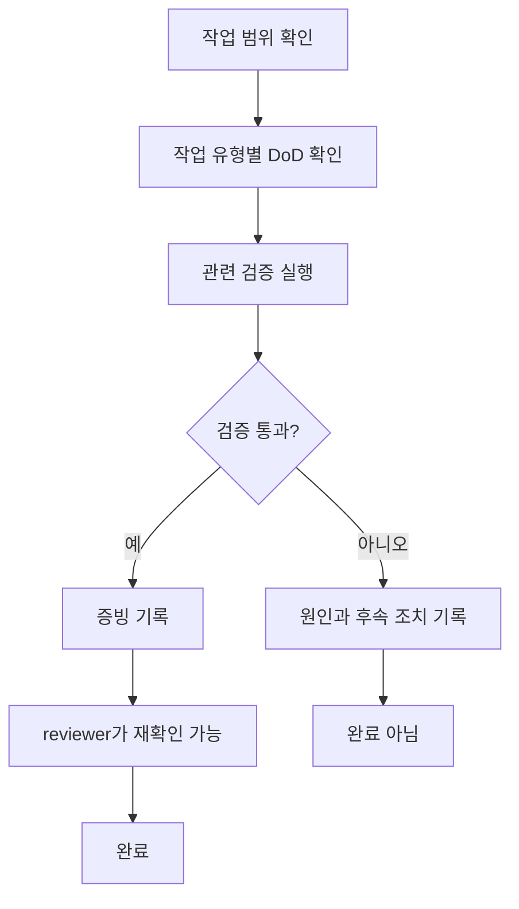

> **작성자**: Threadia 팀
> **작성일**: 2026-06-16
> **최종 수정**: 2026-06-16
> **버전**: v2.0
> **상태**: 검토 중

# 작업 유형별 완료 조건 v2

## 1. 목적

이 문서는 Threadia Sprint 1 작업을 완료로 판단하기 위한 Definition of Done을 정리한다.

완료 기준은 "무엇을 만족해야 완료인가"를 정의한다. 실제 확인 방법과 실행 명령은 `test-build-API-화면 확인 기준 v2.md`에서 다룬다.

## 2. Sprint 1 적용 범위

| 구분 | Sprint 1 기준 |
|---|---|
| Backend | Spring Boot skeleton, 핵심 entity, 로그인/프로젝트/이슈 API 초안, MySQL 연결 확인 |
| Frontend | React + Next 구조 생성 이후 로그인/프로젝트 홈 등 주요 route 확인 |
| DB | MySQL 8.4 local 기준, ERD와 entity/table 관계 정합성 확인 |
| Infra/AWS | EC2/RDS/S3 사용 범위와 계정/비용/배포 시점 문서화. 실제 배포와 S3 파일 저장 구현은 Sprint 1 이후 |
| CI | 초기에는 `./gradlew test` 우선. skeleton 안정화 이후 `./gradlew build`와 GitHub Actions로 확대 |
| AI 사용 | AI 도구 종류가 아니라 owner, 변경 파일 범위, 검증 책임, reviewer 기준으로 관리 |

## 3. 완료 판정 흐름

## 4. 공통 완료 기준

모든 작업은 아래 조건을 기본으로 만족해야 한다.

| 기준 | 완료 조건 |
|---|---|
| 범위 | 요구사항, Backlog, 이슈에 명시된 범위가 반영되었다 |
| 정상 케이스 | 대표 성공 흐름을 실행 또는 문서 검토로 확인했다 |
| 예외 케이스 | 필수값 누락, 권한 부족, 존재하지 않는 리소스 등 주요 실패 조건을 확인했다 |
| 기존 영향 | 변경이 기존 기능, 문서, API, DB 기준에 미치는 영향을 확인했다 |
| 보안 | token, password, 개인정보, secret이 코드와 문서, 로그에 노출되지 않는다 |
| 정리 | 임시 로그, 디버그 코드, 불필요한 주석 처리 코드가 남아 있지 않다 |
| 증빙 | 실행 명령, 결과, 화면 캡처, 요청/응답 예시 중 필요한 증빙이 남아 있다 |
| 후속 조치 | 미완료 또는 미확인 항목은 사유, owner, 처리 시점이 기록되어 있다 |

## 5. 작업 유형별 최소 통과 조건

| 작업 유형 | 최소 완료 조건 | 필수 증빙 |
|---|---|---|
| Backend | API 또는 서버 로직이 요구사항대로 동작하고 `./gradlew test`가 통과한다 | test 결과, API 요청/응답 예시 |
| Frontend | 대상 route나 화면에서 주요 사용자 흐름을 브라우저로 확인할 수 있다 | 화면 캡처 또는 확인 기록 |
| DB | ERD, entity, table 관계가 일치하고 local DB 연결 또는 migration 적용 기준이 확인되었다 | 연결 결과, query 또는 migration 결과 |
| Infra/AWS | EC2/RDS/S3 사용 범위와 계정/비용/배포 시점, 설정값 관리 방식이 문서화되었다 | 문서 링크, 승인 필요 항목 표시 |
| 문서 | 팀원이 문서만 보고 다음 행동을 할 수 있다 | 문서 링크, 검토 결과 |
| PR | 변경 내용, 검증 결과, 영향 범위, 보안/승인 체크가 작성되었다 | PR 본문 또는 작업 기록 |
| AI-assisted | AI 산출물을 owner가 이해하고 직접 검증했으며 reviewer가 분리되어 있다 | AI 사용 범위, 검증 결과, reviewer |

## 6. Backend 완료 기준

Backend 작업은 API, server logic, 인증/인가, validation, DB 연동 변경을 포함한다.

| 항목 | 완료 조건 |
|---|---|
| API 스펙 | 요청 method, URL, request body, response body가 API 초안 또는 합의된 기준과 일치한다 |
| 상태 코드 | 성공, validation 실패, 인증 실패, 권한 부족, 리소스 없음 응답이 구분된다 |
| 인증/인가 | 로그인이 필요한 API는 token 없거나 권한 부족인 요청을 차단한다 |
| 비즈니스 로직 | 핵심 rule이 service 또는 domain layer에서 확인 가능하다 |
| DB 반영 | 생성, 수정, 삭제가 있는 경우 DB 반영 결과까지 확인했다 |
| test | 변경 범위에 맞는 test가 있고 `./gradlew test`가 통과한다 |
| 설정 | 환경 변수, DB 연결, secret 관리 방식이 문서화되었다 |

## 7. Frontend 완료 기준

Frontend 작업은 화면, route, component, 상태 관리, API 연동 변경을 포함한다.

| 항목 | 완료 조건 |
|---|---|
| 화면 진입 | 대상 route에 진입할 수 있고 흰 화면, 무한 로딩, runtime error가 없다 |
| 사용자 흐름 | 로그인, 목록 조회, 상세 진입, 생성/수정 등 작업 범위의 핵심 흐름이 끝까지 동작한다 |
| API 상태 | 성공, 실패, loading, empty 상태 중 변경 범위에 필요한 상태가 화면에서 구분된다 |
| 입력 검증 | 필수값, 형식 오류, 실패 메시지를 사용자가 이해할 수 있다 |
| 화면 기준 | Desktop 기준 화면을 우선 확인하고, Sprint 1에서 필요한 경우 Mobile 375px을 추가 확인한다 |
| 증빙 | 화면 변경은 캡처 또는 확인한 route, 브라우저, 화면 크기를 기록한다 |

## 8. DB 완료 기준

DB 작업은 ERD, entity, table, migration, query 변경을 포함한다.

| 항목 | 완료 조건 |
|---|---|
| ERD 정합성 | table, column, 관계가 ERD v2.0과 일치하거나 차이가 문서화되었다 |
| 제약 조건 | id, unique, foreign key, null 허용 여부, 기본값이 요구사항과 맞다 |
| local 확인 | MySQL 8.4 local 기준으로 연결 또는 migration 적용 가능 여부를 확인했다 |
| API 영향 | DB 변경이 API request/response, validation, 화면 표시 값에 미치는 영향을 확인했다 |
| 데이터 변경 | 삭제나 대량 수정이 있으면 대상 범위와 실행 전후 확인 방법을 기록했다 |

## 9. Infra/AWS 완료 기준

Sprint 1에서 AWS는 실제 배포 구현이 아니라 사용 범위와 절차 정리가 완료 기준이다.

| 항목 | 완료 조건 |
|---|---|
| 사용 범위 | EC2, RDS, S3를 어떤 목적으로 사용할지 문서화되었다 |
| 책임 | AWS 계정은 직접 생성하고 비용은 본인 부담이라는 기준이 기록되었다 |
| 구현 시점 | 실제 EC2 배포와 S3 파일 저장 구현은 Sprint 1 이후로 분리되었다 |
| 설정 관리 | region, DB endpoint, bucket, secret 등 값은 노출하지 않고 관리 방식만 적는다 |
| 승인 | 배포, DB, secret, cloud resource 변경은 승인 필요 작업으로 표시한다 |

## 10. 문서 완료 기준

| 항목 | 완료 조건 |
|---|---|
| 목적 | 문서의 목적, 대상 독자, 적용 범위가 명확하다 |
| 현행성 | API, ERD, 화면 정의서, Backlog 등 관련 문서와 충돌하지 않는다 |
| 실행 가능성 | 팀원이 문서만 보고 다음 행동이나 검증 절차를 수행할 수 있다 |
| 표기 | 파일명, 메타정보, 버전, 상태가 문서 작성 규칙과 맞다 |
| 링크 | 관련 문서 링크, 이미지, 표, code block이 정상적으로 읽힌다 |
| 미확정 | 미확정 항목은 owner, 결정 시점, 후속 처리가 적혀 있다 |

## 11. PR 완료 기준

| 항목 | 완료 조건 |
|---|---|
| 변경 요약 | 무엇을 왜 바꿨는지 reviewer가 이해할 수 있다 |
| 범위 | 포함 범위와 제외 범위가 구분되어 있다 |
| 검증 | `./gradlew test`, API 확인, 브라우저 확인 등 변경 범위에 맞는 검증 결과가 있다 |
| 보안 | secret, 개인정보, token 노출 여부를 확인했다 |
| 승인 필요 작업 | DB schema, 인증/인가, CI, AWS, secret 변경 여부가 표시되어 있다 |
| AI 사용 | AI 사용 여부와 사용 범위가 PR 본문 또는 작업 기록에 남아 있다 |
| review | reviewer가 지정되어 있고 코멘트 반영 또는 미반영 사유가 답변되어 있다 |

## 12. AI-assisted 작업 완료 기준

AI를 사용한 작업은 AI가 만든 결과물이 아니라 owner가 책임지는 작업으로 본다.

| 기준 | 완료 조건 |
|---|---|
| owner | 각 작업에는 최종 책임자 1명이 있다 |
| 파일 범위 | 같은 파일을 여러 명이 동시에 수정하지 않도록 주요 변경 파일을 정했다 |
| 이해 | owner가 AI 산출물의 변경 이유와 동작 방식을 설명할 수 있다 |
| 검증 | AI가 작성했더라도 사람이 직접 test, curl, 브라우저 확인을 수행했다 |
| reviewer | owner와 다른 사람이 review한다 |
| 민감 변경 | DB schema, 인증/인가, CI, AWS, secret은 팀 승인 후 진행한다 |

## 13. 완료로 보지 않는 경우

다음 중 하나라도 해당하면 완료로 보지 않는다.

| 경우 | 이유 |
|---|---|
| 구현만 있고 검증 결과가 없다 | reviewer가 재확인할 수 없다 |
| 정상 케이스만 확인했다 | 실패 케이스에서 실제 사용자가 막힐 수 있다 |
| test 또는 build 실패가 남아 있는데 사유가 없다 | merge 가능 상태로 판단할 수 없다 |
| 화면 변경인데 화면 증빙이 없다 | 사용자 관점 동작을 확인할 수 없다 |
| DB 변경인데 ERD/API 영향 확인이 없다 | 데이터 정합성과 API 충돌 가능성이 남는다 |
| AWS, secret, 인증 변경인데 승인 필요 표시가 없다 | 보안과 비용 리스크가 관리되지 않는다 |
| AI 사용 산출물을 owner가 설명하지 못한다 | 책임 소재와 유지보수 가능성이 불명확하다 |
| 미확인 항목의 owner와 처리 시점이 없다 | 후속 작업으로 추적되지 않는다 |
