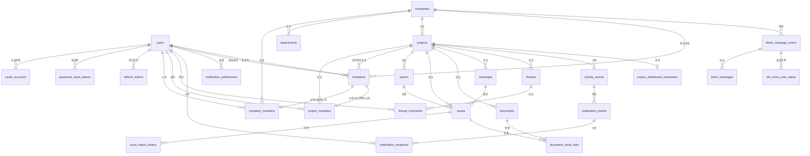

# Threadia ERD v2.0

> **작성자**: Threadia 팀  
> **작성일**: 2026-06-15  
> **최종 수정**: 2026-06-17  
> **버전**: 6일차 수정본 v1
> **상태**: 6일차 수정본
> **수정 근거**: Threadia-기획문서-검수리포트.md
> **기준 문서**: ERD 초안 v1.4, 기능 분해표 v3.0, API 명세서 v2.0, 보류 기능 최종표 v1.0

---

> **Phase A 정합도 메모**: 이 파일은 공식 결정 반영 조정본이다. Sprint 1 구현 기준은 Auth only, Spring Boot/MySQL/Frontend skeleton, CI/PR baseline, Auth flows이며, Sprint 1 DB migration은 `users`, `oauth_accounts`, `password_reset_tokens`, `refresh_tokens`만 포함한다. 회사, 프로젝트, 이슈, 문서, 채팅, DM, 쓰레드, 알림, 프로필 수정, invitation 구현은 Sprint 1 범위에서 제외하고, 전체 MVP API/ERD는 후속 구현 sprint의 reference contract로 유지한다.

## 1. v2.0 변경 요약

| 변경 항목 | 반영 내용 |
|---|---|
| 소셜 로그인 | `oauth_accounts` 추가 |
| 비밀번호 찾기 | `password_reset_tokens` 추가 |
| Refresh token | `refresh_tokens` 추가, hash 저장과 rotation/invalidation 기준 반영 |
| Invitation | `invitations` 추가, Sprint 1.5 등록 사용자 app-internal invitation 정책 반영 |
| 프로필 사진 | `users.avatar_url` MVP 유지 |
| 활동 피드 | `activity_events`를 조건부 확장 원장으로 유지 |
| 대시보드 | `project_dashboard_summaries`를 조건부 read model로 추가 |
| Redis cache | DB 테이블이 아니라 외부 cache 계층으로 문서화 |
| 검색 엔진 | Typesense/Meilisearch는 ERD 범위 밖, 보류 |

---

## 2. 엔티티 목록 요약

| 영역 | 테이블 | 설명 | 상태 |
|---|---|---|---|
| 사용자 | `users` | 로그인 가능한 개인 계정 | Sprint 1 확정 |
| 인증 | `oauth_accounts` | 소셜 로그인 계정 연결 | Sprint 1 확정 |
| 인증 | `password_reset_tokens` | 비밀번호 재설정 token | Sprint 1 확정 |
| 인증 | `refresh_tokens` | JWT refresh token hash, 만료, rotation, revoke 상태 | Sprint 1 확정 |
| 회사 | `companies` | 회사 workspace | MVP reference, Sprint 1 구현 제외 |
| 회사 | `departments` | 회사 하위 부서 | MVP reference, Sprint 1 구현 제외 |
| 회사 | `company_members` | User-Company 소속 및 권한 | MVP reference, Sprint 1 구현 제외 |
| 초대 | `invitations` | 등록 사용자 대상 회사/프로젝트 초대 요청과 상태 | Sprint 1.5 |
| 프로젝트 | `projects` | 회사 하위 프로젝트 | MVP reference, Sprint 1 구현 제외 |
| 프로젝트 | `project_members` | User-Project 소속 및 권한 | MVP reference, Sprint 1 구현 제외 |
| Sprint | `sprints` | Sprint 목표/기간/상태 | MVP |
| 이슈 | `issues` | 칸반 카드/업무 단위 | MVP |
| 이슈 | `issue_status_history` | 이슈 상태 변경 이력 | MVP |
| 문서 | `documents` | Markdown 문서 및 회의록 | MVP |
| 문서 | `document_issue_links` | 문서와 이슈 양방향 연결 | MVP |
| 채팅 | `messages` | 프로젝트 채팅 메시지 | MVP |
| 채팅 | `project_chat_member_states` | 프로젝트 채팅 읽음 위치 | MVP |
| DM | `direct_message_rooms` | 1:1 DM 방 | MVP |
| DM | `direct_messages` | DM 메시지 | MVP |
| DM | `dm_room_user_states` | DM 방별 읽음 위치 | MVP |
| 쓰레드 | `threads` | Issue/Document/Message 대표 논의 공간 | MVP |
| 쓰레드 | `thread_comments` | 쓰레드 댓글/결정 표시 | MVP |
| 활동 | `activity_events` | 주요 변경 원장 | 조건부 확장 |
| 알림 | `notification_events` | 알림 사건 원본 | MVP |
| 알림 | `notification_recipients` | 사용자별 수신/읽음 상태 | MVP |
| 알림 | `notification_preferences` | 개인 알림 설정 | MVP |
| 대시보드 | `project_dashboard_summaries` | 프로젝트 홈 read model | 조건부 확장 |

---

## 3. 핵심 ERD

---

## 4. 신규/변경 테이블 상세

### 4.1 users

| 컬럼 | 타입 | 제약 | 설명 |
|---|---|---|---|
| id | BIGINT | PK | 사용자 ID |
| email | VARCHAR(255) | UNIQUE, NOT NULL | 로그인 이메일 |
| password_hash | VARCHAR(255) | NULL | 로컬 로그인 비밀번호 hash. 소셜 전용 계정은 NULL 가능 |
| nickname | VARCHAR(100) | NOT NULL | 표시 이름 |
| avatar_url | VARCHAR(500) | NULL | 프로필 사진 URL |
| status | ENUM('ACTIVE','SUSPENDED','DELETED') | NOT NULL | 계정 상태 |
| created_at | DATETIME | NOT NULL | 생성 시각 |
| updated_at | DATETIME | NOT NULL | 수정 시각 |

`User.role` 필드는 만들지 않는다. 권한은 `company_members.role`과 `project_members.role`로 판정한다.

### 4.2 oauth_accounts

| 컬럼 | 타입 | 제약 | 설명 |
|---|---|---|---|
| id | BIGINT | PK | 소셜 계정 연결 ID |
| user_id | BIGINT | FK → users.id, NOT NULL | 연결된 사용자 |
| provider | ENUM('GOOGLE','KAKAO','NAVER') | NOT NULL | 소셜 provider. Phase A Sprint 1 구현은 GOOGLE로 한정 |
| provider_user_id | VARCHAR(255) | NOT NULL | provider 내부 사용자 ID |
| provider_email | VARCHAR(255) | NULL | provider에서 받은 이메일 |
| created_at | DATETIME | NOT NULL | 연결 시각 |
| updated_at | DATETIME | NOT NULL | 수정 시각 |

- UNIQUE KEY (`provider`, `provider_user_id`).
- 같은 이메일의 로컬 계정이 있으면 계정 연결 정책을 적용한다.

### 4.3 password_reset_tokens

| 컬럼 | 타입 | 제약 | 설명 |
|---|---|---|---|
| id | BIGINT | PK | token ID |
| user_id | BIGINT | FK → users.id, NOT NULL | 대상 사용자 |
| token_hash | VARCHAR(255) | UNIQUE, NOT NULL | reset token hash |
| expires_at | DATETIME | NOT NULL | 만료 시각 |
| used_at | DATETIME | NULL | 사용 시각 |
| created_at | DATETIME | NOT NULL | 생성 시각 |

- token 원문은 저장하지 않는다.
- 같은 사용자의 미사용 token은 새 요청 시 만료 처리할 수 있다.

### 4.4 refresh_tokens

| 컬럼 | 타입 | 제약 | 설명 |
|---|---|---|---|
| id | BIGINT | PK | refresh token ID |
| user_id | BIGINT | FK -> users.id, NOT NULL | token 소유 사용자 |
| token_hash | VARCHAR(255) | UNIQUE, NOT NULL | refresh token hash. 원문 저장 금지 |
| expires_at | DATETIME | NOT NULL | 만료 시각. Sprint 1 기준 14일 |
| rotated_at | DATETIME | NULL | refresh 성공으로 새 token을 발급한 시각 |
| revoked_at | DATETIME | NULL | logout 또는 강제 무효화 시각 |
| created_at | DATETIME | NOT NULL | 생성 시각 |
| updated_at | DATETIME | NOT NULL | 수정 시각 |

- refresh 성공 시 기존 row는 rotate 처리하고 새 refresh token hash를 저장한다.
- logout 또는 보안상 무효화가 필요하면 `revoked_at`을 기록한다.
- 만료, rotated, revoked token은 재사용할 수 없다.

### 4.5 invitations

| 컬럼 | 타입 | 제약 | 설명 |
|---|---|---|---|
| id | BIGINT | PK | invitation ID |
| company_id | BIGINT | FK -> companies.id, NOT NULL | 초대가 속한 회사 |
| project_id | BIGINT | FK -> projects.id, NULL | 프로젝트 초대인 경우 대상 프로젝트 |
| inviter_user_id | BIGINT | FK -> users.id, NOT NULL | 초대한 사용자 |
| invitee_user_id | BIGINT | FK -> users.id, NOT NULL | 초대받은 등록 사용자 |
| scope_type | ENUM('COMPANY','PROJECT') | NOT NULL | 회사 초대 또는 프로젝트 초대 |
| role | VARCHAR(50) | NOT NULL | 수락 시 부여할 역할. `scope_type=COMPANY`는 `COMPANY_ADMIN` 또는 `MEMBER`, `scope_type=PROJECT`는 `PROJECT_ADMIN` 또는 `MEMBER`만 허용 |
| status | ENUM('PENDING','ACCEPTED','DECLINED','CANCELED','EXPIRED') | NOT NULL | 초대 상태 |
| expires_at | DATETIME | NOT NULL | 기본 생성 시각 + 7일 |
| accepted_at | DATETIME | NULL | 수락 시각 |
| declined_at | DATETIME | NULL | 거절 시각 |
| canceled_at | DATETIME | NULL | 취소 시각 |
| created_at | DATETIME | NOT NULL | 생성 시각 |
| updated_at | DATETIME | NOT NULL | 수정 시각 |

- Sprint 1.5 invitation은 등록 사용자 대상 app-internal invitation만 지원한다. 미가입 사용자 email 발송, token link, signup/onboarding auto-accept, resend는 Sprint 1.5 범위가 아니다.
- 기본 만료 기간은 7일이며, read/accept/decline/cancel 시점에 lazy expiration을 확인한다. 필수 batch scheduler는 두지 않는다.
- `PENDING` invitation 수락 시 `company_members` 또는 `project_members` membership을 생성한다. 이미 멤버인 경우 중복 membership을 만들지 않는다.
- 프로젝트 invitation은 해당 프로젝트가 속한 회사의 `ACTIVE` company member에게만 생성한다.
- invitation-related notification은 내부 `notification_events` 원장 기록까지만 Sprint 1.5 범위로 둔다. Push 알림, 별도 Invitation notification preference, S11 사용자 알림 UI 필수 구현은 포함하지 않는다.

### 4.6 activity_events

| 컬럼 | 타입 | 제약 | 설명 |
|---|---|---|---|
| id | BIGINT | PK | 활동 이벤트 ID |
| company_id | BIGINT | FK → companies.id, NOT NULL | 소속 회사 |
| project_id | BIGINT | FK → projects.id, NULL | 관련 프로젝트 |
| actor_user_id | BIGINT | FK → users.id, NULL | 행위자 |
| event_type | ENUM | NOT NULL | 이벤트 유형 |
| target_type | ENUM | NOT NULL | 대상 유형 |
| target_id | BIGINT | NOT NULL | 대상 ID |
| metadata_json | JSON | NULL | 추가 메타데이터 |
| created_at | DATETIME | NOT NULL | 생성 시각 |

조건부 확장 기준 원장이다. `notification_events`와 통합하지 않고 역할을 분리한다.

### 4.7 project_dashboard_summaries

| 컬럼 | 타입 | 제약 | 설명 |
|---|---|---|---|
| project_id | BIGINT | PK, FK → projects.id | 프로젝트 ID |
| issue_total_count | INT | NOT NULL, DEFAULT 0 | 전체 이슈 수 |
| issue_done_count | INT | NOT NULL, DEFAULT 0 | 완료 이슈 수 |
| issue_in_progress_count | INT | NOT NULL, DEFAULT 0 | 진행 중 이슈 수 |
| document_count | INT | NOT NULL, DEFAULT 0 | 문서 수 |
| activity_count_today | INT | NOT NULL, DEFAULT 0 | 오늘 활동 수 |
| sprint_id | BIGINT | FK → sprints.id, NULL | 현재 Sprint |
| sprint_progress_rate | DECIMAL(5,2) | NULL | Sprint 진행률 |
| refreshed_at | DATETIME | NOT NULL | 갱신 시각 |

summary table은 원본이 아니라 read model이다. 원본은 `issues`, `documents`, `activity_events`, `sprints`다.

---

## 5. 기존 핵심 테이블 유지 기준

| 테이블 | v2.0 기준 |
|---|---|
| `companies` | 회사명, 대표자, 설명, 업종, 로고 URL 유지 |
| `departments` | 단일 depth, 삭제 시 구성원 `department_id = NULL` |
| `company_members` | Sprint 1.5부터 `invitations` 수락 시 생성. 기존 멤버의 역할/부서/상태 변경은 member API에서 처리 |
| `projects` | 삭제 대신 `ARCHIVED` 상태 사용 |
| `invitations` | 등록 사용자 대상 company/project invitation. 상태는 `PENDING`, `ACCEPTED`, `DECLINED`, `CANCELED`, `EXPIRED` |
| `project_members` | 같은 회사 active 구성원만 프로젝트 멤버 가능 |
| `issues` | 5컬럼 상태, source message 연결, 휴지통/복원 |
| `documents` | Markdown 저장, 휴지통/복원 |
| `document_issue_links` | 문서-이슈 그래프 edge 역할 |
| `threads` | `target_type + target_id` 대표 쓰레드 unique |
| `messages` | 수정/삭제 API 미제공 |
| `direct_message_rooms` | 1:1 방만 허용, `user1_id < user2_id` unique |
| `notification_preferences` | Sprint 1은 GLOBAL scope만 허용 |

---

## 6. Redis와 검색 엔진의 위치

| 기술 | ERD 포함 여부 | 판단 |
|---|---|---|
| Redis cache | ERD 미포함 | DB가 아니라 cache 계층. 최근 활동, unread count, dashboard summary 캐시에 사용 |
| STOMP push | ERD 미포함 | 실시간 신호 전달 계층. 원본 데이터는 MySQL |
| Typesense/Meilisearch | ERD 미포함 | Sprint 1 보류. 검색 index는 추후 별도 설계 |
| NoSQL feed store | ERD 미포함 | Sprint 1 제외 |

---

## 7. 6일차 이월 검토 사항

- `issues` 정렬용 position 필드 관리 방식.
- `threads` 자동 생성 vs 수동 생성 정책.
- `activity_events`와 `notification_events`의 운영상 분리/통합 기준.
- 범용 attachments 테이블과 S3 presigned URL 상세 정책은 Sprint 1 이후 구현 단계에서 확정.
- Thread→Issue 추가 연결 방식.
- 범용 `issue_history` 도입 여부.

---

## Phase B invitation 반영 메모

> **생성일**: 2026-06-16
> **상태**: 공식 결정 반영 완료
> **기준**: `.sisyphus/evidence/task-5-invitation-impact-matrix.md`의 affected row와 2026-06-16 공식 decision set을 사용한다.

### 반영 범위

1. Phase B는 Sprint 1.5의 등록 사용자 대상 app-internal invitation 정책을 반영한다.
2. Sprint 1은 Auth-only이며 invitation을 구현하지 않는다.
3. Sprint 1.5부터 회사/프로젝트 멤버 추가는 즉시 membership 생성이 아니라 `invitations` 생성과 대상자 accept 후 membership 생성으로 처리한다.
4. Sprint 2는 actual invitee email sending, token link acceptance, unregistered onboarding, resend, email template, delivery failure handling, batch cleanup/operations의 후보 시점이며 확정 구현 commitment는 아니다.

### invitation 공식 결정

1. Sprint 1.5 포함 범위는 `invitations` table, `PENDING / ACCEPTED / DECLINED / CANCELED / EXPIRED`, company invitation, project invitation, exact email lookup for registered users, received invitation list, accept/decline/cancel, membership creation on accept, internal invitation-related `notification_events`다.
2. Sprint 1.5 제외 범위는 actual email sending to invitees, invitation token link, unregistered-user invitation, signup/onboarding auto-accept, resend다.
3. `notification_events`에는 필요 시 `INVITATION_CREATED`, `INVITATION_ACCEPTED`, `INVITATION_DECLINED`, `MEMBER_ADDED`를 내부 event 원장으로 추가한다. Push 알림, 별도 Invitation notification preference, S11 사용자 알림 UI 필수 구현은 Sprint 1.5 범위가 아니다.
4. Sprint 1.5에서는 user-facing `notification_preferences`에 별도 Invitation category를 노출하지 않고 기존 global notification preference policy를 따른다.
5. `EXPIRED`와 `expires_at`을 유지하고 기본 만료 기간은 7일로 둔다. read/accept/decline/cancel 시 lazy expiration을 확인하며, 만료된 `PENDING` invitation accept는 `409 INVITATION_EXPIRED`로 거절한다.
6. Sprint 1.5에는 필수 batch scheduler를 추가하지 않는다. Batch cleanup/sweeper는 Sprint 2 이후 admin list hygiene, retention, metrics, operational cleanup 필요에 따라 검토한다.
