# Threadia ERD v2.2

> **작성자**: Threadia 팀  
> **작성일**: 2026-06-15  
> **최종 수정**: 2026-07-18
> **버전**: v2.6 WBS 4.10.4 Backend audit read
> **상태**: 확정
> **태그**: erd, db, schema, auth, invitation
> **수정 근거**: Threadia-기획문서-검수리포트.md, DB-schema-관리-정책.md
> **기준 문서**: ERD 초안 v1.4, 기능 분해표 v3.1, API 명세서 v2.0, 보류 기능 최종표 v1.0, Sprint 3 기준선 업데이트 제안, Sprint 3 Backlog 초안

---

> **Phase A 정합도 메모**: 이 파일은 공식 결정 반영 조정본이다. Sprint 1 구현 기준은 Auth only, Spring Boot/MySQL/Frontend skeleton, CI/PR baseline, Auth flows다. DB schema는 `docs/03-design/ERD.md`와 `db/schema.sql`을 기준으로 관리하고, Spring Boot/JPA는 schema 생성이 아니라 mapping 검증에 사용한다. 회사, 프로젝트, 이슈, 문서, 채팅, DM, 쓰레드, 알림, 프로필 수정, invitation 구현은 Sprint 1 범위에서 제외하고, 전체 MVP API/ERD는 후속 구현 sprint의 reference contract로 유지한다.

> **Sprint 3 기준선 메모**: 현재 ERD 기준은 Gate 3/4 완료 상태에 맞춰 Sprint 3 후보, decision-needed, 유지 보류 항목을 분리한다. S15 `4.10.1` support case, `4.10.3` typed system settings와 `4.10.4` Backend lifecycle/audit-read schema를 반영한다. `4.8.1` notification core는 기존 DDL을 사용한다. producer matrix, preferences, enforcement, dashboard, Frontend, retention/cleanup과 나머지 decision-needed 항목은 이 schema 범위 밖이다.

## 0. DB schema 관리 기준

Threadia Sprint 1 개발 단계에서는 Flyway/Liquibase migration tool을 사용하지 않는다. `docs/03-design/ERD.md`는 schema 설계 기준이고, `db/schema.sql`은 MySQL 8.4 local DB 생성 기준이다.

2026-07-04 기준 ERD 검토는 완료됐고, 현재 개발은 이 문서와 `db/schema.sql`을 기준으로 진행한다. 이후 ERD나 schema가 바뀌면 `docs/07-decisions/DB-schema-변경이력.md`와 `docs/07-decisions/기획문서-변경이력.md`에 의미 변경을 기록한다.

Spring Boot JPA Entity는 DB를 자동 생성하거나 수정하는 기준이 아니라, `db/schema.sql`로 생성된 schema와 mapping이 맞는지 검증하는 기준으로 사용한다. DB schema 변경 이력은 `docs/07-decisions/DB-schema-변경이력.md`에 기록한다.

---

## 1. v2.0 변경 요약

| 변경 항목 | 반영 내용 |
|---|---|
| 소셜 로그인 | `oauth_accounts` 추가 |
| 비밀번호 찾기 | `password_reset_tokens` 추가 |
| Refresh token | `refresh_tokens` 추가, hash 저장과 rotation/invalidation 기준 반영 |
| Invitation | `invitations` 추가, Sprint 1.5 등록 사용자 app-internal invitation 정책 반영 |
| Auth hardening | 이메일 정규화, UTC 시각 기준, OAuth 연결 제한, password reset 후 refresh token revoke, non-ACTIVE 인증 차단 기준 반영 |
| 프로필 사진 | `users.avatar_url` MVP 유지 |
| 활동 피드 | `activity_events`를 조건부 확장 원장으로 유지 |
| 대시보드 | `project_dashboard_summaries`를 조건부 read model로 추가 |
| Redis cache | DB 테이블이 아니라 외부 cache 계층으로 문서화 |
| 검색 엔진 | Typesense/Meilisearch는 ERD 범위 밖, 보류 |

---

## 2. 엔티티 목록 요약

| 영역 | 테이블 | 설명 | 상태 |
|---|---|---|---|
| 사용자 | `users` | 로그인 가능한 개인 계정 | Sprint 1 확정 |
| 인증 | `oauth_accounts` | 소셜 로그인 계정 연결 | Sprint 1 확정 |
| 인증 | `password_reset_tokens` | 비밀번호 재설정 token | Sprint 1 확정 |
| 인증 | `refresh_tokens` | JWT refresh token hash, 만료, rotation, revoke 상태 | Sprint 1 확정 |
| 회사 | `companies` | 회사 workspace | Sprint 2 WBS 기준 개발 대상 |
| 회사 | `departments` | 회사 하위 부서 | Sprint 2 WBS 기준 개발 대상 |
| 회사 | `company_members` | User-Company 소속 및 권한 | Sprint 2 WBS 기준 개발 대상 |
| 초대 | `invitations` | 등록 사용자 대상 회사 초대 요청과 상태. 프로젝트 초대는 Sprint 3 후보이며 company invitation과 분리 | Sprint 1.5(company), Sprint 3 후보(project) |
| 프로젝트 | `projects` | 회사 하위 프로젝트 | Sprint 2 WBS 기준 개발 대상 |
| 프로젝트 | `project_members` | User-Project 소속 및 권한 | Sprint 2 WBS 기준 개발 대상 |
| Sprint | `sprints` | Sprint 목표/기간/상태 | Backlog |
| 이슈 | `issues` | 칸반 카드/업무 단위 | Sprint 3 후보 |
| 이슈 | `issue_status_history` | 이슈 상태 변경 이력 | Sprint 3 후보 |
| 문서 | `documents` | Markdown 문서 및 회의록. version/revision exact schema는 Sprint 3 decision-needed | Sprint 3 후보 |
| 문서 | `document_issue_links` | 문서와 이슈 양방향 연결 | Sprint 3 후보 |
| 채팅 | `messages` | 프로젝트 채팅 메시지 | Sprint 3 후보 |
| 채팅 | `project_chat_member_states` | 프로젝트 채팅 읽음 위치 | Sprint 3 후보 |
| DM | `direct_message_rooms` | 1:1 DM 방. participants 일반화는 이번 개발 기간 보류이며 향후 재검토 | Sprint 3 후보 |
| DM | `direct_messages` | DM 메시지 | Sprint 3 후보 |
| DM | `dm_room_user_states` | DM 방별 읽음 위치. 상대 read receipt는 이번 개발 기간 보류이며 향후 재검토 | Sprint 3 후보 |
| 쓰레드 | `threads` | Issue/Document/Message 대표 논의 공간 | Sprint 3 후보 |
| 쓰레드 | `thread_comments` | 쓰레드 댓글/결정 표시 | Sprint 3 후보 |
| 활동 | `activity_events` | 주요 변경 원장 | Sprint 3 후보 |
| 알림 | `notification_events` | 알림 사건 원본 | Sprint 3 후보 |
| 알림 | `notification_recipients` | 사용자별 수신/읽음 상태 | Sprint 3 후보 |
| 알림 | `notification_preferences` | 개인 알림 설정. NOTI-02/03은 현재 계약/reference이며 PROJECT scope exact schema는 API boundary로 유지 | Sprint 3 후보 |
| 대시보드 | `project_dashboard_summaries` | 프로젝트 홈 read model. 성능 필요 확인 전 조건부 | Sprint 3 후보 |
| 플랫폼 인가 | `platform_admin_bootstrap_locks` | 최초 관리자 생성을 직렬화하는 singleton lock row | WBS 4.10.1 foundation |
| 플랫폼 인가 | `platform_admins` | `users`와 1:1로 분리한 ACTIVE/REVOKED 플랫폼 운영 권한 | WBS 4.10.4 lifecycle |
| 고객센터 | `support_cases` | 문의/신고와 단방향 처리 상태 | WBS 4.10.1 구현 |
| 고객센터 | `support_case_public_replies` | 사용자에게 공개되는 관리자 답변 | WBS 4.10.1 구현 |
| 고객센터 | `support_case_internal_notes` | 플랫폼 관리자 전용 내부 메모 | WBS 4.10.1 구현 |
| 운영 감사 | `admin_action_audits` | support case mutation 불변 audit 원장 | WBS 4.10.1 foundation |
| 시스템 설정 | `system_settings` | code-owned 8개 운영 catalog의 versioned JSON value | WBS 4.10.3 구현 |

---

## 3. 핵심 ERD

```mermaid
erDiagram
    users ||--o{ oauth_accounts : "소셜계정"
    users ||--o{ password_reset_tokens : "재설정"
    users ||--o{ refresh_tokens : "갱신토큰"
    users ||--o{ company_members : "소속"
    companies ||--o{ company_members : "보유"
    companies ||--o{ departments : "보유"
    companies ||--o{ projects : "소유"
    companies ||--o{ invitations : "회사초대"

    users ||--o{ project_members : "참여"
    projects ||--o{ project_members : "보유"
    projects ||--o{ invitations : "프로젝트초대"
    projects ||--o{ sprints : "보유"
    projects ||--o{ issues : "보유"
    projects ||--o{ documents : "보유"
    projects ||--o{ messages : "보유"
    projects ||--o{ threads : "보유"
    projects ||--o{ activity_events : "기록"
    projects ||--o| project_dashboard_summaries : "요약"

    threads |o--o{ messages : "연결"

    sprints ||--o{ issues : "포함"
    issues ||--o{ issue_status_history : "이력"
    messages ||--o{ issues : "원본"
    issues ||--o{ document_issue_links : "연결"
    documents ||--o{ document_issue_links : "연결"

    threads ||--o{ thread_comments : "보유"
    users ||--o{ thread_comments : "작성"

    companies ||--o{ direct_message_rooms : "범위"
    direct_message_rooms ||--o{ direct_messages : "보유"
    direct_message_rooms ||--o{ dm_room_user_states : "읽음추적"

    activity_events ||--o{ notification_events : "필요시알림생성"
    notification_events ||--o{ notification_recipients : "수신"
    users ||--o{ notification_recipients : "수신"
    users ||--o{ notification_preferences : "설정"

    users ||--o{ invitations : "초대대상"
    users ||--o{ invitations : "초대자"
    invitations ||--o| company_members : "수락시회사소속"
    invitations ||--o| project_members : "수락시프로젝트소속"
    users ||--o| platform_admins : "플랫폼권한"
    users ||--o{ support_cases : "신고자"
    support_cases ||--o{ support_case_public_replies : "공개답변"
    support_cases ||--o{ support_case_internal_notes : "내부메모"
    support_cases ||--o{ admin_action_audits : "감사연결"
    platform_admins ||--o{ support_case_public_replies : "작성"
    platform_admins ||--o{ support_case_internal_notes : "작성"
    platform_admins ||--o{ admin_action_audits : "관리자행위"
    system_settings ||--o{ admin_action_audits : "설정변경감사"
```

---

## 4. 신규/변경 테이블 상세

### 4.1 users

| 컬럼 | 타입 | 제약 | 설명 |
|---|---|---|---|
| id | BIGINT | PK | 사용자 ID |
| email | VARCHAR(255) | UNIQUE, NOT NULL | 로그인 이메일. 저장 전 `trim + lowercase`로 정규화 |
| password_hash | VARCHAR(255) | NULL | 로컬 로그인 비밀번호 hash. 소셜 전용 계정은 NULL 가능 |
| nickname | VARCHAR(100) | NOT NULL | 표시 이름 |
| avatar_url | VARCHAR(500) | NULL | 프로필 사진 URL |
| status | ENUM('ACTIVE','SUSPENDED','DELETED') | NOT NULL | 계정 상태 |
| created_at | DATETIME | NOT NULL | 생성 시각 |
| updated_at | DATETIME | NOT NULL | 수정 시각 |

`User.role` 필드는 만들지 않는다. 권한은 `company_members.role`과 `project_members.role`로 판정한다.

로그인 이메일은 모든 진입점에서 앞뒤 공백을 제거하고 lowercase로 정규화한 값을 기준으로 저장, 조회, 비교한다. 이 기준은 회원가입, 로그인, 비밀번호 재설정, OAuth 계정 연결, invitation 대상자 lookup에 동일하게 적용한다. `users.email`에는 정규화된 이메일만 저장한다.

login, OAuth callback, token refresh, `/auth/me`는 `users.status = ACTIVE`인 사용자만 성공 처리한다. `SUSPENDED` 또는 `DELETED` 사용자는 인증을 거부한다. 사용자가 `SUSPENDED` 또는 `DELETED`로 변경될 때 해당 사용자의 기존 `refresh_tokens`를 revoke한다. 기존 access token은 별도 blacklist 없이 짧은 만료 시간에 따라 자연 만료시킨다.

### 4.2 oauth_accounts

| 컬럼 | 타입 | 제약 | 설명 |
|---|---|---|---|
| id | BIGINT | PK | 소셜 계정 연결 ID |
| user_id | BIGINT | FK → users.id, NOT NULL | 연결된 사용자 |
| provider | ENUM('GOOGLE','KAKAO','NAVER') | NOT NULL | 소셜 provider. Phase A Sprint 1 구현은 GOOGLE로 한정 |
| provider_user_id | VARCHAR(255) | NOT NULL | provider 내부 사용자 ID |
| provider_email | VARCHAR(255) | NULL | provider에서 받은 이메일 |
| created_at | DATETIME | NOT NULL | 연결 시각 |
| updated_at | DATETIME | NOT NULL | 수정 시각 |

- UNIQUE KEY (`provider`, `provider_user_id`).
- UNIQUE KEY (`user_id`, `provider`). 한 사용자는 provider별 OAuth 계정을 하나만 연결할 수 있다.
- 이메일만 같다는 이유로 provider 계정을 기존 로컬 계정에 blind auto-link하지 않는다. 이미 로그인한 사용자가 명시적으로 연결하거나, provider의 이메일 검증을 신뢰할 수 있는 경우에만 같은 `users` 계정에 연결한다.

### 4.3 password_reset_tokens

| 컬럼 | 타입 | 제약 | 설명 |
|---|---|---|---|
| id | BIGINT | PK | token ID |
| user_id | BIGINT | FK → users.id, NOT NULL | 대상 사용자 |
| token_hash | VARCHAR(255) | UNIQUE, NOT NULL | reset token hash |
| expires_at | DATETIME | NOT NULL | 만료 시각 |
| used_at | DATETIME | NULL | 사용 시각 |
| created_at | DATETIME | NOT NULL | 생성 시각 |

- token 원문은 저장하지 않는다.
- 같은 사용자의 미사용 token은 새 요청 시 만료 처리할 수 있다.
- `password-reset/confirm` 성공 시 해당 사용자의 모든 기존 `refresh_tokens`를 revoke한다. 기존 access token은 별도 blacklist 없이 짧은 만료 시간에 따라 자연 만료시킨다.

### 4.4 refresh_tokens

| 컬럼 | 타입 | 제약 | 설명 |
|---|---|---|---|
| id | BIGINT | PK | refresh token ID |
| user_id | BIGINT | FK -> users.id, NOT NULL | token 소유 사용자 |
| token_hash | VARCHAR(255) | UNIQUE, NOT NULL | refresh token hash. 원문 저장 금지 |
| expires_at | DATETIME | NOT NULL | 만료 시각. Sprint 1 기준 14일 |
| rotated_at | DATETIME | NULL | refresh 성공으로 새 token을 발급한 시각 |
| revoked_at | DATETIME | NULL | logout 또는 강제 무효화 시각 |
| created_at | DATETIME | NOT NULL | 생성 시각 |
| updated_at | DATETIME | NOT NULL | 수정 시각 |

- refresh 성공 시 기존 row는 rotate 처리하고 새 refresh token hash를 저장한다.
- logout, password reset 성공, 사용자 `SUSPENDED`/`DELETED` 상태 변경처럼 보안상 무효화가 필요하면 `revoked_at`을 기록한다.
- 만료, rotated, revoked token은 재사용할 수 없다.

모든 서버 생성 시각과 만료 시각은 UTC 기준으로 생성, 저장, 비교한다. MySQL 컬럼 타입은 `DATETIME`을 유지하되 애플리케이션 계층에서 UTC 값을 저장하고, API 응답은 ISO-8601 UTC `Z` 형식으로 반환한다. 이 기준은 `password_reset_tokens`, `refresh_tokens`, `invitations`, 공통 `created_at`/`updated_at`에 적용한다.

### 4.5 invitations

| 컬럼 | 타입 | 제약 | 설명 |
|---|---|---|---|
| id | BIGINT | PK | invitation ID |
| company_id | BIGINT | FK -> companies.id, NOT NULL | 초대가 속한 회사 |
| project_id | BIGINT | FK -> projects.id, NULL | 프로젝트 초대인 경우 대상 프로젝트 |
| inviter_user_id | BIGINT | FK -> users.id, NOT NULL | 초대한 사용자 |
| invitee_user_id | BIGINT | FK -> users.id, NOT NULL | 초대받은 등록 사용자 |
| scope_type | ENUM('COMPANY','PROJECT') | NOT NULL | 회사 초대 또는 프로젝트 초대 |
| role | VARCHAR(50) | NOT NULL | 수락 시 부여할 역할. `scope_type=COMPANY`는 `COMPANY_ADMIN` 또는 `MEMBER`, `scope_type=PROJECT`는 `PROJECT_ADMIN` 또는 `MEMBER`만 허용 |
| status | ENUM('PENDING','ACCEPTED','DECLINED','CANCELED','EXPIRED') | NOT NULL | 초대 상태 |
| expires_at | DATETIME | NOT NULL | 기본 생성 시각 + 7일 |
| accepted_at | DATETIME | NULL | 수락 시각 |
| declined_at | DATETIME | NULL | 거절 시각 |
| canceled_at | DATETIME | NULL | 취소 시각 |
| created_at | DATETIME | NOT NULL | 생성 시각 |
| updated_at | DATETIME | NOT NULL | 수정 시각 |

- Sprint 1.5 invitation은 등록 사용자 대상 app-internal invitation만 지원한다. 미가입 사용자 email 발송, token link, signup/onboarding auto-accept, resend는 Sprint 1.5 범위가 아니다.
- 기본 만료 기간은 7일이며, read/accept/decline/cancel 시점에 lazy expiration을 확인한다. 필수 batch scheduler는 두지 않는다.
- CHECK: `expires_at > created_at`.
- Sprint 1.5에서는 `PENDING` company invitation 수락 시 `company_members` membership을 생성한다. 이미 회사 멤버인 경우 중복 membership을 만들지 않는다. Project invitation accept와 `project_members` 생성은 Sprint 3 후보로 분리한다.
- 프로젝트 invitation은 `PROJECT-MEMBER-01~02` 기준 Sprint 3 후보다. 구현 시 해당 프로젝트가 속한 회사의 `ACTIVE` company member에게만 생성한다. `INVITE-01~04` company invitation 의미를 덮어쓰지 않는다.
- invitation-related notification은 필요 시 내부 `notification_events` 원장 기록을 남길 수 있으나 Sprint 1.5 완료 조건에는 포함하지 않는다. Push 알림, 별도 Invitation notification preference, S11 사용자 알림 UI 필수 구현은 포함하지 않는다.
- Sprint 1.5 invitation 검증을 위한 최초 회사와 `COMPANY_ADMIN`은 local/dev/demo seed로 준비한다. `POST /api/v1/companies`는 Sprint 1.5 구현 범위에 포함하지 않고 MVP/Sprint 2 reference로 유지하며, 운영 데이터에는 seed를 포함하지 않는다.

### 4.5-A WBS 4.10.1 platform support case

#### platform_admin_bootstrap_locks

| 컬럼 | 타입 | 제약 | 설명 |
|---|---|---|---|
| id | INT | PK, CHECK (`id = 1`) | 최초 관리자 bootstrap을 직렬화하는 singleton row |

canonical schema는 `id = 1` row를 seed한다. 각 application instance는 같은 transaction에서 이 row를 `PESSIMISTIC_WRITE`로 lock한 뒤 `platform_admins` 존재 확인과 최초 insert를 수행한다. 따라서 서로 다른 유효한 bootstrap email로 동시에 시작해도 한 instance만 `SUPER_ADMIN`을 생성하고 나머지는 lock 획득 후 정상 no-op한다.

#### platform_admins

| 컬럼 | 타입 | 제약 | 설명 |
|---|---|---|---|
| id | BIGINT | PK | 플랫폼 관리자 ID |
| user_id | BIGINT | UNIQUE, FK → users.id, NOT NULL | 기존 ACTIVE 로그인 사용자 |
| role | ENUM('PLATFORM_ADMIN','SUPER_ADMIN') | NOT NULL | platform-level role |
| status | ENUM('ACTIVE','REVOKED') | NOT NULL | ACTIVE만 platform authorization에 사용 |
| created_at, updated_at | DATETIME | NOT NULL | 생성·최종 변경 UTC 시각 |
| revoked_at, reactivated_at | DATETIME | NULL | soft revoke·재활성화 시각 |

`users.role`, `company_members`, `project_members`는 platform authorization에 사용하지 않는다. table이 비었을 때만 환경변수 email과 일치하는 기존 ACTIVE 사용자를 최초 `SUPER_ADMIN`으로 bootstrap한다. lifecycle write는 singleton lock 후 ACTIVE actor authority를 새 query로 재검증하며, 마지막 ACTIVE `SUPER_ADMIN` revoke/demote는 service policy로 금지한다.

#### support_cases

| 컬럼 | 타입 | 제약 | 설명 |
|---|---|---|---|
| id | BIGINT | PK | case ID |
| reporter_user_id | BIGINT | FK → users.id, NOT NULL | 작성자/소유자 |
| case_type | ENUM('INQUIRY','REPORT') | NOT NULL | 문의 또는 신고 |
| status | ENUM('OPEN','IN_PROGRESS','RESOLVED','REJECTED','CLOSED') | NOT NULL | 단방향 처리 상태 |
| target_type | ENUM('USER','COMPANY','PROJECT','CONTENT') | NULL | REPORT 대상 유형 |
| target_id | CHAR(36) | NULL | 대상 UUID. 다형성 FK 없음 |
| title | VARCHAR(200) | NOT NULL | 제목 |
| body | TEXT | NOT NULL | 내용 |
| created_at, updated_at | DATETIME | NOT NULL | UTC 생성/수정 시각 |

CHECK는 `INQUIRY`의 target 두 field가 모두 NULL이고 `REPORT`의 `target_type`이 존재함을 보장한다. target domain 존재 여부는 WBS `4.10.1`에서 검증하지 않는다.

#### support_case_public_replies / support_case_internal_notes

두 table은 `id`, `support_case_id`, `author_platform_admin_id`, `body`, `created_at`을 가진다. public reply는 사용자 상세 조회에 포함할 수 있지만 internal note는 platform 전용 query와 DTO만 사용한다. 두 table 모두 hard delete를 제공하지 않는다.

#### admin_action_audits

| 컬럼 | 타입 | 제약 | 설명 |
|---|---|---|---|
| support_case_id | BIGINT | FK → support_cases.id, NOT NULL | 모든 mutation의 case 연결 |
| actor_user_id | BIGINT | FK → users.id, NOT NULL | 실제 actor |
| actor_platform_admin_id | BIGINT | FK → platform_admins.id, NULL | platform action 권한 row |
| authority_source | ENUM('USER','PLATFORM_ADMIN') | NOT NULL | 권한 원천 |
| authority_role | ENUM('PLATFORM_ADMIN','SUPER_ADMIN') | NULL | platform action 당시 role |
| action | ENUM | NOT NULL | case 생성, public reply, internal note, 상태 변경, system setting whole-document replacement |
| target_type, target_id | ENUM, BIGINT | NOT NULL | mutation 대상 종류와 ID. `SYSTEM_SETTING`은 `system_settings.id`를 target ID로 기록하는 audit-only logical relation |
| reason | VARCHAR(500) | NOT NULL | body와 분리된 audit 사유 |
| before_state, after_state | LONGTEXT | before NULL 가능, after NOT NULL | JSON 변경 전후 snapshot |
| created_at | DATETIME | NOT NULL | UTC 감사 시각 |

`idx_aaa_created (created_at, id)`는 platform audit read의 `(created_at DESC, id DESC)` keyset scan을 지원한다. 조회는 ACTIVE platform admin만 허용하며 persisted state를 raw text로 반환하지 않고 object parse 후 action/target allowlist를 재적용한다. malformed/non-object state는 빈 object로 처리한다.

audit entity는 update/delete API와 setter를 제공하지 않는다. mutation과 같은 transaction에서 insert하며 audit insert 실패는 mutation rollback 조건이다. 새 snapshot은 중앙 action/target allowlist를 통과해야 하며 support case의 raw `title`/`body`, system setting의 `value` 전체를 저장하지 않는다.

#### system_settings

| 컬럼 | 타입 | 제약 | 설명 |
|---|---|---|---|
| id | BIGINT | PK | audit target으로 사용하는 surrogate ID |
| setting_key | VARCHAR(100) | UNIQUE, NOT NULL | code-owned stable catalog key |
| value_json | JSON | NOT NULL | key별 validator가 검증한 whole-document value |
| value_schema_version | INT | NOT NULL, DEFAULT 1, CHECK > 0 | 해당 key JSON schema version |
| version | BIGINT | NOT NULL, DEFAULT 1, CHECK > 0 | replacement optimistic version |
| created_at, updated_at | DATETIME | NOT NULL | UTC 생성/수정 시각 |

허용 key는 정확히 `SUPPORT_CASE_CATEGORIES`, `REPORT_REASON_CATEGORIES`, `ENFORCEMENT_REASON_PRESETS`, `ENFORCEMENT_DURATION_PRESETS`, `REPLY_TEMPLATES`, `ANNOUNCEMENT_BANNER`, `SUPPORT_CENTER_STATUS`, `RESULT_NOTIFICATION_POLICY` 8개다. 일반 arbitrary key CRUD는 제공하지 않는다. 각 JSON value는 code-owned validator가 object shape와 unknown field를 거부하며, write는 전체 document replacement만 허용한다. clean-rebuild seed는 policy 예시만 사용한 schema version 1의 최소 self-describing JSON으로 생성한다.

`PLATFORM_ADMIN`과 `SUPER_ADMIN`은 catalog를 조회할 수 있고 `SUPER_ADMIN`만 write할 수 있다. write는 positive expected version을 요구하며 stale version과 동일 JSON value no-op을 각각 409로 거부한다. row는 transaction 안에서 pessimistic lock으로 읽고 version을 정확히 한 번 증가시키며, setting key/schema version/persisted version만 `admin_action_audits`에 같은 transaction으로 저장한다. setting value 전체 snapshot은 저장하지 않으며 audit insert 실패는 setting replacement도 rollback한다.

### 4.6 activity_events

| 컬럼 | 타입 | 제약 | 설명 |
|---|---|---|---|
| id | BIGINT | PK | 활동 이벤트 ID |
| company_id | BIGINT | FK → companies.id, NOT NULL | 소속 회사 |
| project_id | BIGINT | FK → projects.id, NULL | 관련 프로젝트 |
| actor_user_id | BIGINT | FK → users.id, NULL | 행위자 |
| event_type | ENUM | NOT NULL | 이벤트 유형 |
| target_type | ENUM | NOT NULL | 대상 유형 |
| target_id | BIGINT | NOT NULL | 대상 ID |
| metadata_json | JSON | NULL | 추가 메타데이터 |
| created_at | DATETIME | NOT NULL | 생성 시각 |

조건부 확장 기준 활동 원장이다. `notification_events`와 통합하지 않고 역할을 분리한다. 필요 시 activity 이벤트에서 notification 이벤트를 생성하는 연계만 허용한다. 전체 MVP DDL 스켈레톤에는 포함할 수 있으나, Sprint 1 구현·검증과 핵심 MVP 활성화 조건은 별도로 분리한다.

### 4.7 project_dashboard_summaries

| 컬럼 | 타입 | 제약 | 설명 |
|---|---|---|---|
| project_id | BIGINT | PK, FK → projects.id | 프로젝트 ID |
| issue_total_count | INT | NOT NULL, DEFAULT 0 | 전체 이슈 수 |
| issue_done_count | INT | NOT NULL, DEFAULT 0 | 완료 이슈 수 |
| issue_in_progress_count | INT | NOT NULL, DEFAULT 0 | 진행 중 이슈 수 |
| document_count | INT | NOT NULL, DEFAULT 0 | 문서 수 |
| activity_count_today | INT | NOT NULL, DEFAULT 0 | 오늘 활동 수 |
| sprint_id | BIGINT | FK → sprints.id, NULL | 현재 Sprint |
| sprint_progress_rate | DECIMAL(5,2) | NULL | Sprint 진행률 |
| refreshed_at | DATETIME | NOT NULL | 갱신 시각 |

summary table은 원본이 아니라 read model이다. 원본은 `issues`, `documents`, `activity_events`, `sprints`다. 전체 MVP DDL 스켈레톤에는 포함할 수 있으나, 실제 사용은 aggregate query 성능 문제가 확인된 뒤 조건부로 활성화한다.

---

## 5. MVP reference table 상세

이 섹션은 Sprint 1 구현 대상이 아니라 후속 MVP reference table의 schema 상세화 기준이다. `db/schema.sql` 작성 시 전체 MVP DDL에는 반영할 수 있으나, Sprint 1 구현·검증은 Auth 4개 table 중심으로 둔다.

### 5.1 companies

| 컬럼 | 타입 | 제약 | 설명 |
|---|---|---|---|
| id | BIGINT | PK | 회사 ID |
| name | VARCHAR(150) | NOT NULL | 회사명 |
| representative_name | VARCHAR(100) | NULL | 대표자 이름 |
| description | TEXT | NULL | 회사 설명 |
| industry_category | VARCHAR(100) | NULL | 업종 |
| logo_url | VARCHAR(500) | NULL | 회사 로고 URL |
| status | VARCHAR(50) | NOT NULL | 회사 사용 상태. enum 값은 `schema.sql` 작성 전 최종 확정 |
| created_by_user_id | BIGINT | FK -> users.id, NOT NULL | 회사 생성자. 최초 `COMPANY_ADMIN` 기준 |
| created_at | DATETIME | NOT NULL | 생성 시각 |
| updated_at | DATETIME | NOT NULL | 수정 시각 |

- 회사 생성 API는 생성자를 `COMPANY_ADMIN`으로 만드는 정책을 갖고, `created_by_user_id`로 최초 생성자를 기록한다.
- 회사 통계 API는 `company_members`, `departments`, `projects` aggregate로 계산한다.

### 5.2 departments

| 컬럼 | 타입 | 제약 | 설명 |
|---|---|---|---|
| id | BIGINT | PK | 부서 ID |
| company_id | BIGINT | FK -> companies.id, NOT NULL | 소속 회사 |
| name | VARCHAR(100) | NOT NULL | 부서명 |
| created_at | DATETIME | NOT NULL | 생성 시각 |
| updated_at | DATETIME | NOT NULL | 수정 시각 |

- 단일 depth 부서만 지원한다.
- UNIQUE KEY (`company_id`, `name`).
- 부서 삭제 시 `company_members.department_id`는 NULL로 변경한다.

### 5.3 company_members

| 컬럼 | 타입 | 제약 | 설명 |
|---|---|---|---|
| id | BIGINT | PK | 회사 membership ID |
| company_id | BIGINT | FK -> companies.id, NOT NULL | 소속 회사 |
| user_id | BIGINT | FK -> users.id, NOT NULL | 소속 사용자 |
| department_id | BIGINT | FK -> departments.id, NULL | 소속 부서. 부서 삭제 시 NULL |
| role | ENUM('COMPANY_ADMIN','MEMBER') | NOT NULL | 회사 권한 |
| status | ENUM('ACTIVE','SUSPENDED','LEFT') | NOT NULL | 회사 membership 상태 |
| joined_at | DATETIME | NULL | 가입 또는 invitation accept 시각 |
| created_at | DATETIME | NOT NULL | 생성 시각 |
| updated_at | DATETIME | NOT NULL | 수정 시각 |

- UNIQUE KEY (`company_id`, `user_id`).
- Sprint 1.5에서는 company invitation accept 시 생성한다.
- 기존 membership의 role, department, status 변경은 `PATCH /api/v1/companies/{companyId}/company-members/{companyMemberId}`에서 처리한다.

### 5.4 projects

| 컬럼 | 타입 | 제약 | 설명 |
|---|---|---|---|
| id | BIGINT | PK | 프로젝트 ID |
| company_id | BIGINT | FK -> companies.id, NOT NULL | 소속 회사 |
| name | VARCHAR(150) | NOT NULL | 프로젝트명 |
| project_key | VARCHAR(20) | NOT NULL | 프로젝트 key |
| description | TEXT | NULL | 프로젝트 설명 |
| status | ENUM('PLANNING','ACTIVE','PAUSED','COMPLETED','ARCHIVED') | NOT NULL | 프로젝트 상태 |
| start_date | DATE | NULL | 시작일 |
| end_date | DATE | NULL | 종료일 |
| created_by_user_id | BIGINT | FK -> users.id, NOT NULL | 프로젝트 생성자. 최초 `PROJECT_ADMIN` 기준 |
| archived_at | DATETIME | NULL | archive 처리 시각 |
| archived_by_user_id | BIGINT | FK -> users.id, NULL | archive 처리 사용자 |
| archive_reason | TEXT | NULL | archive 요청 사유 |
| created_at | DATETIME | NOT NULL | 생성 시각 |
| updated_at | DATETIME | NOT NULL | 수정 시각 |

- UNIQUE KEY (`company_id`, `project_key`).
- 프로젝트는 물리 삭제하지 않고 `ARCHIVED` 상태로 전환한다.
- CHECK: `end_date IS NULL OR start_date IS NULL OR start_date <= end_date`.
- CHECK: `status = 'ARCHIVED'`이면 `archived_at`과 `archived_by_user_id`를 함께 기록하고, archive가 아니면 둘 다 NULL로 둔다.

### 5.5 project_members

| 컬럼 | 타입 | 제약 | 설명 |
|---|---|---|---|
| id | BIGINT | PK | 프로젝트 membership ID |
| project_id | BIGINT | FK -> projects.id, NOT NULL | 소속 프로젝트 |
| user_id | BIGINT | FK -> users.id, NOT NULL | 참여 사용자 |
| role | ENUM('PROJECT_ADMIN','MEMBER') | NOT NULL | 프로젝트 권한 |
| status | ENUM('ACTIVE','REMOVED') | NOT NULL | 프로젝트 membership 상태 |
| joined_at | DATETIME | NULL | 참여 또는 invitation accept 시각 |
| created_at | DATETIME | NOT NULL | 생성 시각 |
| updated_at | DATETIME | NOT NULL | 수정 시각 |

- UNIQUE KEY (`project_id`, `user_id`).
- 프로젝트 멤버는 같은 회사의 active company member만 가능하다. 이 검증은 service policy로 처리한다.
- `PROJECT_ADMIN` 최소 1명 유지 조건은 DB 단일 제약으로 강제하지 않고 service policy로 처리한다.

### 5.6 sprints

| 컬럼 | 타입 | 제약 | 설명 |
|---|---|---|---|
| id | BIGINT | PK | Sprint ID |
| project_id | BIGINT | FK -> projects.id, NOT NULL | 소속 프로젝트 |
| name | VARCHAR(150) | NOT NULL | Sprint 이름 |
| goal | TEXT | NULL | Sprint 목표 |
| status | ENUM('PLANNED','ACTIVE','COMPLETED') | NOT NULL | Sprint 상태 |
| start_date | DATE | NULL | 계획 시작일 |
| end_date | DATE | NULL | 계획 종료일 |
| started_at | DATETIME | NULL | 실제 시작 시각 |
| completed_at | DATETIME | NULL | 실제 종료 시각 |
| summary | TEXT | NULL | 종료 요약 |
| created_at | DATETIME | NOT NULL | 생성 시각 |
| updated_at | DATETIME | NOT NULL | 수정 시각 |

- INDEX (`project_id`, `status`).
- CHECK: `end_date IS NULL OR start_date IS NULL OR start_date <= end_date`.
- Sprint 종료 시 미완료 이슈 처리 기준은 service policy에서 확정한다.

### 5.7 issues

| 컬럼 | 타입 | 제약 | 설명 |
|---|---|---|---|
| id | BIGINT | PK | 이슈 ID |
| project_id | BIGINT | FK -> projects.id, NOT NULL | 소속 프로젝트 |
| sprint_id | BIGINT | FK -> sprints.id, NULL | 배정 Sprint. 미배정 backlog는 NULL |
| issue_key | VARCHAR(40) | NOT NULL | 사람용 이슈 키. `project_key` 접두어 + 프로젝트별 순번 |
| reporter_user_id | BIGINT | FK -> users.id, NOT NULL | 등록자 |
| assignee_user_id | BIGINT | FK -> users.id, NULL | 담당자 |
| source_type | ENUM('MANUAL','MESSAGE') | NOT NULL | 이슈 생성 원본 유형 |
| source_message_id | BIGINT | FK -> messages.id, NULL | from-message 생성 원본 |
| title | VARCHAR(200) | NOT NULL | 이슈 제목 |
| description | TEXT | NULL | 이슈 설명 |
| status | ENUM('BACKLOG','TODO','IN_PROGRESS','IN_REVIEW','DONE') | NOT NULL | 5컬럼 칸반 상태 |
| priority | ENUM('LOW','MEDIUM','HIGH','URGENT') | NOT NULL | 우선순위 |
| due_date | DATE | NULL | 마감일 |
| trashed_at | DATETIME | NULL | 휴지통 이동 시각 |
| trashed_by_user_id | BIGINT | FK -> users.id, NULL | 휴지통 이동 사용자 |
| restored_at | DATETIME | NULL | 마지막 복원 시각 |
| created_at | DATETIME | NOT NULL | 생성 시각 |
| updated_at | DATETIME | NOT NULL | 수정 시각 |

- INDEX (`project_id`, `status`).
- INDEX (`project_id`, `sprint_id`).
- INDEX (`assignee_user_id`, `status`).
- UNIQUE KEY (`project_id`, `issue_key`).
- CHECK: `source_type = 'MANUAL'`이면 `source_message_id IS NULL`, `source_type = 'MESSAGE'`이면 `source_message_id IS NOT NULL`.
- CHECK: `trashed_at`과 `trashed_by_user_id`는 둘 다 NULL이거나 둘 다 NOT NULL이어야 한다.
- Kanban column 내 정렬용 `position` column은 6일차 이월 검토 사항으로 남긴다.
- reporter, assignee, sprint, source message가 같은 project 범위에 속하는지는 service policy로 검증한다.
- 일반 사용자(A)의 `DONE` 이동 제한은 `issue_status_history`가 아니라 service policy로 처리한다.

### 5.8 issue_status_history

| 컬럼 | 타입 | 제약 | 설명 |
|---|---|---|---|
| id | BIGINT | PK | 상태 변경 이력 ID |
| issue_id | BIGINT | FK -> issues.id, NOT NULL | 대상 이슈 |
| changed_by_user_id | BIGINT | FK -> users.id, NOT NULL | 변경자 |
| from_status | ENUM('BACKLOG','TODO','IN_PROGRESS','IN_REVIEW','DONE') | NULL | 이전 상태. 최초 생성 이력은 NULL |
| to_status | ENUM('BACKLOG','TODO','IN_PROGRESS','IN_REVIEW','DONE') | NOT NULL | 변경 상태 |
| changed_at | DATETIME | NOT NULL | 변경 시각 |

- INDEX (`issue_id`, `changed_at`).
- 권한 차이와 상태 전이 허용 여부는 service policy로 처리한다.

### 5.9 documents

| 컬럼 | 타입 | 제약 | 설명 |
|---|---|---|---|
| id | BIGINT | PK | 문서 ID |
| project_id | BIGINT | FK -> projects.id, NOT NULL | 소속 프로젝트 |
| author_user_id | BIGINT | FK -> users.id, NOT NULL | 작성자 |
| title | VARCHAR(200) | NOT NULL | 문서 제목 |
| document_type | ENUM('DOC','MEETING_NOTE') | NOT NULL | 문서 유형 |
| content | LONGTEXT | NOT NULL | Markdown 본문 |
| trashed_at | DATETIME | NULL | 휴지통 이동 시각 |
| trashed_by_user_id | BIGINT | FK -> users.id, NULL | 휴지통 이동 사용자 |
| restored_at | DATETIME | NULL | 마지막 복원 시각 |
| created_at | DATETIME | NOT NULL | 생성 시각 |
| updated_at | DATETIME | NOT NULL | 수정 시각 |

- INDEX (`project_id`, `document_type`).
- CHECK: `trashed_at`과 `trashed_by_user_id`는 둘 다 NULL이거나 둘 다 NOT NULL이어야 한다.
- 문서 영구 삭제는 Sprint 3 decision-needed이며, 참조 무결성, audit, 보존 기간, 권한 기준 결정 전까지 schema 계약을 추가하지 않는다.
- optimistic locking용 version/revision column과 document versioning table 여부는 Sprint 3 decision-needed다. `DOCUMENT_VERSION_CONFLICT`는 API boundary로만 관리하고, exact schema는 선행 결정 후 반영한다.
- 문서 수정 event는 `notification_events`에서 판단한다.

### 5.10 document_issue_links

| 컬럼 | 타입 | 제약 | 설명 |
|---|---|---|---|
| id | BIGINT | PK | 문서-이슈 연결 ID |
| project_id | BIGINT | FK -> projects.id, NOT NULL | 조회와 project 범위 검증용 project ID |
| document_id | BIGINT | FK -> documents.id, NOT NULL | 문서 |
| issue_id | BIGINT | FK -> issues.id, NOT NULL | 이슈 |
| created_by_user_id | BIGINT | FK -> users.id, NOT NULL | 연결 생성자 |
| link_type | ENUM('RELATED') | NOT NULL | 연결 유형. 현재 API는 `RELATED`만 사용 |
| created_at | DATETIME | NOT NULL | 생성 시각 |

- UNIQUE KEY (`document_id`, `issue_id`).
- 문서와 이슈가 같은 프로젝트에 속하는지는 service policy로 검증한다.
- `project_id`는 조회 편의와 tenant 범위 검증을 위한 중복 저장값이며, document와 issue의 project와 반드시 같아야 한다.
- 그래프 API에서는 이 table을 edge 원본으로 사용한다.

### 5.11 messages

| 컬럼 | 타입 | 제약 | 설명 |
|---|---|---|---|
| id | BIGINT | PK | 프로젝트 메시지 ID |
| project_id | BIGINT | FK -> projects.id, NOT NULL | 소속 프로젝트 |
| author_user_id | BIGINT | FK -> users.id, NOT NULL | 작성자 |
| thread_id | BIGINT | FK -> threads.id, NULL | 연결된 쓰레드 |
| content | TEXT | NOT NULL | 메시지 본문 |
| created_at | DATETIME | NOT NULL | 생성 시각 |

- INDEX (`project_id`, `created_at`, `id`).
- 메시지 수정/삭제 API는 제공하지 않는다.
- `updated_at`은 두지 않는다. MVP에서 메시지는 불변이며 수정 API를 제공하지 않기 때문이다.
- `POST /api/v1/projects/{projectId}/messages` request가 `threadId`를 받으므로 최종 DDL에는 `thread_id` FK/index가 필요하다. 오후 schema 초안처럼 `thread_id`가 빠지면 API와 충돌한다.
- API request field는 `content`다. DDL에서 `body` 계열 column명을 쓰는 경우 Entity/API mapping을 명시해야 하며, canonical ERD는 `content`를 기준으로 둔다.
- 프로젝트 메시지만 이슈 전환 원본이 될 수 있고, DM 메시지는 이슈 전환을 금지한다.

### 5.12 project_chat_member_states

| 컬럼 | 타입 | 제약 | 설명 |
|---|---|---|---|
| project_id | BIGINT | PK, FK -> projects.id | 프로젝트 |
| user_id | BIGINT | PK, FK -> users.id | 사용자 |
| last_read_message_id | BIGINT | FK -> messages.id, NULL | 마지막으로 읽은 프로젝트 메시지 |
| last_read_at | DATETIME | NULL | 읽음 처리 시각 |
| updated_at | DATETIME | NOT NULL | 수정 시각 |

- unread count는 저장값이 아니라 `last_read_message_id` 이후 메시지를 기준으로 계산한다.
- 프로젝트 멤버만 mark-read할 수 있다.

### 5.13 direct_message_rooms

| 컬럼 | 타입 | 제약 | 설명 |
|---|---|---|---|
| id | BIGINT | PK | DM 방 ID |
| company_id | BIGINT | FK -> companies.id, NOT NULL | 회사 범위 |
| user1_id | BIGINT | FK -> users.id, NOT NULL | 정렬된 사용자 ID 중 작은 값 |
| user2_id | BIGINT | FK -> users.id, NOT NULL | 정렬된 사용자 ID 중 큰 값 |
| created_at | DATETIME | NOT NULL | 생성 시각 |

- CHECK (`user1_id` < `user2_id`).
- UNIQUE KEY (`company_id`, `user1_id`, `user2_id`).
- 같은 회사 구성원 간 1:1 DM만 현재 schema 계약으로 둔다. 다자간 DM, DM room + participants 일반화, 상대 read receipt는 이번 개발 기간 보류다. 영구 제외하지 않으며 향후 재검토 전 schema를 추가하지 않는다.

### 5.14 direct_messages

| 컬럼 | 타입 | 제약 | 설명 |
|---|---|---|---|
| id | BIGINT | PK | DM 메시지 ID |
| room_id | BIGINT | FK -> direct_message_rooms.id, NOT NULL | DM 방 |
| sender_user_id | BIGINT | FK -> users.id, NOT NULL | 발신자 |
| content | TEXT | NOT NULL | 메시지 본문 |
| created_at | DATETIME | NOT NULL | 생성 시각 |

- INDEX (`room_id`, `created_at`, `id`).
- API request field는 `content`다. DDL에서 `body` 계열 column명을 쓰는 경우 Entity/API mapping을 명시해야 한다.
- DM 메시지 삭제, 상대 read receipt, DM 메시지 이슈 전환은 보류한다.

### 5.15 dm_room_user_states

| 컬럼 | 타입 | 제약 | 설명 |
|---|---|---|---|
| room_id | BIGINT | PK, FK -> direct_message_rooms.id | DM 방 |
| user_id | BIGINT | PK, FK -> users.id | 사용자 |
| last_read_direct_message_id | BIGINT | FK -> direct_messages.id, NULL | 마지막으로 읽은 DM 메시지 |
| last_read_at | DATETIME | NULL | 읽음 처리 시각 |
| updated_at | DATETIME | NOT NULL | 수정 시각 |

- unread count는 저장값이 아니라 `last_read_direct_message_id` 이후 메시지를 기준으로 계산한다.
- DM 방 참여자만 mark-read할 수 있다.

### 5.16 threads

| 컬럼 | 타입 | 제약 | 설명 |
|---|---|---|---|
| id | BIGINT | PK | 쓰레드 ID |
| project_id | BIGINT | FK -> projects.id, NOT NULL | 소속 프로젝트 |
| target_type | ENUM('ISSUE','DOCUMENT','MESSAGE') | NOT NULL | 대표 쓰레드 대상 유형 |
| target_id | BIGINT | NOT NULL | 대상 ID |
| topic | VARCHAR(200) | NULL | 쓰레드 주제 |
| created_by_user_id | BIGINT | FK -> users.id, NOT NULL | 생성자 |
| created_at | DATETIME | NOT NULL | 생성 시각 |
| updated_at | DATETIME | NOT NULL | 수정 시각 |

- UNIQUE KEY (`target_type`, `target_id`).
- 대표 Thread는 `POST /api/v1/projects/{projectId}/threads`의 명시적 get-or-create만 생성한다. Issue/Document/Message 생성은 자동 생성하지 않는다.
- `(target_type, target_id)` unique key는 대표 Thread 하나를 DB에서 보장한다. 다형성 target의 존재와 `project_id` 일치는 service에서 검증한다.

### 5.17 thread_comments

| 컬럼 | 타입 | 제약 | 설명 |
|---|---|---|---|
| id | BIGINT | PK | 쓰레드 댓글 ID |
| thread_id | BIGINT | FK -> threads.id, NOT NULL | 대상 쓰레드 |
| author_user_id | BIGINT | FK -> users.id, NOT NULL | 작성자 |
| content | TEXT | NOT NULL | 댓글 본문 |
| created_at | DATETIME | NOT NULL | 생성 시각 |
| updated_at | DATETIME | NOT NULL | 수정 시각 |

- INDEX (`thread_id`, `id`).
- 댓글은 append-only다. 수정/삭제, `mentionedUserIds` 파싱·저장, notification/event 발행은 이 slice 범위 밖이다.
- `updated_at`은 기존 DDL compatibility를 위해 유지하지만 append-only 생성 시 `created_at`과 동일하다.

### 5.18 notification_events

| 컬럼 | 타입 | 제약 | 설명 |
|---|---|---|---|
| id | BIGINT | PK | 알림 사건 ID |
| activity_event_id | BIGINT | FK -> activity_events.id, NULL | 활동 원장에서 파생된 알림인 경우의 선택적 연계 |
| company_id | BIGINT | FK -> companies.id, NULL | 회사 범위 |
| project_id | BIGINT | FK -> projects.id, NULL | 프로젝트 범위 |
| actor_user_id | BIGINT | FK -> users.id, NULL | 알림 유발 사용자 |
| type | VARCHAR(50) | NOT NULL | 알림 유형. 예: `ISSUE_ASSIGNED`, `MENTIONED` |
| target_type | VARCHAR(50) | NOT NULL | 알림 대상 유형 |
| target_id | BIGINT | NOT NULL | 알림 대상 ID |
| title | VARCHAR(200) | NOT NULL | 알림 제목 |
| body | TEXT | NULL | 알림 본문 |
| metadata_json | JSON | NULL | 추가 메타데이터 |
| created_at | DATETIME | NOT NULL | 생성 시각 |

- INDEX (`company_id`, `project_id`, `type`).
- `activity_events`와 통합하지 않는다. 필요 시 activity 이벤트에서 notification 이벤트를 생성하는 연계만 허용한다.
- `GET /api/v1/notifications` 응답 예시는 `title`, `body`, `target`, `readAt`을 포함한다. 따라서 표시용 `title`/`body`를 “응답 스키마 없음”을 이유로 제거하지 않는다. 다만 `route`, `payload_json` 같은 추가 스냅샷 column은 API 계약 확정 전까지 보류한다.
- invitation 관련 event는 내부 원장 기록 후보이며 Sprint 1.5 완료 조건은 아니다.
- WBS `4.8.1`에서 허용하는 `type`은 `ISSUE_ASSIGNED`, `ISSUE_STATUS_CHANGED`, `THREAD_COMMENTED`, `MENTIONED`, `DOCUMENT_UPDATED`, `DOCUMENT_LINKED_TO_ISSUE`, `SPRINT_STARTED`, `SPRINT_ENDED`, `PROJECT_MESSAGE`, `DIRECT_MESSAGE`, `MEMBER_ADDED`, `ROLE_CHANGED`다.
- target type은 `ISSUE`, `DOCUMENT`, `MESSAGE`, `THREAD`, `DIRECT_MESSAGE_ROOM`, `PROJECT`, `SPRINT`로 제한한다. 이 catalog는 애플리케이션 enum과 API validation 기준이며 기존 `VARCHAR(50)` DDL은 변경하지 않는다.
- 이번 slice는 이미 저장된 event를 inbox에 제공하는 consumer boundary다. producer wiring, event publisher와 event/recipient matrix는 별도 정책 승인 전 구현하지 않는다.

### 5.19 notification_recipients

| 컬럼 | 타입 | 제약 | 설명 |
|---|---|---|---|
| id | BIGINT | PK | 사용자별 수신 알림 ID |
| notification_event_id | BIGINT | FK -> notification_events.id, NOT NULL | 알림 사건 |
| recipient_user_id | BIGINT | FK -> users.id, NOT NULL | 수신 사용자 |
| read_at | DATETIME | NULL | 읽음 시각 |
| created_at | DATETIME | NOT NULL | 생성 시각 |

- UNIQUE KEY (`notification_event_id`, `recipient_user_id`).
- INDEX (`recipient_user_id`, `read_at`, `created_at`, `id`).
- API는 로그인 사용자 소유의 수신 알림만 읽음 처리한다.
- 목록과 unread count, read-all은 항상 `recipient_user_id = current active user`를 강제한다. 목록 keyset은 `created_at DESC, id DESC`이며 cursor는 사용자와 정규화 filter를 HMAC으로 결합한다.
- 개별 read는 소유 row를 잠그고 `read_at IS NULL`일 때만 server UTC를 기록한다. 반복 호출은 최초 `read_at`을 보존한다. 다른 사용자 소유 row는 403, 없는 row는 404다.
- read-all은 선택적 company/project/type filter와 `read_at IS NULL` 조건으로 본인 row만 갱신한다. `company_id`/`project_id` scope는 ACTIVE membership과 project-company 일치를 service policy로 검증한다.

### 5.20 notification_preferences

| 컬럼 | 타입 | 제약 | 설명 |
|---|---|---|---|
| id | BIGINT | PK | 알림 설정 ID |
| user_id | BIGINT | FK -> users.id, NOT NULL | 설정 사용자 |
| scope_type | ENUM('GLOBAL') | NOT NULL | MVP는 GLOBAL scope만 허용 |
| notification_type | VARCHAR(50) | NOT NULL | 알림 유형. 예: `ISSUE_ASSIGNED`, `MENTIONED` |
| enabled | BOOLEAN | NOT NULL | 수신 여부 |
| created_at | DATETIME | NOT NULL | 생성 시각 |
| updated_at | DATETIME | NOT NULL | 수정 시각 |

- UNIQUE KEY (`user_id`, `scope_type`, `notification_type`).
- 전체 알림 on/off는 외부 API의 `notificationType=ALL`이 아니라 별도 요청 형식으로 처리한다.
- `scope_type=PROJECT`는 Sprint 3 decision-needed로 처리한다. 실제 지원 기준, unique key, project FK 필요 여부가 확정되기 전까지 ERD에는 concrete column이나 table 계약을 추가하지 않는다.

### 5.21 service policy 검증 항목

DB FK와 CHECK만으로 표현하기 어려운 tenant/project/다형성 정합성은 service policy와 테스트로 막는다.

| 검증 항목 | 이유 |
|---|---|
| `company_members.department_id`가 같은 회사의 부서인지 | FK는 부서 존재만 보장하고 회사 일치는 보장하지 못한다. |
| `project_members.user_id`가 해당 프로젝트 회사의 active company member인지 | 프로젝트 멤버십은 회사 멤버십을 전제로 한다. |
| 프로젝트별 `PROJECT_ADMIN` 최소 1명 유지 | DB 단일 row 제약으로 표현하기 어렵다. |
| `issues.sprint_id`가 같은 프로젝트의 sprint인지 | FK는 sprint 존재만 보장한다. |
| `issues.reporter_user_id`, `assignee_user_id`가 active project member인지 | FK는 user 존재만 보장한다. |
| `issues.source_message_id`가 같은 프로젝트의 message인지 | FK는 message 존재만 보장한다. |
| `document_issue_links`의 document/issue/project 3자 정합성 | 문서와 이슈가 같은 project에 속해야 한다. |
| `direct_message_rooms`의 두 참여자가 같은 회사 구성원인지 | FK와 `user1_id < user2_id`만으로는 회사 소속을 보장하지 못한다. |
| `direct_messages.sender_user_id`가 해당 DM room 참여자인지 | FK는 sender 존재만 보장한다. |
| `project_chat_member_states.user_id`가 해당 project member인지 | 읽음 위치는 project member만 가질 수 있다. |
| `dm_room_user_states.user_id`가 해당 DM room 참여자인지 | DM 읽음 위치는 room 참여자만 가질 수 있다. |
| `last_read_message_id`가 같은 project/room의 메시지인지 | FK는 메시지 존재만 보장한다. |
| `threads`, `activity_events`, `notification_events`의 `target_type/target_id`가 실제 대상과 같은 project를 가리키는지 | 다형성 target은 FK로 직접 강제할 수 없다. |
| `invitations`의 pending 중복 초대 방지와 project-company 소속 정합성 | 상태 조건부 unique와 cross-table 소속 검증은 service policy가 담당한다. |

---

## 5.22 Sprint 3 decision-needed schema 경계

아래 항목은 Sprint 3에서 선행 결정이 필요한 schema 영향이다. 이 표는 구현 계약이 아니라 경계 기록이며, concrete table, column, FK, index는 결정 후 별도 변경이력으로 반영한다.

| 항목 | 현재 경계 |
|---|---|
| S15 후속 범위 | WBS `4.10.4` Backend lifecycle/audit-read까지 위 schema에 반영했다. 사용자/회사 enforcement, dashboard, notification 확장, Frontend, retention/cleanup schema는 후속 결정 전 추가하지 않는다. |
| Attachment | S3 presigned URL, metadata, 권한, 크기, MIME 정책 결정 전까지 `attachments` table 계약을 추가하지 않는다. |
| Document versioning | optimistic locking 우선안은 decision-needed다. `documents.version` column 또는 별도 version table 여부는 미정이다. |
| Advanced DM | 1:1 DM 현재 schema를 유지한다. participants table과 read receipt schema는 이번 개발 기간에 추가하지 않으며 향후 재검토한다. |
| PROJECT notification scope | GLOBAL preference 계약을 유지한다. PROJECT scope column/FK/index는 `PROJECT_NOTIFICATION_SCOPE_DEFERRED` API boundary이며 요구사항추적표 primary WBS row로 backfill하지 않는다. |
| Restore / permanent delete | 프로젝트 복원, 이슈/문서 영구 삭제는 권한, 보존 기간, 참조 무결성, audit 정책 확정 전 schema를 추가하지 않는다. |

---

## 6. Redis와 검색 엔진의 위치

| 기술 | ERD 포함 여부 | 판단 |
|---|---|---|
| Redis cache | ERD 미포함 | DB가 아니라 cache 계층. 최근 활동, unread count, dashboard summary 캐시에 사용 |
| STOMP push | ERD 미포함 | 실시간 신호 전달 계층. 원본 데이터는 MySQL |
| Typesense/Meilisearch | ERD 미포함 | Sprint 3 decision-needed. 기본안은 MySQL `LIKE` 또는 FULLTEXT 우선이며 검색 엔진 도입은 별도 결정 |
| NoSQL feed store | ERD 미포함 | Sprint 1 제외 |

---

## 7. 6일차 이월 검토 사항

- `issues` 정렬용 position 필드 관리 방식.
- `threads` 자동 생성 vs 수동 생성 정책.
- `activity_events`와 `notification_events`는 분리 운영한다. activity 이벤트가 notification 이벤트를 생성하는 조건은 구현 단계에서 이벤트별로 제한한다.
- 범용 attachments 테이블과 S3 presigned URL 상세 정책은 Sprint 3 decision-needed로 확정.
- S15 WBS `4.10.1`, `4.10.3`, `4.10.4` Backend는 구현 기준으로 유지한다. enforcement, dashboard/notification 확장, Frontend, retention/cleanup exact schema는 후속 결정으로 유지한다.
- document optimistic locking용 exact schema는 Sprint 3 decision-needed로 확정.
- DM participants/read receipt schema는 이번 개발 기간 보류로 두고 향후 재검토한다. PROJECT notification scope schema는 Sprint 3 decision-needed로 유지한다.
- project restore와 issue/document permanent delete schema 영향은 Sprint 3 decision-needed로 확정.
- Thread→Issue 추가 연결 방식.
- 범용 `issue_history` 도입 여부.

---

## Phase B invitation 반영 메모

> **생성일**: 2026-06-16
> **상태**: 공식 결정 반영 완료
> **기준**: `.sisyphus/evidence/task-5-invitation-impact-matrix.md`의 affected row와 2026-06-16 공식 decision set을 사용한다.

> **현재 기준선 주석**: 이 섹션은 2026-06-16/Sprint 1.5 결정 기록이다. 현재 Gate 3/4 완료 기준선은 project invitation을 Sprint 3 `PROJECT-MEMBER-01~02` 후보로 다루며, `INVITE-01~04` company invitation을 project invitation으로 재사용하지 않는다.

### 반영 범위

1. Phase B는 Sprint 1.5의 등록 사용자 대상 app-internal invitation 정책을 반영한다.
2. Sprint 1은 Auth-only이며 invitation을 구현하지 않는다.
3. Sprint 1.5부터 회사 멤버 추가는 즉시 membership 생성이 아니라 `invitations` 생성과 대상자 accept 후 membership 생성으로 처리한다. 프로젝트 멤버 추가와 project invitation은 당시 Sprint 2 후보로 분리한 과거 결정 기록이며, 현재 기준선에서는 Sprint 3 `PROJECT-MEMBER-01~02` 후보로 다룬다.
4. 당시 Sprint 2는 project invitation, project membership 생성, actual invitee email sending, token link acceptance, unregistered onboarding, resend, email template, delivery failure handling, batch cleanup/operations의 후보 시점이며 확정 구현 commitment는 아니었다. 현재 project invitation baseline은 Sprint 3 `PROJECT-MEMBER-01~02` 후보이고, `INVITE-01~04`는 company invitation 전용이다.

### invitation 공식 결정

1. Sprint 1.5 포함 범위는 `invitations` table, `PENDING / ACCEPTED / DECLINED / CANCELED / EXPIRED`, company invitation, exact email lookup for registered users, received invitation list, accept/decline/cancel, company membership creation on accept다.
2. Sprint 1.5 제외 범위는 project invitation, project membership creation, actual email sending to invitees, invitation token link, unregistered-user invitation, signup/onboarding auto-accept, resend다.
3. `notification_events`에는 필요 시 `INVITATION_CREATED`, `INVITATION_ACCEPTED`, `INVITATION_DECLINED`, `MEMBER_ADDED`를 내부 event 원장으로 기록할 수 있으나 Sprint 1.5 완료 조건에는 포함하지 않는다. Push 알림, 별도 Invitation notification preference, S11 사용자 알림 UI 필수 구현은 Sprint 1.5 범위가 아니다.
4. Sprint 1.5에서는 user-facing `notification_preferences`에 별도 Invitation category를 노출하지 않고 기존 global notification preference policy를 따른다.
5. `EXPIRED`와 `expires_at`을 유지하고 기본 만료 기간은 7일로 둔다. read/accept/decline/cancel 시 lazy expiration을 확인하며, 만료된 `PENDING` invitation accept는 `409 INVITATION_EXPIRED`로 거절한다.
6. Sprint 1.5에는 필수 batch scheduler를 추가하지 않는다. Batch cleanup/sweeper는 Sprint 2 이후 admin list hygiene, retention, metrics, operational cleanup 필요에 따라 검토한다.

### Phase C 추가 동기화 결정

1. Sprint 1.5 invitation 검증은 local/dev/demo seed 회사 1개와 `COMPANY_ADMIN` 1명을 사용한다. `POST /api/v1/companies`는 Sprint 1.5 구현 범위에 포함하지 않고 MVP/Sprint 2 reference로 유지하며 운영 데이터에는 seed를 포함하지 않는다.
2. `activity_events`는 활동 원장, `notification_events`는 알림 사건 원본으로 별도 운영한다. 두 저장소를 통합하지 않고, 필요 시 activity 이벤트에서 notification 이벤트를 생성하는 연계만 허용한다.
3. 서버 생성 시각과 만료 시각은 UTC 기준으로 생성, 저장, 비교한다. ERD의 `DATETIME` 타입은 유지하고 API 응답은 ISO-8601 UTC `Z` 형식으로 반환한다.
4. 로그인 이메일은 모든 진입점에서 `trim + lowercase`로 정규화한 값을 저장, 조회, 비교한다. 이 기준은 signup, login, password reset, OAuth 계정 연결, invitation lookup에 동일하게 적용한다.
5. OAuth 계정 연결은 이메일만 같다는 이유로 blind auto-link하지 않는다. 이미 로그인한 사용자이거나 provider 이메일 검증을 신뢰할 수 있는 경우에만 기존 `users` 계정과 연결한다.
6. `password-reset/confirm` 성공 시 해당 사용자의 모든 기존 `refresh_tokens`를 revoke한다. 기존 access token은 별도 blacklist 없이 짧은 만료 시간에 따라 자연 만료시킨다.
7. login, OAuth callback, token refresh, `/auth/me`는 `users.status = ACTIVE`인 사용자만 성공 처리한다. `SUSPENDED` 또는 `DELETED` 사용자는 인증을 거부하며, 상태 변경 시 기존 `refresh_tokens`를 revoke한다.
