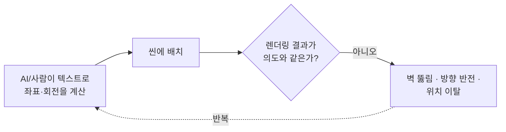
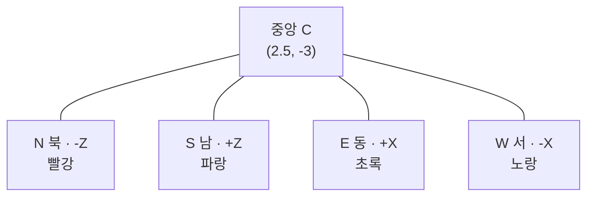

> **작성자**: 정철진
> **작성일**: 2026-07-23
> **최종 수정**: 2026-07-23
> **버전**: v1.0
> **상태**: 완료 — 포트폴리오용
> **태그**: troubleshooting, three.js, react-three-fiber, spatial-reasoning, ai-tooling, frontend

# "AI는 3D 좌표와 방향을 잘 모른다" — 월드 좌표 실측 원칙으로 근절한 기록

> 개인 기술 연구 노트다. S03 3D 사무실 메인 허브(`frontend/components/hub/OfficeFloor.tsx`,
> `frontend/components/hub/DebugDirections.tsx`, `frontend/components/hub/hubSeats.ts`)를
> AI 코딩 도구와 함께 작업하며 겪은 문제와, 그걸 프로젝트 전체의 3D 작업 원칙으로
> 바꾼 과정을 정리한다. 지금까지 문서화하지 않고 코드 주석에만 흩어져 있던 내용이라
> 이번에 한 문서로 모았다.

## 한눈에 보는 결과

| 항목 | Before | After |
|---|---|---|
| 좌표/회전 결정 방식 | AI가 텍스트로 계산한 좌표를 그대로 신뢰 | 씬에 렌더링된 실제 월드 좌표를 측정해 확정 |
| 방향(동서남북) 확인 수단 | 코드만 보고 축(X/Z) 방향을 추정 | `DebugDirections`로 씬에 직접 방향 마커를 세워 눈으로 확인 |
| 대표 사고 | 탕비실 바 카운터가 벽을 뚫음, 책상 블록 회전 후 위치 이탈, 쓰레기통이 엉뚱한 방향을 향함 | 동일 클래스 문제 재발 없음(실측 후 배치는 항상 고정) |
| 재사용성 | 사고가 날 때마다 즉흥적으로 좌표를 다시 추측 | `SHOW_DEBUG_DIRECTIONS`/`SHOW_SEAT_MARKERS` 플래그로 언제든 재검증 가능한 상시 도구화 |

---

## 1. 배경 — 3D 허브를 AI와 함께 만든다는 것

S03 메인 허브는 Kenney Furniture Kit(CC0) glTF 모델을 React Three Fiber 씬에 배치해
만든 3D 사무실이다. 책상 8석, 벽, 라운지존, 탕비실을 한 방(`OfficeFloor.tsx`) 안에
격자·구역으로 나눠 채운다.

작업 초반(건물 뼈대, 바닥 타일 반복 배치처럼 좌표 규칙이 단순한 구간)에는 AI에게
"x축으로 몇 칸, z축으로 몇 칸" 식으로 배치를 맡겨도 문제가 없었다. 문제는 가구가
늘어나고 회전(rotation)이 섞이기 시작하면서부터였다.

## 2. 문제 — AI가 반복해서 틀린 지점들

세 가지 사고가 실제로 있었다(전부 `OfficeFloor.tsx` 주석에 원인이 남아 있다).

### 2-1. 회전축을 낀 그룹 이동에서 위치가 어긋남

책상 8개(4x2 격자)를 통째로 90도 돌려 방 안 특정 위치에 붙이는 작업이었다. 개별
책상 좌표는 그대로 두고 그룹 전체를 회전+이동시키면 되는 단순한 변환처럼 보였지만,
"회전 후 그룹이 어디에 오는지"를 텍스트 계산만으로 예측하는 게 계속 어긋났다.
결국 `DESK_GROUP_ROTATE_X_OFFSET`, `DESK_GROUP_ROTATE_Z_OFFSET`이라는 별도
보정값을 두고, 회전 후 실제 렌더링 결과를 보면서 값을 맞춰야 했다.

### 2-2. 모델마다 다른 pivot(anchor) 기준을 텍스트로는 못 맞춤

탕비실 바 카운터(`kitchenBar.glb`)를 배치할 때, 조리대 계열(서쪽 벽)과 같은
간격 공식을 그대로 적용했다가 카운터가 반대쪽 벽(동쪽, x=2.0)을 뚫는 사고가
났다. 원인은 `kitchenBar`가 `rotation=-90도`일 때 앵커(모델 원점)가
`(min-x, min-z)` 모서리라, 조리대 계열과 퍼지는 방향이 반대였기 때문이다.
쓰레기통도 마찬가지였다 — 페달이 로컬 `+z` 방향으로 튀어나온 모델인지 실측
전에는 알 수 없었고, 방향을 잘못 잡으면 페달이 벽을 향하게 배치됐다.

### 2-3. 탑뷰만으로 좌표를 추정하다 목표 위치가 계속 빗나감

라운지존 소파·테이블 세트를 다른 코너로 옮기는 작업에서는, 카메라 탑뷰
스크린샷과 그리드선만 보고 목표 좌표를 추정하려 했다. 사람이 눈대중으로
"대략 여기쯤"이라고 판단한 값과 실제 3D 공간의 좌표 사이에 계속 오차가
생겼다.

이 세 사고의 공통점은 전부 **"AI(또는 사람)가 머릿속으로 3차원 변환을 계산해서
말로 전달한 값"과 "실제 씬 렌더링 결과"가 어긋난다**는 것이었다. 회전이 섞이거나,
모델마다 원점 기준이 다르거나, 탑뷰 이미지처럼 정보가 손실된 자료로 좌표를
추정할 때 특히 심했다.

## 3. 근본 원인 — 텍스트 기반 추론은 3D 변환에 약하다

LLM 기반 코딩 도구는 코드·텍스트 추론에는 강하지만, "이 좌표를 이만큼 회전시키면
월드 공간의 어디에 있게 되는가", "이 모델의 원점(pivot)이 중심인지 모서리인지"
같은 3차원 기하 문제는 텍스트만으로 정확히 시뮬레이션하기 어렵다. 특히
- 회전이 섞인 그룹 변환(2-1)
- 모델마다 다른 pivot 기준(2-2)
- 정보가 압축된 이미지(탑뷰 스크린샷)로부터의 역산(2-3)

이 세 경우 모두 "계산해서 맞다고 판단한 값"과 "실제로 렌더링해보면 다른 값"이
반복해서 발생했다.

## 4. 해결 — "계산 대신 항상 실측"을 원칙으로

### 4-1. 방향 감각 자체를 눈으로 확인하는 도구를 만든다

`DebugDirections` 컴포넌트를 만들어, 오피스 중심을 기준으로 동서남북에 색이 다른
기둥과 좌표 라벨을 세웠다.

이 씬의 방향-축 대응(동=+X, 서=-X, 북=-Z, 남=+Z)은 코드만 봐서는 매번 헷갈렸는데,
마커를 세우고 나서는 "지금 카메라가 보는 이 방향이 실제로 어느 축인지"를 즉시
확인할 수 있게 됐다. 평소엔 `SHOW_DEBUG_DIRECTIONS = false`로 꺼두고, 새로 뭔가를
배치할 때만 잠깐 켠다.

### 4-2. 배치 좌표는 계산값이 아니라 렌더링된 실측값을 쓴다

책상 8석(`hubSeats.ts`)이 대표 사례다. `DeskGrid`가 그룹 전체를 회전(`rotation={[0, -Math.PI / 2, 0]}`)한
상태라 개별 책상의 로컬 좌표만으로는 월드 좌표를 손으로 계산하기 번거롭고 틀리기
쉬웠다. `getWorldPosition()`으로 각 좌석의 실제 월드 좌표를 읽어와 그 값을 그대로
`HUB_SEAT_POSITIONS` 상수로 확정했다 — 더 이상 손계산이나 벡터 덧셈을 하지 않는다.

탕비실 가구들(2-2 사례)도 같은 방식으로 다시 잡았다. 모델별 실측 폭(싱크대·조리대
0.45m, 커피머신 0.19m)과 pivot 위치(모서리 vs 중심)를 각각 확인한 뒤 좌표를
새로 계산해, 벽을 뚫거나 간격이 벌어지는 문제를 없앴다.

## 5. 결과 — 프로젝트 3D 작업 컨벤션으로 정착

이 원칙은 이후 이 프로젝트에서 3D 씬에 뭔가를 배치할 때의 기본 태도가 됐다.

- **"손계산보다 실측이 정확하다"**는 원칙이 `hubSeats.ts` 주석에 명문화되어, 이후
  좌표 작업(예: 여러 층/여러 사무실 확장)에서도 같은 방식을 따르게 했다.
- `DebugDirections`, `SeatMarkers`(`SHOW_SEAT_MARKERS`)처럼 지우지 않고 남겨둔
  on/off 디버그 도구들이 같은 패턴을 공유한다 — 평소엔 꺼두고, 배치를 조정할 일이
  생기면 잠깐 켜서 눈으로 검증한다.
- 이후 배치 작업(라운지존 좌표 재조정, 탕비실 가구 재배치 등)에서는 "AI가 계산한
  값을 바로 코드에 반영"하는 대신 "먼저 렌더링해서 실제 값을 확인 → 코드에 반영"
  순서를 지켰다.

## 6. 회고 — 무엇을 배웠나

1. **AI에게 3D 기하 계산을 통째로 맡기지 않는다.** 회전·pivot·좌표계처럼 텍스트
   추론만으로는 검증하기 어려운 영역은, AI가 낸 값을 그대로 신뢰하기보다 "실제
   렌더링 결과로 확인"하는 단계를 항상 끼워 넣어야 한다.
2. **눈으로 확인할 수 있는 임시 도구를 만드는 비용은 그 뒤로 계속 회수된다.**
   `DebugDirections`는 원래 한 번 헷갈려서 급하게 만든 도구였지만, 지우지 않고
   남겨둔 덕분에 이후 배치 작업마다 반복 사용할 수 있었다.
3. **"실측"은 사람에게도 적용되는 원칙이다.** 탑뷰 스크린샷만 보고 좌표를
   추정했던 라운지존 사례처럼, AI가 아니라 사람이 직접 값을 짤 때도 같은 함정에
   빠질 수 있다 — 이 프로젝트에서는 회전이나 pivot이 관련된 배치는 예외 없이
   실측을 거치는 걸 원칙으로 삼았다.

## 참고

- `frontend/components/hub/DebugDirections.tsx` — 방향지시물 컴포넌트
- `frontend/components/hub/hubSeats.ts` — 실측(`getWorldPosition`) 원칙이 명문화된 좌표 상수
- `frontend/components/hub/OfficeFloor.tsx` — 회전 오프셋, pivot 실측, 탑뷰 재추정 사례가 남은 주석
- [3d-오피스-렌더링-연구.md](3d-오피스-렌더링-연구.md) — 3D 오피스 모델 선택/성능 사전 조사(이 문서의 배경이 된 연구)
