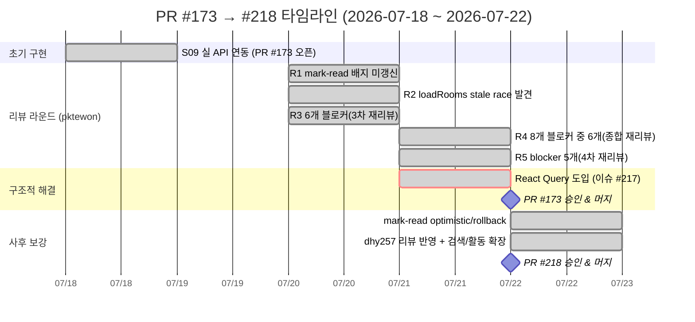
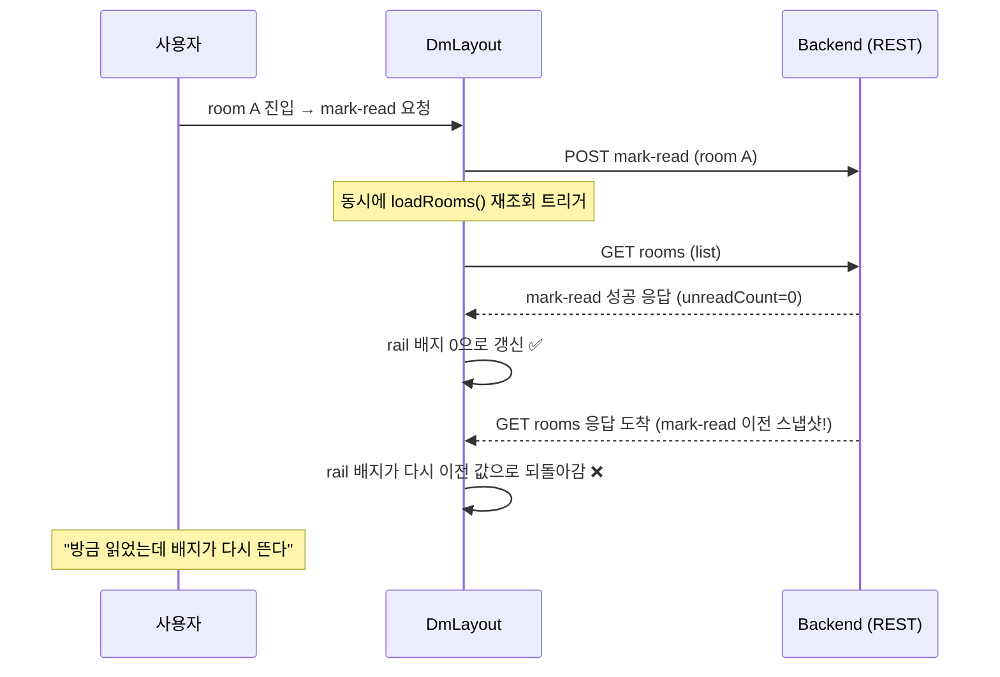
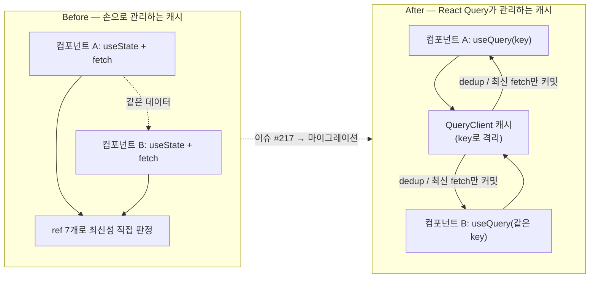

> **작성자**: 정철진
> **작성일**: 2026-07-22
> **최종 수정**: 2026-07-22
> **버전**: v1.0
> **상태**: 완료 — 포트폴리오용
> **태그**: troubleshooting, react-query, race-condition, dm, refactoring, tanstack-query, frontend-architecture

# "같은 버그가 4번 재발했다" — DM 화면 race condition을 라이브러리 교체로 근절한 기록

> 개인 기술 연구 노트다. WBS 4.7.3.2(1:1 DM Frontend, PR #173)와 그 후속 리팩터링
> (이슈 #217, PR #218)에서 겪은 문제와 해결 과정을 정리한다. 코드 리뷰 4~5라운드에
> 걸쳐 "같은 모양의 버그"가 계속 재발한 원인을 진단하고, 손으로 짠 동시성 방어 코드를
> 전부 걷어내고 라이브러리(TanStack Query)로 교체해 구조적으로 해결한 과정이다.

## 한눈에 보는 결과

| 지표 | Before | After | 변화 |
|---|---|---|---|
| **stale-response 방어 코드**(hand-rolled ref) | DM 7개 + 검색 1개 + 활동 피드 1개 = **9개** | **0개** (전부 라이브러리로 이관) | **-100%** |
| **네비게이션 소유권 가드**(router.push 관련) | 0개 | 3개(dm/layout 2, members 1) | 신규 발견·추가 |
| **코드 리뷰 라운드**(PR #173, pktewon) | — | 6회(승인까지) | Changes Requested ×5 → Approved ×1 |
| **동시성 버그로 인한 재작업 커밋** | — | 5개(2026-07-20~21) | — |
| **최종 변경 규모**(DM+검색+활동, 13개 파일) | — | +803 / -616 lines | 순감소(-) |
| **회귀 테스트** | DM 관련 0개(신규 기능) | DM 12개 + 활동 피드 1개(신규) + production 전용 5개 | +18개 |
| **적용 범위** | DM 화면 1개 | DM + 검색(WBS 4.9.4.2) + 활동 피드(WBS 4.9.1.2), 총 4개 화면 | 3개 화면 추가 이관 |

---

## 1. 배경 — 무슨 화면이었나

WBS 4.7.3.2, S09 1:1 DM 화면(팀원 목록 → DM 시작 → 실시간처럼 보이는 채팅 UI)을
2026-07-18에 처음 구현해 PR #173을 올렸다. 백엔드는 REST 폴링 기반(WebSocket 아님) —
그래서 프론트가 "언제 다시 불러올지", "이 응답이 아직 유효한지"를 직접 판단해야 하는
구조였다.

## 2. 타임라인 — 리뷰 5라운드의 기록

| 라운드 | 시각(KST) | 리뷰어 지적 | 대응 |
|---|---|---|---|
| R1 | 07-20 01:59 | mark-read 후 unread 배지가 rail에 반영 안 됨 | `DmRoomsContext` 신설해 layout↔page 간 room state 공유 |
| R2 | 07-20 05:07 | (수정 확인) + **새 race 발견**: markRoomRead 지연 응답이 최신 상태를 덮음 | `sequenceRef`/`latestLoadSequenceRef` generation 카운터 추가 |
| R3 | 07-20 06:53 | (수정 확인) + mark-read 실패 시 배지 유지 안 됨, IME 조합 중 Enter 전송 | stale response를 "버리기"가 아니라 "room 단위 merge"로 재설계 |
| R4 | 07-20 08:53 | **종합 재검증**에서 8개 블로커(그중 6개 프론트에서 즉시 수정 가능) | `readGenerationsRef`, `pickerRequestSequenceRef` 등 추가 |
| R5 | 07-21 06:11 | candidate API 이관(이슈 #208) 후 재검증, 5개 블로커 잔존 | `startDmSequenceRef`, route/companyId 직접 검증 추가 |
| **승인** | 07-22 01:14 | 전부 반영 확인 | **APPROVED → dev 머지** |

**5라운드 동안 반복된 지적의 공통점**: 표면적으로는 서로 다른 버그였지만
("배지가 안 바뀐다", "새 대화가 옛 대화로 덮인다", "읽음 처리가 되돌아간다"),
전부 같은 질문에 대한 답을 컴포넌트마다 손으로 새로 구현하다 생긴 문제였다.

> **"이 비동기 응답이 지금도 유효한가?"**

## 3. 근본 원인 — 손으로 구현한 "캐시 최신성 판정"

R5 시점, `dm/layout.tsx` 하나에 쌓여 있던 방어 코드:

| ref 이름 | 역할 |
|---|---|
| `sequenceRef` | loadRooms/markRoomRead가 공유하는 논리 시계 |
| `latestLoadSequenceRef` | loadRooms 전용, "가장 최근 호출인지" 판정 |
| `readGenerationsRef` | room별 "언제 읽음 처리했는지" + 그 시점 unreadCount |
| `startDmSequenceRef` | 새 DM 생성(get-or-create) 요청 세대 |
| `pickerRequestSequenceRef` | candidate 목록 조회 요청 세대 |
| `mountedRef` | 컴포넌트 언마운트 여부 |
| `pathnameRef` | 요청 시작 시점의 경로 |

**컴포넌트 하나에 손으로 짠 동시성 가드 7개.** 그리고 같은 패턴이 이 화면에만
있는 게 아니었다 — 검색(WBS 4.9.4.2, `searchGenerationRef`)과 활동 피드
(WBS 4.9.1.2, `loadSeqRef`)에도 동일한 모양의 가드가 각각 독립적으로
재발명돼 있었다.

전형적인 재현 시나리오(R2에서 발견된 것):

`GET rooms` 요청이 `mark-read` 요청보다 **늦게 시작했는데 먼저 응답이 온 것도 아니고,
먼저 시작했는데 늦게 도착한** 경우 — 요청 순서와 응답 순서가 뒤바뀌는 전형적인
race condition이다. 이런 종류의 문제는 개별 버그를 하나씩 잡아도 다른 조합에서
계속 재발한다(실제로 5라운드에 걸쳐 그랬다).

## 4. 해결 — "직접 판정"에서 "라이브러리에 위임"으로

TanStack Query(React Query) v5를 도입해서 DM 화면 전체(`dm/layout.tsx`,
`dm/[roomId]/page.tsx`, `members/page.tsx`)를 옮겼다.

- **dedup**: 두 컴포넌트가 같은 `queryKey`(`dm-rooms`)를 쓰면 실제 네트워크 요청은
  한 번만 나간다 — `DmRoomsContext`로 억지로 공유하던 걸 걷어냈다.
- **최신 응답만 커밋**: `latestLoadSequenceRef`가 하던 일을 라이브러리가 내부적으로
  보장한다.
- **mutation 취소/무효화**: mark-read는 `onMutate`에서 진행 중인 재조회를
  `cancelQueries`로 취소하고, `onSuccess`에서 `setQueryData`로 해당 room만 patch —
  `readGenerationsRef`가 하던 "이 시점 이후 값 고정" 역할을 대체한다.
- **선언적 의존성**: `room.companyId` 검증 전 messages를 못 부르게 하던 순차 호출
  로직은 `enabled: roomValid`로 대체됐다 — `Promise.all` 금지 규칙 자체가 불필요해졌다.

결과: **7개 중 6개 제거**(`pathnameRef`만 남음 — 이유는 5절 참고).

## 5. 라이브러리도 못 잡아준 것 — "가드에는 두 종류가 있다"

PR #218을 열자 팀원(dhy257)이 리뷰에서 정확히 짚었다:

> React Query가 mutation/cache lifecycle은 관리하지만, `router.push()` 같은
> side effect는 자동으로 취소하지 않습니다.

이게 이번 트러블슈팅의 핵심 통찰이다. **모든 hand-rolled guard가 같은 문제가
아니었다**:

| 가드 종류 | 다루는 문제 | React Query가 해결하나? |
|---|---|---|
| **응답 최신성**(stale response) | "이 fetch 결과가 아직 유효한가" | ✅ 전부 해결(queryKey 격리 + dedup) |
| **네비게이션 소유권**(side-effect ownership) | "이 컴포넌트가 아직 화면에 있는가" (있어야 `router.push` 실행 가능) | ❌ 캐시 밖의 부수효과라 라이브러리 책임이 아님 |

`pathnameRef`가 마이그레이션 후에도 유일하게 남았던 이유가 바로 이거였다. 그리고
리뷰에서 지적된 두 가지 잔여 gap도 전부 이 두 번째 종류였다:

1. **DmLayout 언마운트 케이스 누락**: `pathnameRef`는 "같은 화면 안에서 room만
   바뀐 경우"만 잡고, "`/dm` 밖으로 완전히 나가 컴포넌트 자체가 사라진 경우"는
   못 잡았다(마이그레이션 때 `mountedRef`를 "이제 필요 없다"고 지우면서 생긴 gap).
2. **`members/page.tsx`(S14)**: 아예 아무 가드도 없이 `mutateAsync` 직후
   바로 `router.push()`.

**흥미로운 부작용**: 이 gap을 검증하던 기존 테스트가 `about:blank`로 이동해서
"언마운트 후 무시됨"을 확인하고 있었는데, 실제로는 `about:blank` 이동이
**페이지 JS 컨텍스트 자체를 통째로 날려버려서** 가드 코드를 완전히 지워도
테스트가 그대로 통과했다(실측으로 확인). **테스트가 그린인 것과 버그가 없는 것은
다르다**는 걸 다시 확인한 사례다 — 실제 앱 내부 네비게이션(`/1/settings`)으로
테스트를 다시 짜서야 진짜 회귀 방지 효과를 갖게 됐다.

대응: `mountedRef`를 **narrower한 목적**(오직 unmount 여부 확인)으로 두 곳에
다시 추가하고, `AuthContext.logout()`에 `queryClient.clear()`를 추가해 세 번째
지적(로그아웃/로그인 전환 시 user-scoped 캐시 미분리)까지 해결했다.

## 6. "고친 게 재사용 가능한가?" — 검색·활동 피드로 확장 적용

같은 모양의 가드가 다른 화면에도 있었다는 걸 처음부터 알고 있었다(이슈 #217
자체에 "비슷한 폴링 기반 화면도 감사가 필요하다"고 적어뒀다). PR #218을 정리하는
김에 실제로 감사해서 적용까지 했다.

| 화면 | WBS | 이전 방어 코드 | 이후 |
|---|---|---|---|
| 검색(디바운스 + cursor pagination) | 4.9.4.2 | `searchGenerationRef`(PR #191 리뷰 반영) | `useInfiniteQuery`, queryKey에 검색어 포함 |
| 활동 피드(offset pagination) | 4.9.1.2 | `loadSeqRef`(PR #205 리뷰 반영) | `useInfiniteQuery`, queryKey에 projectId 포함 |
| DM 인덱스 리다이렉트 | 4.7.3.2 | `cancelled` ref + 중복 fetch | `useDmRoomsQuery` 재사용(레일과 캐시 공유) |

핵심은 **generation 카운터가 통째로 필요 없어졌다는 것**이다 — `queryKey`
자체가 격리 경계 역할을 한다. 검색어를 "alpha"에서 "beta"로 바꾸면 React Query는
아예 다른 캐시 엔트리로 구독을 옮기므로, "alpha"의 지연된 `loadMore` 응답이
와도 그건 "alpha" 캐시만 갱신할 뿐 화면이 보고 있는 "beta" 데이터와는 애초에
섞일 수가 없다. **generation 번호를 비교하는 코드**(명령형)에서
**격리된 캐시 키를 쓰는 것**(선언적)으로 문제 자체의 표현 방식이 바뀐 것이다.

활동 피드는 이 작업 전까지 회귀 테스트가 **0개**였다 — 마이그레이션하면서
처음으로 스모크 테스트가 생겼다.

## 7. 최종 검증

- `tsc --noEmit`, `eslint` 통과
- 프론트 스모크 테스트 63개, production 전용 스모크 5개 전부 통과
- 13개 파일 변경, `+803 / -616` lines (순감소)

## 8. 회고 — 무엇을 배웠나

1. **재발하는 버그는 "여러 개의 버그"가 아니라 "하나의 구조적 비용"의 증상일
   수 있다.** 리뷰 5라운드 동안 매번 "다른 버그"처럼 보고했지만, 실제로는
   "요청 최신성을 손으로 판정한다"는 같은 원인의 다른 발현이었다.
2. **라이브러리 도입이 모든 걸 해결해주지 않는다 — 그리고 그게 오히려 유용한
   신호다.** React Query 도입 후에도 남은 문제(네비게이션 소유권)는 "이 라이브러리가
   책임지는 경계가 어디까지인가"를 명확히 알려줬다. 남은 가드가 왜 남았는지
   설명할 수 있다는 것 자체가 아키텍처를 제대로 이해했다는 증거다.
3. **테스트가 통과한다고 회귀 방지가 되는 게 아니다.** `about:blank` 테스트
   사례처럼, 테스트가 "우연히" 통과할 수 있는 조건(전체 페이지 컨텍스트 초기화 등)을
   의심하고, 가드를 일부러 지워서 테스트가 실패하는지 확인하는 습관이 필요하다.
4. **한 곳에서 배운 해결책은 감사해서 넓혀야 값어치가 커진다.** 검색·활동 피드까지
   같은 원리로 정리하면서, "이 해결책이 DM에만 맞는 임시방편이 아니라 이 프로젝트의
   폴링 기반 화면 전반에 적용 가능한 패턴"이라는 걸 검증했다.

## 참고

- 이슈 [#217](https://github.com/SEUIL/Threadia/issues/217) — React Query 도입 논의
- PR [#173](https://github.com/SEUIL/Threadia/pull/173) — WBS 4.7.3.2 S09 1:1 DM Frontend
- PR [#218](https://github.com/SEUIL/Threadia/pull/218) — React Query 마이그레이션 + late navigation guard/auth cache 보강 + 검색·활동 피드 확장
- `frontend/hooks/useDmQueries.ts`, `frontend/app/(app)/[companyId]/dm/`,
  `frontend/app/(app)/[companyId]/[projectId]/search/page.tsx`,
  `frontend/app/(app)/[companyId]/[projectId]/activity/page.tsx`
