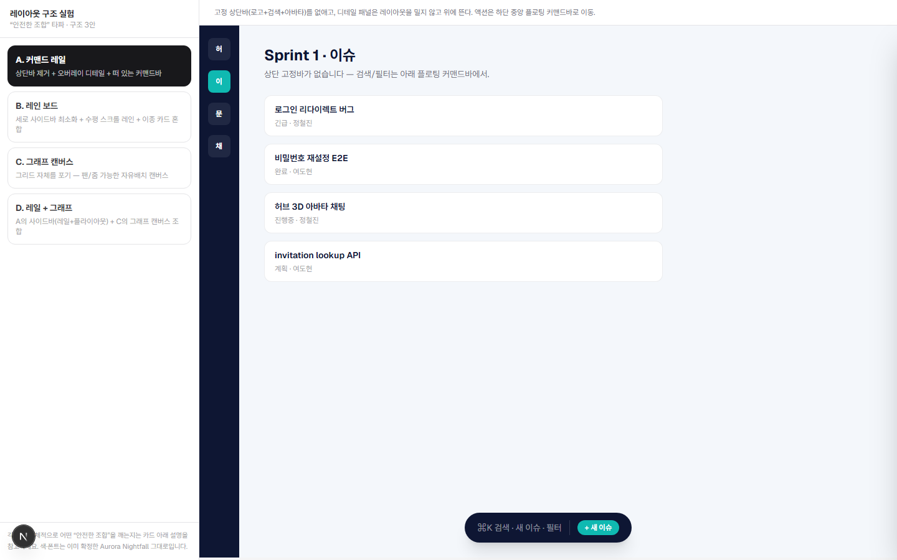
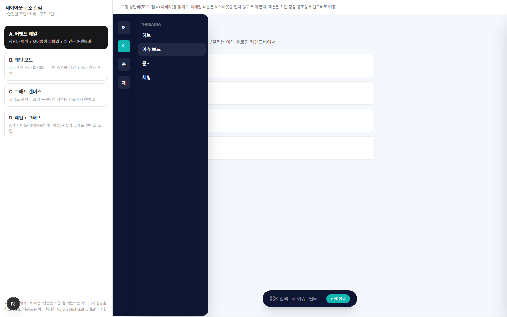
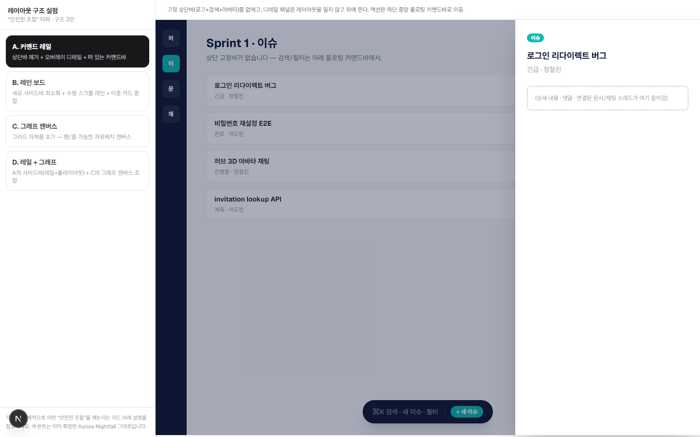
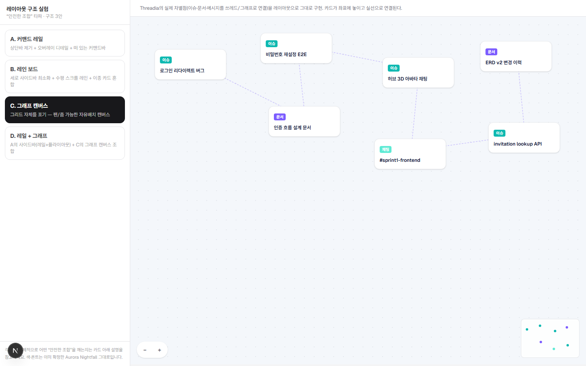
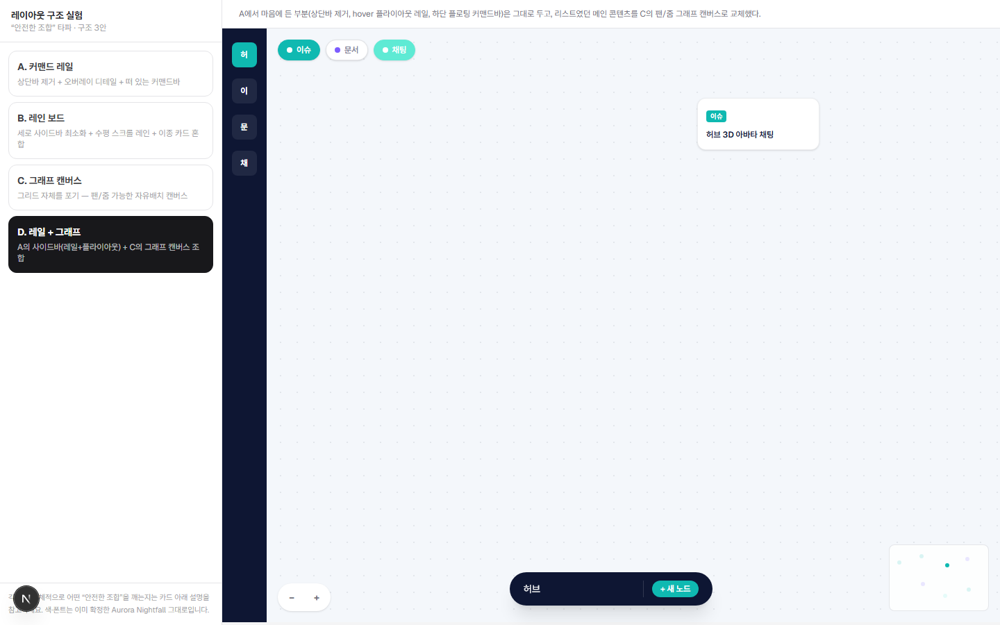

> **작성자**: 정철진
> **작성일**: 2026-07-06
> **최종 수정**: 2026-07-06
> **버전**: v1.0
> **상태**: 작성 중 — 프로토타입 검증 단계, 실제 적용 범위 미확정
> **태그**: frontend, design, layout, ui-ux, graph-view, prototype

# 레이아웃 구조 실험 — 레일 + 그래프 조합

> Sprint 작업이 아닌 개인 디자인 리서치다. 지난 작업(폰트·테두리 등 디테일 정리)과 달리 이번엔
> **UI 레이아웃 구조 자체**(박스/버튼 위치, 화면 골격)를 실험했다. 색·폰트는 이미 확정한
> Aurora Nightfall 조합과 Pretendard/Geist를 그대로 쓴다 — 관련 배경은
> [디자인-레퍼런스-연구.md](./디자인-레퍼런스-연구.md) 참조.

## 1. 문제의식 — "안전한 조합" 타파

AI로 화면을 만들면 거의 항상 같은 골격으로 수렴한다: 좌측 고정 사이드바 + 상단 고정바(로고·검색·아바타)
+ 메인 영역 카드그리드(`rounded-xl` + `shadow-sm`). 기능적으로 틀린 건 아니지만, 이 조합 자체가
"AI스러움"의 큰 부분을 차지한다.

이번 실험은 색/타이포/셰이프가 아니라 **레이아웃 구조 자체**와 **인터랙션·모션**에서 그 조합을 깨는
방향을 시도했다. 실제 코드로 동작하는 프로토타입을 먼저 만들고, 그중 마음에 드는 부분을 조합해서
최종 방향을 좁히는 순서로 진행했다.

## 2. 프로토타입 위치

```text
frontend/design-sample/src/app/layouts/page.tsx
```

`frontend/design-sample`는 색 조합 실험(`palettes.css`)에 이미 쓰이던 개인 프론트 실험용 Next.js
프로젝트다. `/layouts` 라우트에 구조안을 스위처로 전환해가며 비교할 수 있게 만들었다. 스크린샷은
Playwright로 실제 렌더링된 화면을 캡처했다(`frontend/design-sample/scripts/capture-screenshots.mjs`).

## 3. 1차로 검토한 3개 구조안

| 안 | 핵심 아이디어 | 깨는 지점 |
|---|---|---|
| A. 커맨드 레일 | 상단바 제거, hover 시 펼쳐지는 아이콘 레일, 디테일은 레이아웃을 밀지 않는 오버레이, 액션은 하단 플로팅 커맨드바 | 고정 상단바 + 사이드 이동식 디테일 패널 |
| B. 레인 보드 | 40px 고정 아이콘 레일, 카드그리드 대신 수평 스크롤 레인, 이슈·문서·채팅 카드가 한 레인에 혼합 | 카드그리드 대시보드 |
| C. 그래프 캔버스 | 그리드 자체를 포기하고 팬/줌 가능한 자유배치 캔버스, 노드를 실선으로 연결 | 사이드바+그리드 레이아웃 자체 |

세 안 모두 Threadia 실제 화면(Sprint 1 이슈 보드)을 가정한 목업 데이터로 채워 조작해봤다.

### A. 커맨드 레일



레일에 마우스를 올리면 옆으로 펼쳐지는 플라이아웃이 뜬다(레이아웃을 밀지 않고 위에 뜬다):



이슈를 클릭하면 배경이 어두워지며 우측에서 디테일 패널이 슬라이드 인 한다. 하단 중앙엔 검색/필터/새
이슈 액션을 모은 플로팅 커맨드바가 상단바를 대신한다:



### C. 그래프 캔버스



점 배경 위에 이슈(teal)·문서(violet)·채팅(aqua) 노드가 좌표에 자유배치되고 점선으로 관계가
연결된다. 드래그로 팬, 좌하단 버튼으로 줌, 우하단에 미니맵이 있다. 이 구조는 **Threadia의 실제
차별점**(이슈·문서·메시지를 쓰레드/그래프로 연결)을 레이아웃 수준에서 그대로 구현한 것이라, 단순히
"특이해 보이려는" 시도가 아니라 제품 컨셉과 직결된다.

## 4. 결정 — A의 사이드바 + C의 그래프 뷰

세 안을 실제로 조작해본 뒤 A의 사이드바 체계(레일+플라이아웃, 상단바 제거, 플로팅 커맨드바)와 C의
그래프 뷰를 조합하기로 했다. B(레인 보드)는 이번 조합에서는 보류.


구현은 코드 재사용으로 처리했다 — `RailNav`(레일+플라이아웃), `FloatingCommandBar`(하단 커맨드바),
`GraphCanvasBody`(팬/줌 캔버스 본체)를 공용 컴포넌트로 분리해 A/C/D가 같은 코드를 공유한다.

### 4.1 타입 필터 + 검색 연동

그래프에 노드가 늘어나면(이슈+문서+채팅이 한 캔버스에 섞이므로) 타입별로 걸러볼 수 있어야 한다고
판단해 좌상단에 필터 칩을 추가했다. 칩 색은 노드 색(`kindColor`)과 그대로 매칭해서 "이 색 = 이
타입"이라는 매핑을 필터에서도 유지한다. 하단 커맨드바의 검색창(플레이스홀더 텍스트였던 걸 실제
input으로 교체)과는 AND 조건으로 연동된다 — 타입 필터로 좁힌 뒤 제목 검색으로 더 좁히는 식.



위 스크린샷은 "문서" 타입을 끄고 "허브"로 검색한 결과 — 조건에 맞는 노드 1개만 남고 나머지는
연결선까지 함께 사라진다. 미니맵에도 걸러진 노드는 흐리게(dim) 남겨서 "지금 얼마나 숨겨져 있는지"
감이 오게 했다.


노드를 클릭하면 그 노드 근처에서 확대되는 형태로 상세 카드가 뜬다(A의 우측 슬라이드 패널과는
다른 방식 — 캔버스 위에서는 클릭한 좌표와의 공간적 연결감을 유지하는 쪽이 더 자연스럽다고 판단).
필터로 가려진 노드가 선택돼 있던 경우 카드는 자동으로 닫힌다.

## 5. 배치/동작 규칙 정리

향후 실제 화면(Threadia 허브 등)에 적용할 때 참고할 규칙:

- **레일**: 기본 폭 64px(아이콘만), hover 시 208px 플라이아웃이 `scaleX` + opacity로 전환(300ms
  ease-out). 레이아웃을 밀지 않고 `position: absolute`로 겹쳐 뜬다.
- **플로팅 커맨드바**: 화면 하단 중앙 고정, pill 형태, navy 배경. 상단바가 없는 화면에서 검색/주요
  액션의 유일한 진입점이므로 항상 떠 있어야 한다(스크롤에 안 밀림).
- **그래프 캔버스 배경**: `radial-gradient` 점 그리드, 24px 간격, `rgba(navy, 0.08)` — 그리드가
  있다는 느낌은 남기되 카드형 레이아웃처럼 보이지 않게 옅게.
- **노드 카드**: 폭 176px 고정, 타입 배지(색 pill) + 제목만. 상세는 클릭 시 별도 카드로 분리해
  캔버스 위 정보 밀도를 낮게 유지.
- **연결선**: violet, 점선(`4 3`), opacity 0.35 — 너무 강조되면 노드보다 선이 먼저 눈에 들어와서
  방해된다.
- **타입 색 매핑 고정**: 이슈=teal, 문서=violet, 채팅=aqua. 필터 칩·노드 배지·미니맵 점 모두 동일
  매핑을 쓴다 — 색이 곧 범례 역할을 하므로 화면마다 매핑이 달라지면 안 된다.
- **필터 off 상태 표현**: 완전히 숨기지 않고 미니맵에서는 opacity 0.15로 남겨서 "존재하지만
  숨겨짐"을 구분한다.

## 6. 남은 것 / 다음 단계

- **적용 범위 미확정**: 이 그래프 뷰를 허브(3D 화면 밖 메인 대시보드)에만 쓸지, 이슈 보드 자체를
  대체할지 아직 결정 안 함. 이슈가 많아지는 실제 Sprint 2+ 시점엔 그래프가 오히려 리스트보다 느리게
  읽힐 수 있어 병행(그래프/리스트 뷰 전환) 여지를 열어둬야 한다.
- **성능 재검토 필요**: 지금은 목업 노드 7개 기준. 실제 이슈·문서·채팅이 수십~수백 개로 늘어났을 때
  SVG 연결선 개수, DOM 노드 수, pan/zoom 성능은 별도로 확인 필요.
- **레인 보드(B)는 보류**: 이번엔 조합에서 뺐지만, "이종 카드가 한 레인에 섞인다"는 아이디어 자체는
  그래프 캔버스의 노드 타입 필터와 유사한 문제의식이라 나중에 재검토 여지 있음.
- **팀 공유 전 개인 실험 단계**: 아직 팀 논의 전이라 Threadia 본 프론트엔드(`frontend/`)에는
  반영하지 않았다. `design-sample`의 격리된 프로토타입 상태로만 존재한다.

관련: [디자인-레퍼런스-연구.md](./디자인-레퍼런스-연구.md), [프로젝트-구조-파악.md](./프로젝트-구조-파악.md)
